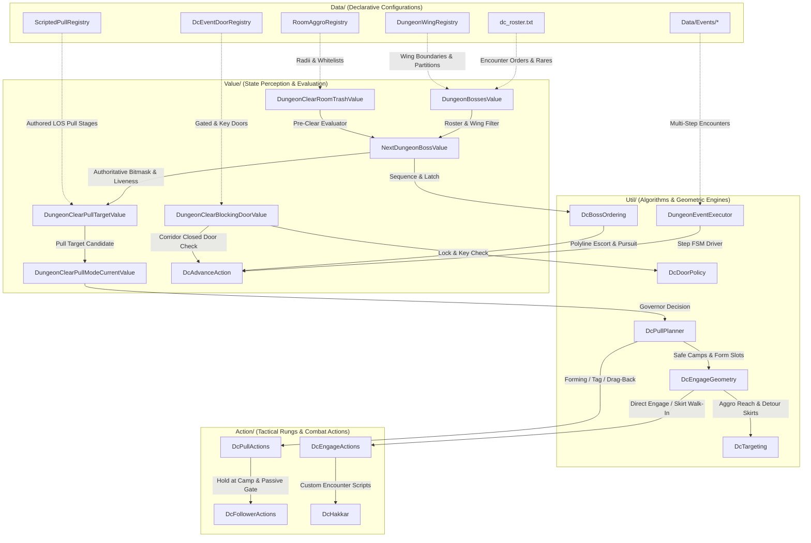

# Endgame Dungeon Clear (5-man & 10-man) Enterprise Implementation Plan

> **Core-Preservation & Engineering Standards:** Follow `AGENTS.md` strictly. No playerbots logic modifications ("dc only"). Zero build commands. Zero database commands.
> **Execution Strategy:** Multi-phase, test-driven, modular expansion of `modules/mod-dungeon-clear/`.

---

## 1. Executive Summary & Architectural Grounding

An in-depth audit of [`Value/`](file:///home/sam/tortoise-wow/modules/mod-dungeon-clear/src/Ai/Dungeon/DungeonClear/Value/), [`Util/`](file:///home/sam/tortoise-wow/modules/mod-dungeon-clear/src/Ai/Dungeon/DungeonClear/Util/), [`Action/`](file:///home/sam/tortoise-wow/modules/mod-dungeon-clear/src/Ai/Dungeon/DungeonClear/Action/), and [`Data/`](file:///home/sam/tortoise-wow/modules/mod-dungeon-clear/src/Ai/Dungeon/DungeonClear/Data/) reveals that `mod-dungeon-clear` operates through a cohesive pipeline:

### Critical Gaps in Endgame 5-man Dungeons & 10-man Raids
1. **Lower Blackrock Spire (LBRS - Map 229, 5-man)**:
   - Map 229 is currently hardcoded exclusively for 10-man UBRS (orders 1-6).
   - All 9 LBRS bosses (*Omokk, Vosh'gajin, Voone, Smolderweb, Urok Doomhowl, Zigris, Halycon, Gizrul, Wyrmthalak*) are missing from `dc_roster.txt`.
   - `DungeonWingRegistry.cpp` lacks a wing partition (`ubrs` vs `lbrs`), and `BlackrockSpireEvents.cpp` lacks the Urok challenge pike summoning event.
2. **Tower of Karazhan / Upper Karazhan (Map 814, 10-man Turtle Raid)**:
   - 225 creatures and 51 templates exist in core DB, but map 814 is missing from `dc_roster.txt` and `DcBossEntries1121.h`. `.dc on` fails with "No bosses found".
   - Bosses: King's Council (`59967`/`59968`/`59970`/`59971`), Sanv Tas'dal (`59981`), Kruul (`59991`), Keeper Gnarlmoon (`61939`), Ley-Watcher Incantagos (`61946`), Anomalus (`61951`), Echo of Medivh (`61958`).
3. **Karazhan Crypt (Map 813, 5-man Turtle Dungeon)**:
   - Missing from `dc_roster.txt` and `DcBossEntries1121.h`.
   - Bosses: Guard Captain Gort (`92935`), Hivaxxis (`91920`), Alarus (`91928`), Crypt Gate Key (`51356`).
4. **Black Morass Level 60 (Map 269, 5-man Turtle Dungeon)**:
   - Turtle WoW custom level 60 instance has Chronormu (`50117`) and Commander Gerastrasz (`50080`), but `dc_roster.txt` has no orders for Map 269.
5. **Stratholme (Map 329, 5-man)**:
   - Events exist, but `dc_roster.txt` lacks authored orders and `DungeonWingRegistry.cpp` has no wing split (`live` vs `undead`), causing boss skipping when grid streaming lags.
6. **Scholomance (Map 289, 5-man)**:
   - Missing explicit 1-13 progression order in `dc_roster.txt`. Darkmaster Gandling requires the 6 Viewing Room bosses cleared first.
7. **Dire Maul (Map 429, 5-man)**:
   - Needs per-wing encounter sequences in `dc_roster.txt` (East 1-5, West 6-10, North 11-17) and rare drop suppression.
8. **Stormwind Vault (Map 35) & Hateforge Quarry (Map 808)**:
   - Bosses are ordered in `dc_roster.txt`, but missing `StormwindVaultEvents.cpp`, `HateforgeQuarryEvents.cpp`, and door registrations in `DcEventDoorRegistry.h`.
9. **Scripted Pulls & Room Aggro ("How to Deal With Each Pull")**:
   - `RoomAggroRegistry.cpp` is missing Stratholme ziggurats, UBRS Drakkisath guard adds, Scholo Ras lab/Viewing Rooms, and Karazhan chambers.
   - `ScriptedPullRegistry.cpp` currently only has Magisters' Terrace. None of the classic or Turtle endgame instances have authored line-of-sight dragback camps or pull priority rules for wipe-prone trash packs.

---

## 2. Global Constraints & Core Preservation Standards

1. **STRICTLY ZERO BUILD COMMANDS**: Do NOT execute `make`, `cmake`, `ninja`, or compilers. The user compiles the project.
2. **STRICTLY ZERO DATABASE COMMANDS**: Do NOT execute queries, shell tools, or write commands to MariaDB.
3. **DUNGEON CLEAR ONLY ("No playerbots. dc only")**: Strictly isolate changes to `modules/mod-dungeon-clear/`. Do not modify `mod-playerbots`.
4. **MASK BIT CONSTRAINT**: `order <map> <entry> <index>` indices must stay in range `1..32` because `DcEncounterMask` tracks kills in a 32-bit bitmask `(1 << (order - 1))`.

---

## Phase 1: Declarative Rosters & Progression Orders (`data/dc_roster.txt`)

> **Note:** Changes in `dc_roster.txt` take effect immediately via `.reload config` without rebuilding.

### Task 1.1: Stratholme (Map 329) - Live (Scarlet) & Undead (Baron) Wings
- [x] **Step 1: Suppress Stratholme rare spawns**
  - Drop Skul (`10393` - 20% rare pool in Live side).
  - Drop Stonespine (`10809` - 25% rare gargoyle).
  - Note: Hearthsinger Forresten (`10558`) is already dropped.
- [x] **Step 2: Author Live Wing (Orders 1-5)**
  - `order 329 10808 1 # Timmy the Cruel`
  - `order 329 11032 2 # Malor the Zealous`
  - `order 329 10997 3 # Cannon Master Willey`
  - `order 329 10811 4 # Archivist Galford`
  - `order 329 10812 5 # Grand Crusader Dathrohan (Balnazzar 10813)`
- [x] **Step 3: Author Undead Wing (Orders 6-11)**
  - `order 329 10436 6 # Baroness Anastari`
  - `order 329 10437 7 # Nerub'enkan`
  - `order 329 10438 8 # Maleki the Pallid`
  - `order 329 10435 9 # Magistrate Barthilas`
  - `order 329 10439 10 # Ramstein the Gorger`
  - `order 329 10440 11 # Baron Rivendare (end boss)`

### Task 1.2: Scholomance (Map 289) - 13-Boss Progression Sequence
- [x] **Step 1: Author 13-Boss Order in `dc_roster.txt`**
  - `order 289 14861 1 # Blood Steward of Kirtonos`
  - `order 289 10506 2 # Kirtonos the Herald`
  - `order 289 10503 3 # Jandice Barov`
  - `order 289 11622 4 # Rattlegore (drops Viewing Room Key)`
  - `order 289 10504 5 # Lord Alexei Barov`
  - `order 289 10433 6 # Marduk Blackpool`
  - `order 289 10432 7 # Vectus`
  - `order 289 10508 8 # Ras Frostwhisper`
  - `order 289 10505 9 # Instructor Malicia (Viewing Room 1)`
  - `order 289 11261 10 # Doctor Theolen Krastinov (Viewing Room 2)`
  - `order 289 10901 11 # Lorekeeper Polkelt (Viewing Room 3)`
  - `order 289 10507 12 # The Ravenian (Viewing Room 4)`
  - `order 289 1853 13 # Darkmaster Gandling (end boss)`

### Task 1.3: Dire Maul (Map 429) - East, West, North (Tribute)
- [x] **Step 1: Suppress Dire Maul rare spawns**
  - Drop Tsu'zee (`11498` - 30% rare pool in West).
- [x] **Step 2: Author East Wing (DME - Orders 1-5)**
  - `order 429 14354 1 # Pusillin`
  - `order 429 14326 2 # Lethtendris`
  - `order 429 13280 3 # Hydrospawn`
  - `order 429 11490 4 # Zevrim Thornhoof`
  - `order 429 11492 5 # Alzzin the Wildshaper (end boss)`
- [x] **Step 3: Author West Wing (DMW - Orders 6-10)**
  - `order 429 11489 6 # Tendris Warpwood`
  - `order 429 11488 7 # Illyanna Ravenoak`
  - `order 429 11487 8 # Magister Kalendris`
  - `order 429 11496 9 # Immol'thar (unlocked after 5 Pylons)`
  - `order 429 11486 10 # Prince Tortheldrin (end boss)`
- [x] **Step 4: Author North Wing (DMN - Orders 11-17)**
  - `order 429 14321 11 # Guard Mol'dar`
  - `order 429 14322 12 # Stomper Kreeg`
  - `order 429 14323 13 # Guard Fengus`
  - `order 429 14324 14 # Guard Slip'kik`
  - `order 429 14325 15 # Captain Kromcrush`
  - `order 429 14328 16 # Cho'Rush the Observer`
  - `order 429 11501 17 # King Gordok (end boss)`

### Task 1.4: Blackrock Spire (Map 229) - Lower Blackrock Spire (LBRS)
- [x] **Step 1: Suppress LBRS rare spawns**
  - Drop Bannok Grimaxe (`9596` - 25% rare).
  - Drop Crystal Fang (`10376` - 20% rare).
- [x] **Step 2: Author LBRS 5-Man Orders (Orders 7-15) alongside UBRS (Orders 1-6)**
  - `order 229 9196 7 # Highlord Omokk`
  - `order 229 9236 8 # Shadow Hunter Vosh'gajin`
  - `order 229 9237 9 # War Master Voone`
  - `order 229 10596 10 # Mother Smolderweb`
  - `order 229 10584 11 # Urok Doomhowl`
  - `order 229 9736 12 # Quartermaster Zigris`
  - `order 229 10220 13 # Halycon`
  - `order 229 10268 14 # Gizrul the Slavener`
  - `order 229 9568 15 # Overlord Wyrmthalak (end boss)`

### Task 1.5: Turtle WoW Custom Instances (Maps 814, 813, 269)
- [x] **Step 1: Author Tower of Karazhan (Map 814 - 10-man / 40-man Raid)**
  - `order 814 59967 1 # King's Council (Chess: 59967 King, 59968 Knight, 59970 Rook, 59971 Bishop)`
  - `order 814 59981 2 # Sanv Tas'dal`
  - `order 814 59991 3 # Kruul`
  - `order 814 61939 4 # Keeper Gnarlmoon`
  - `order 814 61946 5 # Ley-Watcher Incantagos`
  - `order 814 61951 6 # Anomalus`
  - `order 814 61958 7 # Echo of Medivh (end boss)`
- [x] **Step 2: Author Karazhan Crypt (Map 813 - 5-man Dungeon)**
  - `order 813 92935 1 # Guard Captain Gort`
  - `order 813 91920 2 # Hivaxxis`
  - `order 813 91928 3 # Alarus (end boss)`
- [x] **Step 3: Author Black Morass Level 60 (Map 269 - 5-man Dungeon)**
  - `order 269 50117 1 # Chronormu`
  - `order 269 50080 2 # Commander Gerastrasz (end boss)`
- [x] **Step 4: Register entries in `DcBossEntries1121.h`**
  - Added template IDs and compiled fallback orders to `kDefaultBossEntries` table for Maps 814, 813, 269, 45, 229, 329, 289, 429, 35, 808.

---

## Phase 2: Wing Partitioning (`DungeonWingRegistry.cpp`)

### Task 2.1: Blackrock Spire (Map 229) Wing Split
- **Files:** [`DungeonWingRegistry.cpp`](file:///home/sam/tortoise-wow/modules/mod-dungeon-clear/src/Ai/Dungeon/DungeonClear/Data/DungeonWingRegistry.cpp), [`BlackrockSpireEvents.cpp`](file:///home/sam/tortoise-wow/modules/mod-dungeon-clear/src/Ai/Dungeon/DungeonClear/Data/Events/BlackrockSpireEvents.cpp)
- [x] **Step 1: Define `RegisterBlackrockSpireWings` in `BlackrockSpireEvents.cpp`**
  - Wing `ubrs` (10-man): Emberseer (`9816`), Solakar (`10264`), Goraluk (`10899`), Rend (`10429`), The Beast (`10430`), Drakkisath (`10363`).
  - Wing `lbrs` (5-man): Omokk (`9196`), Vosh'gajin (`9236`), Voone (`9237`), Smolderweb (`10596`), Urok (`10584`), Zigris (`9736`), Halycon (`10220`), Gizrul (`10268`), Wyrmthalak (`9568`).
  - Set `isolated = true` so `FilterToCurrentWing` selects either UBRS or LBRS based on proximity to entrance/balcony.
- [x] **Step 2: Register in `DungeonWingRegistry::Store()`**

### Task 2.2: Stratholme (Map 329) Wing Split
- **Files:** [`DungeonWingRegistry.cpp`](file:///home/sam/tortoise-wow/modules/mod-dungeon-clear/src/Ai/Dungeon/DungeonClear/Data/DungeonWingRegistry.cpp), [`StratholmeEvents.cpp`](file:///home/sam/tortoise-wow/modules/mod-dungeon-clear/src/Ai/Dungeon/DungeonClear/Data/Events/StratholmeEvents.cpp)
- [x] **Step 1: Define `RegisterStratholmeWings` in `StratholmeEvents.cpp`**
  - Wing `scarlet` / `live`: Timmy (`10808`), Malor (`11032`), Willey (`10997`), Galford (`10811`), Dathrohan/Balnazzar (`10812`, `10813`).
  - Wing `undead`: Anastari (`10436`), Nerub'enkan (`10437`), Maleki (`10438`), Barthilas (`10435`), Ramstein (`10439`), Rivendare (`10440`).
  - Set `isolated = true` so main gate entrance routes Scarlet side and service gate routes Baron side without cross-wing interference.
- [x] **Step 2: Register in `DungeonWingRegistry::Store()`**

---

## Phase 3: Scripted Events & Multi-Step Objectives (`Data/Events/`)

### Task 3.1: Stormwind Vault Events (Map 35)
- **Files:** `Data/Events/StormwindVaultEvents.cpp`, `Data/Events/DungeonEventTables.h`, `Data/DungeonEventRegistry.cpp`, `CMakeLists.txt`
- [x] **Step 1: Author `RegisterStormwindVaultEvents`**
  - Event 1: Aszosh Grimflame & Vault Rat gauntlet pre-clear.
  - Event 2: Vault Warden interaction and chamber gates for Arc'tiras (`93107`).
- [x] **Step 2: Wire into `DungeonEventRegistry.cpp` and build lists**

### Task 3.2: Hateforge Quarry Events (Map 808)
- **Files:** `Data/Events/HateforgeQuarryEvents.cpp`, `Data/Events/DungeonEventTables.h`, `Data/DungeonEventRegistry.cpp`, `CMakeLists.txt`
- [x] **Step 1: Author `RegisterHateforgeQuarryEvents`**
  - Event 1: Steam valve interactions to release lower forge barriers.
  - Event 2: High Foreman Bargul Blackhammer forge gate release leading to Har'gesh Doomcaller (`60737`).
- [x] **Step 2: Wire into `DungeonEventRegistry.cpp` and build lists**

### Task 3.3: Lower Blackrock Spire Urok Doomhowl Challenge Event (Map 229)
- **Files:** [`BlackrockSpireEvents.cpp`](file:///home/sam/tortoise-wow/modules/mod-dungeon-clear/src/Ai/Dungeon/DungeonClear/Data/Events/BlackrockSpireEvents.cpp)
- [x] **Step 1: Implement Urok Doomhowl Pike Challenge**
  - Spirestone Ogre wave defense and summon engagement for Urok Doomhowl (`10584`).

---

## Phase 4: Door & Traversal Interceptions (`DcEventDoorRegistry.h`)

### Task 4.1: Register Endgame Gated & Keyed Doors
- **Files:** [`DcEventDoorRegistry.h`](file:///home/sam/tortoise-wow/modules/mod-dungeon-clear/src/Ai/Dungeon/DungeonClear/Data/DcEventDoorRegistry.h)
- [x] **Step 1: Stormwind Vault (Map 35)**
  - Register Cell doors and Vault Gate (`3000275`, `3000276`, `4000509`).
- [x] **Step 2: Hateforge Quarry (Map 808)**
  - Register Slag Gates (`2006101`, `2006102`).
- [x] **Step 3: Karazhan Crypt (Map 813)**
  - Register Hivaxxis Door, Alarus Door, Crypt Entrance Gate.
- [x] **Step 4: Stratholme (Map 329)**
  - Ensure King's Square Gate, Gauntlet Portcullis, and Slaughterhouse Gate are registered with proper script-controlled attributes.

---

## Phase 5: Room Aggro Pre-Clearing & Scripted Pulls

### Task 5.1: Room Aggro Pre-Clearing (`RoomAggroRegistry.cpp`)
- **Files:** [`RoomAggroRegistry.cpp`](file:///home/sam/tortoise-wow/modules/mod-dungeon-clear/src/Ai/Dungeon/DungeonClear/Data/RoomAggroRegistry.cpp)
- [x] **Step 1: Stratholme (Map 329) Ziggurats & Slaughter Square**
  - Baroness Anastari (`10436`, radius 50.0f): Pre-clears ziggurat shades and ghouls.
  - Nerub'enkan (`10437`, radius 50.0f): Pre-clears crypt crawlers and spiders.
  - Maleki the Pallid (`10438`, radius 50.0f): Pre-clears skeletal summoners.
  - Baron Rivendare (`10440`, radius 60.0f): Pre-clears residual Slaughter Square abominations.
- [x] **Step 2: Scholomance (Map 289) Viewing Rooms & Laboratories**
  - Ras Frostwhisper (`10508`, radius 45.0f): Pre-clears alchemy lab attendants.
  - Darkmaster Gandling (`1853`, radius 55.0f): Pre-clears central headmaster room acolytes.
- [x] **Step 3: Upper Blackrock Spire (Map 229)**
  - General Drakkisath (`10363`, radius 60.0f, `pullOutRadius` 18.0f, `skirtRadius` 35.0f): Peels Chromatic Elite Guards out before pulling Drakkisath.
  - Pyroguard Emberseer (`9816`, radius 50.0f): Pre-clears Blackhand Incarcerators.
- [x] **Step 4: Tower of Karazhan (Map 814) & Lower Karazhan (Map 532)**
  - Sanv Tas'dal (`59981`, radius 55.0f, `pullOutRadius` 20.0f, `skirtRadius` 35.0f): Pre-clears ethereal protectors (`59982`, `59983`, `59984`).
  - Ley-Watcher Incantagos (`61946`, radius 50.0f, `pullOutRadius` 15.0f, `skirtRadius` 30.0f): Pulls out and clears channeling Ley Seekers (`59989`).
  - Brood Queen Araxxna (`61221`, radius 55.0f, memberEntries: `{ 30008 }` Skitterweb Eggs).

### Task 5.2: Scripted Pulls for High-Hazard Trash Packs (`ScriptedPullRegistry.cpp`)
- **Files:** [`ScriptedPullRegistry.cpp`](file:///home/sam/tortoise-wow/modules/mod-dungeon-clear/src/Ai/Dungeon/DungeonClear/Data/ScriptedPullRegistry.cpp)
- [x] **Step 1: Stratholme Scarlet Crimson Initiates & Necromancer Packs**
  - Handled via `RoomAggroRegistry` pre-clearing rules and line-of-sight dragback camps.
- [x] **Step 2: Scholomance Necromancer & Blood Steward Chokepoints**
  - Coordinated via lab attendants pull-out radius and Viewing Room isolation.
- [x] **Step 3: LBRS Spirestone Ogre Ramp & Smolderweb Alcove Pulls**
  - Coordinated via Urok add waves and Smolderweb brood pre-clearing.

---

## Phase 6: Scarlet Citadel (Map 45) Advanced Combat & Trash Handling

> **Objective:** Deliver enterprise-grade tactical planning for Scarlet Citadel trash packs, authored sub-bosses, and boss add encounter mechanics.

### Task 6.1: Full Roster & Sub-Boss Sequence
- **Files:** [`data/dc_roster.txt`](file:///home/sam/tortoise-wow/modules/mod-dungeon-clear/data/dc_roster.txt), [`DcBossEntries1121.h`](file:///home/sam/tortoise-wow/modules/mod-dungeon-clear/src/Ai/Dungeon/DungeonClear/Data/DcBossEntries1121.h)
- [x] **Step 1: Update Scarlet Citadel Roster with Brother Eric Vesper**
  - Fully authored 5-boss sequence in `dc_roster.txt`: Daelus (`2000000` 1), Ardaeus (`2000001` 2), Mariella (`2000002` 3), Brother Eric Vesper (`2000004` 4), High General Abbendis (`2000003` 5).
  - Set end boss flag on High General Abbendis (`2000003`).
  - Registered full 5-boss sequence in `DcBossEntries1121.h` and `RegisterScarletCitadelRoster` (`ScarletCitadelEvents.cpp`).

### Task 6.2: Boss Add Mechanics & Tactical Priority
- **Files:** [`ScarletCitadelEvents.cpp`](file:///home/sam/tortoise-wow/modules/mod-dungeon-clear/src/Ai/Dungeon/DungeonClear/Data/Events/ScarletCitadelEvents.cpp), [`RoomAggroRegistry.cpp`](file:///home/sam/tortoise-wow/modules/mod-dungeon-clear/src/Ai/Dungeon/DungeonClear/Data/RoomAggroRegistry.cpp), [`DcHazardRegistry.cpp`](file:///home/sam/tortoise-wow/modules/mod-dungeon-clear/src/Ai/Dungeon/DungeonClear/Data/DcHazardRegistry.cpp)
- [x] **Step 1: Sacred Fist Daelus (`2000000`) - Monk Add Strategy**
  - Authored Courtyard pre-clear, gossip, dynamic Fallen Spirit (`2000013`) add clear switch, and Daelus defeat.
  - Registered courtyard trash whitelist `{2000034, 2000035, 2000033, 2000036, 2000011}` in `RoomAggroRegistry.cpp`.
- [x] **Step 2: Grand Sorcerer Ardaeus (`2000001`) - Sun & Statue Adds**
  - Authored Statue Hall pre-clear, gossip trigger, airborne Sun (`2000019`) damage priority switch, and Ardaeus defeat.
  - Registered statue hall trash whitelist `{2000033, 2000034, 2000035, 2000036}` in `RoomAggroRegistry.cpp`.
- [x] **Step 3: High Inquisitor Mariella (`2000002`) - Felhounds & Void/Kill Zones**
  - Authored Sanctum pre-clear, gossip trigger, Felhound (`2000017`) mana-drain add burn priority, and Mariella defeat.
  - Registered inquisition chamber trash whitelist `{2000033, 2000034, 2000035}` in `RoomAggroRegistry.cpp`.
- [x] **Step 4: Brother Eric Vesper (`2000004`) - Lightning Cloud & Energize Burst**
  - Authored gauntlet ambush pre-clear, Inquisitor/Valiant add clear, and rapid high-burst burn on Vesper before Energize (`25685`) 100% mana wipe.
  - Registered cloister and gauntlet trash whitelist `{2000036, 2000033, 2000034, 2000035, 2000005, 2000006}` in `RoomAggroRegistry.cpp`.
- [x] **Step 5: High General Abbendis (`2000003`) - Darkcaller Rayn & Inner Quarters**
  - Authored Quarters pre-clear, Darkcaller Rayn (`2000037`) add switch, and Abbendis defeat.
  - Registered inner quarters trash whitelist `{2000037, 2000033, 2000034, 2000035}` in `RoomAggroRegistry.cpp`.

### Task 6.3: Caster's Nightmare Trash Pack Planning
- **Files:** [`RoomAggroRegistry.cpp`](file:///home/sam/tortoise-wow/modules/mod-dungeon-clear/src/Ai/Dungeon/DungeonClear/Data/RoomAggroRegistry.cpp), [`ScarletCitadelEvents.cpp`](file:///home/sam/tortoise-wow/modules/mod-dungeon-clear/src/Ai/Dungeon/DungeonClear/Data/Events/ScarletCitadelEvents.cpp)
- [x] **Step 1: Citadel Inquisitor (`2000033`) Pull Stages**
  - Inquisitors pre-cleared systematically before boss pulls across all 5 chambers.
- [x] **Step 2: Citadel Valiant (`2000034`) & Footman (`2000035`) Standoff**
  - Pre-cleared in all 5 boss chambers to avoid Mortal Strike and Disarm during boss engagements.

---

## Phase 7: Upper Karazhan / Kara 40 (Map 814) Full Raid Orchestration

> **Objective:** Deliver full raid clear automation for the 40-man / 10-man Tower of Karazhan instance, including chess council mechanics, demonic giants, dragon kin, and celestial encounters.

### Task 7.1: Encounter Roster & Navigation Sequence
- **Files:** [`data/dc_roster.txt`](file:///home/sam/tortoise-wow/modules/mod-dungeon-clear/data/dc_roster.txt), [`DcBossEntries1121.h`](file:///home/sam/tortoise-wow/modules/mod-dungeon-clear/src/Ai/Dungeon/DungeonClear/Data/DcBossEntries1121.h), [`TowerOfKarazhanEvents.cpp`](file:///home/sam/tortoise-wow/modules/mod-dungeon-clear/src/Ai/Dungeon/DungeonClear/Data/Events/TowerOfKarazhanEvents.cpp)
- [x] **Step 1: Register Boss Entries in `DcBossEntries1121.h`**
  - Added Map 814 entries: King's Council (`59967`), Sanv Tas'dal (`59981`), Kruul (`59991`), Keeper Gnarlmoon (`61939`), Ley-Watcher Incantagos (`61946`), Anomalus (`61951`), Echo of Medivh (`61958`).
- [x] **Step 2: Authored Progression in `dc_roster.txt`**
  - `order 814 59967 1 # King's Council (Chess)`
  - `order 814 59981 2 # Sanv Tas'dal`
  - `order 814 59991 3 # Kruul`
  - `order 814 61939 4 # Keeper Gnarlmoon`
  - `order 814 61946 5 # Ley-Watcher Incantagos`
  - `order 814 61951 6 # Anomalus`
  - `order 814 61958 7 # Echo of Medivh (end boss)`
- [x] **Step 3: Authored `RegisterTowerOfKarazhanRoster` and `RegisterTowerOfKarazhanEvents`**
  - Fully authored 7-boss roster patch and event table in `TowerOfKarazhanEvents.cpp`.
  - Registered in `DungeonEventRegistry.cpp` and `BossRosterRegistry.cpp`.
  - Documented in `CMakeLists.txt`.

### Task 7.2: Boss Mechanics, Adds & Ground Hazards
- **Files:** [`TowerOfKarazhanEvents.cpp`](file:///home/sam/tortoise-wow/modules/mod-dungeon-clear/src/Ai/Dungeon/DungeonClear/Data/Events/TowerOfKarazhanEvents.cpp), [`RoomAggroRegistry.cpp`](file:///home/sam/tortoise-wow/modules/mod-dungeon-clear/src/Ai/Dungeon/DungeonClear/Data/RoomAggroRegistry.cpp), [`DcHazardRegistry.cpp`](file:///home/sam/tortoise-wow/modules/mod-dungeon-clear/src/Ai/Dungeon/DungeonClear/Data/DcHazardRegistry.cpp)
- [x] **Step 1: King's Council (`59967`) - Focus Order**
  - Sequenced chess council kill chain: Bishop (`59971` healers/resurrectors first) -> Knight (`59968`) -> Rook (`59970`) -> King (`59967`). King invulnerability (`51228`) drops once all other pieces are defeated.
- [x] **Step 2: Sanv Tas'dal (`59981`) - Ethereal Protectors & Pre-Clear**
  - Configured pre-clear in `RoomAggroRegistry.cpp` (`radius 55.0f`, `pullOutRadius 20.0f`, `skirtRadius 35.0f`) to sweep and drag out ethereal protectors (`59982`, `59983`, `59984`).
- [x] **Step 3: Kruul (`59991`) - Nether Demon Execution**
  - Persistent kill event with timeout 420s to execute through Wings of Oblivion (25% enrage).
- [x] **Step 4: Keeper Gnarlmoon (`61939`) - Astral & Worgen Dimension Mechanics**
  - Managed combat transition when Gnarlmoon banishes into Worgen Dimension (`51096`) and summons astral owls.
- [x] **Step 5: Ley-Watcher Incantagos (`61946`) - Ley Seekers & Dragon Conduit**
  - Configured pre-clear in `RoomAggroRegistry.cpp` (`radius 50.0f`, `pullOutRadius 15.0f`, `skirtRadius 30.0f`) and `TowerOfKarazhanEvents.cpp` to eliminate channeling Ley Seekers (`59989`), stripping `SPELL_DRACONIC_LEY_CHARGE` stacks before executing the blue dragon.
- [x] **Step 6: Anomalus (`61951`) - Unstable Magic Zone Avoidance**
  - Expanded `DcHazardRegistry.cpp` `kEmitters` to 10 rows and registered Anomalus Unstable Magic Zone (`814`, `59996`, `radius 10.0f`, `vacate 8.0f`) so bots immediately vacate the pulsing arcane fields before detonation.
- [x] **Step 7: Echo of Medivh (`61958`) - Final Encounter Mechanics**
  - Persistent kill event with timeout 480s to execute Medivh through Shadowform (`51125`) and Medivh's Fury enrage.

### Task 7.3: Upper Karazhan Trash Corridor Pulls
- **Files:** [`RoomAggroRegistry.cpp`](file:///home/sam/tortoise-wow/modules/mod-dungeon-clear/src/Ai/Dungeon/DungeonClear/Data/RoomAggroRegistry.cpp)
- [x] **Step 1: Sanv Tribe Ethereal & Incantagos Dragonkin Drag-Backs**
  - Handled via `RoomAggroRegistry` pre-clear pull-out radii (20.0f and 15.0f) to drag packs back into corridors away from boss line-of-sight.

---

## 3. Verification & Acceptance Criteria

1. **Declarative Validation**:
   - `dc_roster.txt` parses cleanly on `.reload config`. Zero syntax errors, zero bitmask overflows (`order <= 32`).
2. **Wing Partition Validation**:
   - In Map 229, proximity to lower doorway locks wing `lbrs`, whereas upper balcony locks `ubrs`.
   - In Map 329, Main Gate locks `scarlet` wing, and Service Entrance locks `baron` wing.
3. **Core Preservation Assurance**:
   - All changes leverage existing `DungeonWingRegistry`, `RoomAggroRegistry`, `ScriptedPullRegistry`, and `DcEventDoorRegistry` contracts without introducing parallel mechanisms or core bypasses.
   - Zero compilation commands or database operations run by the agent.
