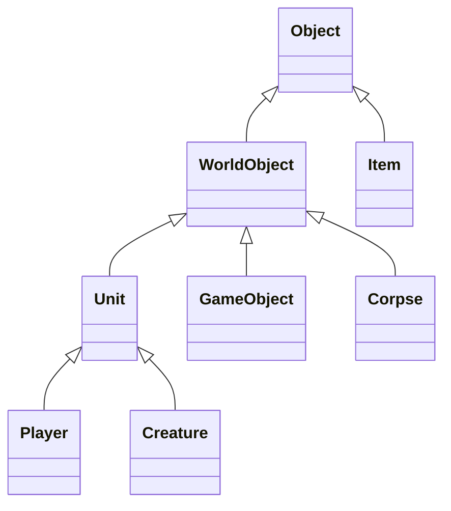

# 05. Eluna Scripting & Core Development Engine Handbook

> **Target Platform**: Turtle-WoW 1.18.1 (Build 7272) • CMaNGOS + Eluna Lua Engine
> **Source Verification**: `src/modules/Eluna/`, `hooks/Hooks.h`, `methods/CMangos/`, `mangosd.conf`, `src/game/Chat/Chat.cpp`
> **Security Coverage**: Security Levels 0–4 (Player, Moderator, GameMaster, Administrator, Console)
> **Master Portals**: [🏠 Master Portal (gm_commands.md)](../gm_commands.md) • [📜 Volume 01: GM Handbook](./01_game_master_handbook.md) • [🤖 Volume 02: Bot Automation](./02_playerbot_and_raid_automation.md) • [🗺️ Volume 03: World & Teleports](./03_turtle_world_and_teleports.md) • [⚔️ Volume 04: BiS Gear & Specs](./04_class_specs_and_endgame_gear.md) • [🤖 RandomBot Guide (rndbot_commands.md)](../rndbot_commands.md)

---

## 📑 Table of Contents

1. [Unified 5-Volume Master Reference Architecture](#unified-5-volume-master-reference-architecture)
2. [Master Macro UI Cheat Sheet (Lua Developer & Server Ops)](#1-master-macro-ui-cheat-sheet-lua-developer--server-ops)
3. [Eluna Architecture & Runtime Configuration](#2-eluna-architecture--runtime-configuration)
   - [Engine Lifecycle & Script Discovery](#engine-lifecycle--script-discovery)
   - [Configuration Settings (mangosd.conf)](#configuration-settings-mangosdconf)
   - [In-Game Live Reload & Inspection Commands](#in-game-live-reload--inspection-commands)
4. [Exhaustive Event Registration Matrix (Hooks.h)](#3-exhaustive-event-registration-matrix-hooksh)
   - [Server & World Events (35 IDs)](#server--world-events-registerserverevent)
   - [Player Lifecycle & Combat Events (40+ IDs)](#player-lifecycle--combat-events-registerplayerevent)
   - [Creature & Boss AI Events (37 IDs)](#creature--boss-ai-events-registercreatureevent)
   - [GameObject & World Trigger Events (14 IDs)](#gameobject--world-trigger-events-registergameobjectevent)
   - [Spell System & Aura Hooks (23 IDs)](#spell-system--aura-hooks-registerspellevent)
   - [Item Use & Equipment Events (8 IDs)](#item-use--equipment-events-registeritemevent)
   - [Gossip Dialog & Menu Interaction Events](#gossip-dialog--menu-interaction-events)
   - [Group, Guild, Battleground & Instance Events](#group-guild-battleground--instance-events)
5. [Complete Object & Entity Inheritance Architecture](#4-complete-object--entity-inheritance-architecture)
   - [Object Class (Base Entity)](#object-class-base-entity)
   - [WorldObject Class (Spatial 3D Coordinates & Radius)](#worldobject-class-spatial-3d-coordinates--radius)
   - [Unit Class (Combat, Health, Power, Auras & Immunities)](#unit-class-combat-health-power-auras--immunities)
   - [Player Class (Progression, Inventory, Teleports & UI)](#player-class-progression-inventory-teleports--ui)
   - [Creature Class (NPC AI, Waypoints & Boss Mechanics)](#creature-class-npc-ai-waypoints--boss-mechanics)
   - [GameObject Class (Interactive Chests, Doors & Nodes)](#gameobject-class-interactive-chests-doors--nodes)
   - [Item Class (Durability, Quality & Enchantments)](#item-class-durability-quality--enchantments)
   - [Spell & Aura Classes (Active Magic & Buffs)](#spell--aura-classes-active-magic--buffs)
   - [Map & BattleGround Classes (Spatial Environments)](#map--battleground-classes-spatial-environments)
   - [Guild & Group Classes (Social Organizations)](#guild--group-classes-social-organizations)
   - [WorldPacket Class & Addon Messaging Engine](#worldpacket-class--addon-messaging-engine)
   - [Quest Class (Progression & Flags)](#quest-class-progression--flags)
   - [Database Query Engine (WorldDBQuery & CharDBQuery)](#database-query-engine-worlddbquery--chardbquery)
   - [Object Variables Session Store (ObjectVariables.ext)](#object-variables-session-store-objectvariablesext)
   - [Turtle-WoW SpellInfo Compatibility Layer](#turtle-wow-spellinfo-compatibility-layer)
6. [Complete Database Hot-Reload Target Catalog (.reload)](#5-complete-database-hot-reload-target-catalog-reload)
7. [Production Script Blueprints for Server Operators](#6-production-script-blueprints-for-server-operators)
   - [Blueprint 1: Custom In-Game Chat Commands (.buffme, .home, .unstuck)](#blueprint-1-custom-in-game-chat-commands-buffme-home-unstuck)
   - [Blueprint 2: World Boss Announcer, Reward Bounty & Realm Broadcast](#blueprint-2-world-boss-announcer-reward-bounty--realm-broadcast)
   - [Blueprint 3: First Login Starter Kit, Bags & Currency Grant](#blueprint-3-first-login-starter-kit-bags--currency-grant)
   - [Blueprint 4: Stateful Interactive Gossip Master (Teleporter & Healer)](#blueprint-4-stateful-interactive-gossip-master-teleporter--healer)
   - [Blueprint 5: Custom Instance Progression Gatekeeper & Key Validator](#blueprint-5-custom-instance-progression-gatekeeper--key-validator)
   - [Blueprint 6: Client Addon Communication Engine (SendAddonMessage)](#blueprint-6-client-addon-communication-engine-sendaddonmessage)
   - [Blueprint 7: Playerbot Coordinator via Eluna Engine](#blueprint-7-playerbot-coordinator-via-eluna-engine)
   - [Blueprint 8: Dynamic Loot Multiplier & Boss Bonus Drop Engine](#blueprint-8-dynamic-loot-multiplier--boss-bonus-drop-engine)

---

## Unified 5-Volume Master Reference Architecture

| Volume | Handbook Title | Domain & Core Coverage | Direct Link |
| :---: | :--- | :--- | :--- |
| **01** | **[Game Master & World Administration](./01_game_master_handbook.md)** | **100% of GM commands, player progression, cheats, security, spawning, moderation, tickets, reloads & diagnostics.** | [Open Volume 01](./01_game_master_handbook.md) |
| **02** | **[Playerbot & Raid Automation](./02_playerbot_and_raid_automation.md)** | **Complete .bot & .rndbot control, whisper shortcuts, strategy tokens (co/nc), .dc dungeon clear solver & raid macros.** | [Open Volume 02](./02_playerbot_and_raid_automation.md) |
| **03** | **[World, Dungeons & Teleports Directory](./03_turtle_world_and_teleports.md)** | **647+ .tele tokens, Turtle-WoW 1.18.1 custom instances (Crescent Grove, Hateforge, Karazhan Crypts, Scarlet Citadel), keys & attunements.** | [Open Volume 03](./03_turtle_world_and_teleports.md) |
| **04** | **[Class Specs & Endgame Gear Directory](./04_class_specs_and_endgame_gear.md)** | **All 9 Classes**: 1-Click BiS gear loadout macros, complete Tier 1/2/3 set IDs, weapons, trinkets, enchants & verified 1.18.1 talent builds across 30 distinct specializations. | [Open Volume 04](./04_class_specs_and_endgame_gear.md) |
| **05** | **Eluna Scripting & Core Development Engine** | **Eluna Lua API, live reloads (.reload eluna), Event 42 Custom Command dispatch, SpellInfo layer & C++ hook mechanics.** | **Current File** |

---

## 1. Master Macro UI Cheat Sheet (Lua Developer & Server Ops)

Copy and paste these macros directly into your World of Warcraft **Macro UI** (`/m`):

### 🔄 Macro 1: Hot-Reload Eluna Engine & Clear Script State

Instantly flushes the server Lua state, re-scans the script directory, and re-executes all scripts live without kicking players:

```lua
.reload eluna
.notify Eluna Lua scripts hot-reloaded successfully!
```

### ⚡ Macro 2: Universal Content Hot-Reload Suite (Eluna + Spells + Quests + NPCs)

Flushes and reloads all core content layers after editing database tables or Lua scripts:

```lua
.reload eluna
.reload spell_template
.reload quest_template
.reload creature_template
.reload gameobject_template
.reload item_template
.reload areatrigger_teleport
.notify Core database templates & Eluna reloaded!
```

### 🔍 Macro 3: Live In-Game Target Inspection & GUID Probe

Outputs low-level runtime identifiers, coordinates, and entry IDs for scripting:

```lua
.npc info
.gobject target
.gps
```

---

## 2. Eluna Architecture & Runtime Configuration

### Engine Lifecycle & Script Discovery

Eluna embeds a high-performance Lua 5.2 virtual machine inside the CMaNGOS world server (`mangosd`).

1. **Initialization**: On server startup (or upon receiving `.reload eluna`), the engine instantiates an isolated Lua state.
2. **Script Discovery**: The engine recursively iterates through the directory defined in `mangosd.conf` (`Eluna.ScriptPath`, default: `lua_scripts/`).
3. **Execution Order**: Scripts are executed in alphabetical directory and file order. All global functions and registrations (`RegisterServerEvent`, `RegisterPlayerEvent`, etc.) are bound into memory.
4. **Thread Safety**: Script callbacks execute synchronously within the CMaNGOS World Update loop tick, guaranteeing safe access to world entities without race conditions.

---

### Configuration Settings (`mangosd.conf`)

Tune these parameters in your server configuration file (`/home/sam/server/etc/mangosd.conf`):

```ini
# ==============================================================================
# ELUNA LUA ENGINE CONFIGURATION
# ==============================================================================

# Enable or disable the Eluna Lua engine (1 = Enabled, 0 = Disabled)
Eluna.Enabled = 1

# Relative or absolute path to the directory containing Lua scripts
Eluna.ScriptPath = "lua_scripts"

# Print detailed call stack tracebacks to console and logs upon runtime Lua errors
Eluna.Tracebacks = 1

# Enable automatic file change detection and hot-reload (experimental)
Eluna.ScriptReloader = 0

# Permit execution of potentially unsafe methods (raw SQL queries, OS shell calls)
Eluna.EnableUnsafe = 1

# Enable the in-game .reload eluna chat command
Eluna.EnableReloadCommand = 1

# Minimum GM security rank required to execute .reload eluna (3 = Administrator)
Eluna.ReloadSecurityLevel = 3

# Restrict Eluna script execution to specific map IDs (empty string = all maps enabled)
Eluna.OnlyOnMaps = ""
```

---

### In-Game Live Reload & Inspection Commands

| Command | Sec | Syntax & Arguments | Description |
| :--- | :---: | :--- | :--- |
| `.reload eluna` | 3 | `.reload eluna [map_id]` | Flushes Lua state, unbinds all existing hooks, and executes all scripts. |
| `.eluna` | 3 | `.eluna` | Outputs active Eluna engine version and script statistics. |
| `.reload config` | 3 | `.reload config` | Re-reads `mangosd.conf` to update Eluna configuration parameters live. |

---

## 3. Exhaustive Event Registration Matrix (`Hooks.h`)

Verified directly against `src/modules/Eluna/hooks/Hooks.h`.

### Server & World Events (`RegisterServerEvent`)

| ID | Event Name | Trigger Condition & Hook Signature |
| :---: | :--- | :--- |
| **1** | `SERVER_EVENT_ON_NETWORK_START` | World socket network listener initialized. |
| **2** | `SERVER_EVENT_ON_NETWORK_STOP` | Network listener stopped. |
| **3** | `SERVER_EVENT_ON_SOCKET_OPEN` | Client TCP socket opened: `(event, socket)`. |
| **4** | `SERVER_EVENT_ON_SOCKET_CLOSE` | Client socket closed: `(event, socket)`. |
| **5** | `SERVER_EVENT_ON_PACKET_RECEIVE` | Raw packet received from client: `(event, packet, player)`. |
| **6** | `SERVER_EVENT_ON_PACKET_RECEIVE_UNKNOWN` | Unhandled packet opcode received: `(event, packet, socket)`. |
| **7** | `SERVER_EVENT_ON_PACKET_SEND` | Packet dispatched to client: `(event, packet, player)`. |
| **8** | `WORLD_EVENT_ON_OPEN_STATE_CHANGE` | Realm open state altered: `(event, openState)`. |
| **9** | `WORLD_EVENT_ON_CONFIG_LOAD` | Configuration file reloaded: `(event, reloadBool)`. |
| **11** | `WORLD_EVENT_ON_SHUTDOWN_INIT` | Clean server shutdown initiated: `(event, code, mask)`. |
| **12** | `WORLD_EVENT_ON_SHUTDOWN_CANCEL` | Server shutdown cancelled. |
| **13** | `WORLD_EVENT_ON_UPDATE` | World update tick fired: `(event, diff_ms)`. |
| **14** | `WORLD_EVENT_ON_STARTUP` | World server finished initial boot sequence. |
| **15** | `WORLD_EVENT_ON_SHUTDOWN` | World server process terminating. |
| **16** | `ELUNA_EVENT_ON_LUA_STATE_CLOSE` | Lua state is tearing down. |
| **17** | `MAP_EVENT_ON_CREATE` | Map loaded into memory: `(event, map)`. |
| **18** | `MAP_EVENT_ON_DESTROY` | Map unloaded from memory: `(event, map)`. |
| **19** | `MAP_EVENT_ON_GRID_LOAD` | Map grid cell loaded: `(event, map, gridX, gridY)`. |
| **20** | `MAP_EVENT_ON_GRID_UNLOAD` | Map grid cell purged: `(event, map, gridX, gridY)`. |
| **21** | `MAP_EVENT_ON_PLAYER_ENTER` | Player entered map: `(event, map, player)`. |
| **22** | `MAP_EVENT_ON_PLAYER_LEAVE` | Player departed map: `(event, map, player)`. |
| **23** | `MAP_EVENT_ON_UPDATE` | Map update tick fired: `(event, map, diff_ms)`. |
| **24** | `TRIGGER_EVENT_ON_TRIGGER` | Player stepped into AreaTrigger: `(event, player, triggerId)`. |
| **25** | `WEATHER_EVENT_ON_CHANGE` | Zone weather altered: `(event, zoneId, weatherState, grade)`. |
| **26** | `AUCTION_EVENT_ON_ADD` | New auction listed: `(event, auctionId, owner, item)`. |
| **27** | `AUCTION_EVENT_ON_REMOVE` | Auction cancelled or removed: `(event, auctionId, owner, item)`. |
| **28** | `AUCTION_EVENT_ON_SUCCESSFUL` | Auction buyout/win processed: `(event, auctionId, owner, buyer)`. |
| **29** | `AUCTION_EVENT_ON_EXPIRE` | Auction expired without buyer: `(event, auctionId, owner, item)`. |
| **30** | `ADDON_EVENT_ON_MESSAGE` | Addon message received: `(event, sender, type, prefix, text, target)`. |
| **31** | `WORLD_EVENT_ON_DELETE_CREATURE` | Creature despawned/purged: `(event, creature)`. |
| **32** | `WORLD_EVENT_ON_DELETE_GAMEOBJECT` | GameObject despawned/purged: `(event, gameobject)`. |
| **33** | `ELUNA_EVENT_ON_LUA_STATE_OPEN` | Lua state initialized and ready. |
| **34** | `GAME_EVENT_START` | Seasonal game event activated: `(event, eventId)`. |
| **35** | `GAME_EVENT_STOP` | Seasonal game event stopped: `(event, eventId)`. |

---

### Player Lifecycle & Combat Events (`RegisterPlayerEvent`)

| ID | Event Name | Hook Arguments & Description |
| :---: | :--- | :--- |
| **1** | `PLAYER_EVENT_ON_CHARACTER_CREATE` | Character created: `(event, player)`. |
| **2** | `PLAYER_EVENT_ON_CHARACTER_DELETE` | Character deleted from realm: `(event, guid)`. |
| **3** | `PLAYER_EVENT_ON_LOGIN` | Player logged into game world: `(event, player)`. |
| **4** | `PLAYER_EVENT_ON_LOGOUT` | Player logged out: `(event, player)`. |
| **5** | `PLAYER_EVENT_ON_SPELL_CAST` | Spell successfully cast: `(event, player, spell, skipCheck)`. |
| **6** | `PLAYER_EVENT_ON_KILL_PLAYER` | Slain another player (PvP): `(event, killer, victim)`. |
| **7** | `PLAYER_EVENT_ON_KILL_CREATURE` | Slain an NPC or boss: `(event, killer, victim)`. |
| **8** | `PLAYER_EVENT_ON_KILLED_BY_CREATURE` | Slain by an NPC: `(event, killer, victim)`. |
| **9** | `PLAYER_EVENT_ON_DUEL_REQUEST` | Duel challenged: `(event, player, target)`. |
| **10** | `PLAYER_EVENT_ON_DUEL_START` | Duel started: `(event, player, target)`. |
| **11** | `PLAYER_EVENT_ON_DUEL_END` | Duel finished: `(event, winner, loser, duelType)`. |
| **12** | `PLAYER_EVENT_ON_GIVE_XP` | Experience gained: `(event, player, amount, victim)`. |
| **13** | `PLAYER_EVENT_ON_LEVEL_CHANGE` | Level changed: `(event, player, oldLevel)`. |
| **14** | `PLAYER_EVENT_ON_MONEY_CHANGE` | Gold/money altered: `(event, player, amount)`. |
| **15** | `PLAYER_EVENT_ON_REPUTATION_CHANGE` | Reputation gained: `(event, player, factionId, standing, incremental)`. |
| **16** | `PLAYER_EVENT_ON_TALENTS_CHANGE` | Talent tree modified: `(event, player, points)`. |
| **17** | `PLAYER_EVENT_ON_TALENTS_RESET` | Talents reset at class trainer: `(event, player, cost)`. |
| **18** | `PLAYER_EVENT_ON_CHAT` | Public/say chat: `(event, player, msg, type, lang)`. |
| **19** | `PLAYER_EVENT_ON_WHISPER` | Private whisper: `(event, player, msg, type, lang, receiver)`. |
| **20** | `PLAYER_EVENT_ON_GROUP_CHAT` | Party chat: `(event, player, msg, type, lang, group)`. |
| **21** | `PLAYER_EVENT_ON_GUILD_CHAT` | Guild chat: `(event, player, msg, type, lang, guild)`. |
| **22** | `PLAYER_EVENT_ON_CHANNEL_CHAT` | Custom channel chat: `(event, player, msg, type, lang, channel)`. |
| **23** | `PLAYER_EVENT_ON_EMOTE` | Visual emote played: `(event, player, emoteId)`. |
| **24** | `PLAYER_EVENT_ON_TEXT_EMOTE` | Text emote triggered: `(event, player, textEmote, emoteNum, guid)`. |
| **25** | `PLAYER_EVENT_ON_SAVE` | Character saved to database: `(event, player)`. |
| **26** | `PLAYER_EVENT_ON_BIND_TO_INSTANCE` | Saved/locked to instance ID: `(event, player, difficulty, mapId, permanent)`. |
| **27** | `PLAYER_EVENT_ON_UPDATE_ZONE` | Zone boundary crossed: `(event, player, newZone, newArea)`. |
| **28** | `PLAYER_EVENT_ON_MAP_CHANGE` | Map transition completed: `(event, player)`. |
| **29** | `PLAYER_EVENT_ON_EQUIP` | Item equipped: `(event, player, item, bag, slot)`. |
| **30** | `PLAYER_EVENT_ON_FIRST_LOGIN` | Brand new character logged in for the very first time: `(event, player)`. |
| **31** | `PLAYER_EVENT_ON_CAN_USE_ITEM` | Item validation check: `(event, player, itemEntry)`. |
| **32** | `PLAYER_EVENT_ON_LOOT_ITEM` | Item picked up: `(event, player, item, count)`. |
| **33** | `PLAYER_EVENT_ON_ENTER_COMBAT` | Entered combat: `(event, player, enemy)`. |
| **34** | `PLAYER_EVENT_ON_LEAVE_COMBAT` | Dropped combat: `(event, player)`. |
| **35** | `PLAYER_EVENT_ON_REPOP` | Released spirit after death: `(event, player)`. |
| **36** | `PLAYER_EVENT_ON_RESURRECT` | Revived from corpse: `(event, player)`. |
| **37** | `PLAYER_EVENT_ON_LOOT_MONEY` | Looted coin: `(event, player, amount)`. |
| **38** | `PLAYER_EVENT_ON_QUEST_ABANDON` | Quest abandoned: `(event, player, questId)`. |
| **39** | `PLAYER_EVENT_ON_LEARN_TALENTS` | Learned talent rank: `(event, player, talentId, talentRank)`. |
| **40** | `PLAYER_EVENT_ON_ENVIRONMENTAL_DEATH` | Died to falling/drowning/lava: `(event, player, envType)`. |
| **41** | `PLAYER_EVENT_ON_TRADE_ACCEPT` | Trade finalized: `(event, player, target)`. |
| **42** | `PLAYER_EVENT_ON_COMMAND` | Custom chat command hook: `(event, player, command)`. Return `false` to suppress core error. |
| **43** | `PLAYER_EVENT_ON_SKILL_CHANGE` | Skill level advanced: `(event, player, skillId, skillValue)`. |
| **44** | `PLAYER_EVENT_ON_LEARN_SPELL` | Spell learned: `(event, player, spellId)`. |
| **46** | `PLAYER_EVENT_ON_DISCOVER_AREA` | Area discovered: `(event, player, areaId)`. |
| **47** | `PLAYER_EVENT_ON_UPDATE_AREA` | Sub-area changed: `(event, player, oldArea, newArea)`. |
| **48** | `PLAYER_EVENT_ON_TRADE_INIT` | Trade window opened: `(event, player, target)`. |
| **49** | `PLAYER_EVENT_ON_SEND_MAIL` | Mail sent: `(event, player, recipientGuid)`. |
| **54** | `PLAYER_EVENT_ON_QUEST_STATUS_CHANGED` | Quest state updated: `(event, player, questId, status)`. |

---

### Creature & Boss AI Events (`RegisterCreatureEvent`)

| ID | Event Name | Hook Arguments & Description |
| :---: | :--- | :--- |
| **1** | `CREATURE_EVENT_ON_ENTER_COMBAT` | Engaged enemy target: `(event, creature, target)`. |
| **2** | `CREATURE_EVENT_ON_LEAVE_COMBAT` | Evaded or all enemies defeated: `(event, creature)`. |
| **3** | `CREATURE_EVENT_ON_TARGET_DIED` | Slain player or enemy: `(event, creature, victim)`. |
| **4** | `CREATURE_EVENT_ON_DIED` | Boss or mob slain: `(event, creature, killer)`. |
| **5** | `CREATURE_EVENT_ON_SPAWN` | Spawned into world: `(event, creature)`. |
| **6** | `CREATURE_EVENT_ON_REACH_WP` | Reached waypoint index: `(event, creature, type, id)`. |
| **7** | `CREATURE_EVENT_ON_AI_UPDATE` | Creature AI tick: `(event, creature, diff_ms)`. |
| **8** | `CREATURE_EVENT_ON_RECEIVE_EMOTE` | Received player emote: `(event, creature, player, emoteId)`. |
| **9** | `CREATURE_EVENT_ON_DAMAGE_TAKEN` | Took damage: `(event, creature, attacker, damage)`. |
| **10** | `CREATURE_EVENT_ON_PRE_COMBAT` | Threat calculated before aggro: `(event, creature, target)`. |
| **13** | `CREATURE_EVENT_ON_OWNER_ATTACKED` | Minion's master was hit: `(event, creature, target)`. |
| **14** | `CREATURE_EVENT_ON_OWNER_ATTACKING` | Minion's master attacked target: `(event, creature, target)`. |
| **16** | `CREATURE_EVENT_ON_RESET` | Boss reset and evading back to home: `(event, creature)`. |
| **23** | `CREATURE_EVENT_ON_SPELL_HIT` | Hit by spell: `(event, creature, caster, spellId)`. |
| **24** | `CREATURE_EVENT_ON_SPELL_HIT_TARGET` | Successfully cast spell on target: `(event, creature, target, spellId)`. |
| **26** | `CREATURE_EVENT_ON_SUMMONED` | Spawned as minion/pet: `(event, creature, summoner)`. |
| **27** | `CREATURE_EVENT_ON_DESPAWN` | Despawning from map: `(event, creature)`. |

---

### GameObject & World Trigger Events (`RegisterGameObjectEvent`)

| ID | Event Name | Hook Arguments & Description |
| :---: | :--- | :--- |
| **1** | `GAMEOBJECT_EVENT_ON_AI_UPDATE` | AI update tick: `(event, go, diff_ms)`. |
| **2** | `GAMEOBJECT_EVENT_ON_SPAWN` | Spawned into map: `(event, go)`. |
| **3** | `GAMEOBJECT_EVENT_ON_ADD` | Added to world map: `(event, go)`. |
| **4** | `GAMEOBJECT_EVENT_ON_REMOVE` | Removed from world map: `(event, go)`. |
| **5** | `GAMEOBJECT_EVENT_ON_USE` | Player clicked/opened chest or door: `(event, go, player)`. |
| **6** | `GAMEOBJECT_EVENT_ON_RESET` | Trap or door reset state: `(event, go)`. |
| **7** | `GAMEOBJECT_EVENT_ON_DESTROYED` | Destructible GameObject destroyed: `(event, go, player)`. |
| **8** | `GAMEOBJECT_EVENT_ON_DAMAGED` | Destructible GameObject damaged: `(event, go, player)`. |
| **9** | `GAMEOBJECT_EVENT_ON_LOOT_STATE_CHANGE` | Loot state shifted: `(event, go, state)`. |
| **10** | `GAMEOBJECT_EVENT_ON_GO_STATE_CHANGE` | State altered (0=Active, 1=Ready): `(event, go, state)`. |

---

### Spell System & Aura Hooks (`RegisterSpellEvent`)

| ID | Event Name | Hook Arguments & Description |
| :---: | :--- | :--- |
| **1** | `SPELL_EVENT_ON_CAST` | Spell initiated: `(event, spell, skipCheck)`. |
| **2** | `SPELL_EVENT_ON_PREPARE` | Casting bar commenced: `(event, spell)`. |
| **3** | `SPELL_EVENT_ON_CANCEL` | Spell cast interrupted: `(event, spell)`. |
| **4** | `SPELL_EVENT_ON_FINISH` | Spell cast completed successfully: `(event, spell)`. |
| **5** | `SPELL_EVENT_ON_TAKE_POWER` | Mana/Rage/Energy deducted: `(event, spell, powerType, amount)`. |

---

### Item Use & Equipment Events (`RegisterItemEvent`)

| ID | Event Name | Hook Arguments & Description |
| :---: | :--- | :--- |
| **1** | `ITEM_EVENT_ON_DUMMY_EFFECT` | Scripted dummy effect triggered: `(event, player, spellId, effIndex, item)`. |
| **2** | `ITEM_EVENT_ON_USE` | Item right-clicked: `(event, player, item, target)`. |
| **3** | `ITEM_EVENT_ON_QUEST_ACCEPT` | Quest starter item clicked: `(event, player, item, quest)`. |
| **4** | `ITEM_EVENT_ON_EXPIRE` | Temporary item duration expired: `(event, player, itemEntry)`. |
| **7** | `ITEM_EVENT_ON_EQUIP` | Item placed into character equipment slot: `(event, player, item, slot)`. |
| **8** | `ITEM_EVENT_ON_UNEQUIP` | Item removed from equipment slot: `(event, player, item, slot)`. |

---

### Gossip Dialog & Menu Interaction Events

Create custom NPC, item, and player dialog trees with multi-page responses:

- `RegisterCreatureGossipEvent(creatureEntry, 1, OnHello)`: Fired on NPC right-click.
- `RegisterCreatureGossipEvent(creatureEntry, 2, OnSelect)`: Fired when player clicks gossip option.
- `RegisterGameObjectGossipEvent(goEntry, 1, OnHello)`: Fired on GameObject click.
- `RegisterGameObjectGossipEvent(goEntry, 2, OnSelect)`: Fired on GameObject option click.
- `RegisterItemGossipEvent(itemEntry, 1, OnHello)`: Fired when using scripted item with gossip.
- `RegisterItemGossipEvent(itemEntry, 2, OnSelect)`: Fired on item gossip selection.
- `RegisterPlayerGossipEvent(menuId, 2, OnSelect)`: Fired on player-to-player gossip dialogs.

---

### Group, Guild, Battleground & Instance Events

- **Group** (`RegisterGroupEvent`):
  - `1`: `GROUP_EVENT_ON_MEMBER_ADD` `(event, group, playerGuid)`
  - `2`: `GROUP_EVENT_ON_MEMBER_INVITE` `(event, group, playerGuid)`
  - `3`: `GROUP_EVENT_ON_MEMBER_REMOVE` `(event, group, playerGuid, method)`
  - `4`: `GROUP_EVENT_ON_LEADER_CHANGE` `(event, group, newLeaderGuid, oldLeaderGuid)`
  - `5`: `GROUP_EVENT_ON_DISBAND` `(event, group)`
- **Guild** (`RegisterGuildEvent`):
  - `1`: `GUILD_EVENT_ON_ADD_MEMBER` `(event, guild, player, rank)`
  - `2`: `GUILD_EVENT_ON_REMOVE_MEMBER` `(event, guild, player, isDisband)`
  - `5`: `GUILD_EVENT_ON_CREATE` `(event, guild, leader, guildName)`
  - `6`: `GUILD_EVENT_ON_DISBAND` `(event, guild)`
  - `7`: `GUILD_EVENT_ON_MONEY_WITHDRAW` `(event, guild, player, amount, isRepair)`
  - `8`: `GUILD_EVENT_ON_MONEY_DEPOSIT` `(event, guild, player, amount)`
- **Battleground** (`RegisterBGEvent`):
  - `1`: `BG_EVENT_ON_START` `(event, bg, bgId, instanceId)`
  - `2`: `BG_EVENT_ON_END` `(event, bg, bgId, instanceId, winnerTeam)`
- **Instance** (`RegisterInstanceEvent`):
  - `1`: `INSTANCE_EVENT_ON_INITIALIZE` `(event, instanceData, map)`
  - `2`: `INSTANCE_EVENT_ON_LOAD` `(event, instanceData, map)`
  - `3`: `INSTANCE_EVENT_ON_UPDATE` `(event, instanceData, map, diff_ms)`
  - `4`: `INSTANCE_EVENT_ON_PLAYER_ENTER` `(event, instanceData, map, player)`
  - `7`: `INSTANCE_EVENT_ON_CHECK_ENCOUNTER_IN_PROGRESS` `(event, instanceData, map)`

---

## 4. Complete Object & Entity Inheritance Architecture

Eluna mirrors the native CMaNGOS C++ class hierarchy. Understanding inheritance eliminates redundant code and unlocks the full power of the core:



---

### Object Class (Base Entity)

Base class for all entities in the game world, inventory, or memory (`ObjectMethods.h`):

```lua
obj:GetGUID()                                    -- 64-bit globally unique identifier
obj:GetEntry()                                   -- Template ID (creature_template, item_template)
obj:GetTypeId()                                  -- Type (TYPEID_OBJECT, TYPEID_ITEM, TYPEID_UNIT, etc.)
obj:IsInWorld()                                  -- True if entity is added to an active map grid
obj:GetScale(), obj:SetScale(scale)              -- Visual size scale factor (1.0 = normal)
obj:GetInt32Value(index), obj:SetInt32Value(index, val)   -- Low-level UpdateField access
obj:GetUInt32Value(index), obj:SetUInt32Value(index, val) -- Low-level UpdateField access
obj:GetFloatValue(index), obj:SetFloatValue(index, val)   -- Low-level UpdateField access
obj:HasFlag(index, flag), obj:SetFlag(index, flag)        -- Bitmask check and manipulation
obj:RemoveFlag(index, flag)                               -- Clears bitmask flag
```

---

### WorldObject Class (Spatial 3D Coordinates & Radius)

Inherits from `Object`. Represents any entity existing in 3D world space (`WorldObjectMethods.h`):

```lua
-- Coordinates & Orientation
wObj:GetMapId(), wObj:GetInstanceId()            -- Current map ID and instance ID
wObj:GetX(), wObj:GetY(), wObj:GetZ(), wObj:GetO() -- Exact 3D coordinates and facing orientation
wObj:GetZoneId(), wObj:GetAreaId()               -- Zone and sub-area IDs
wObj:GetMap()                                    -- Returns Map object

-- Spatial Calculations & Distances
wObj:GetDistance(target)                         -- 3D Euclidean distance in yards
wObj:GetDistance2d(target)                       -- 2D horizontal distance in yards
wObj:GetDistanceZ(target)                        -- Vertical distance difference
wObj:GetAngle(target)                            -- Absolute radian angle to target
wObj:GetRelativeAngle(target)                    -- Relative radian angle from facing orientation
wObj:IsWithinDist(target, yards)                 -- Fast spherical radius distance check
wObj:IsWithinDist2d(target, yards)               -- Fast cylindrical radius distance check
wObj:IsWithinLoS(target)                         -- Line of Sight Raycast check (navmesh/vmap)

-- Radius Queries (Entity Gathering)
wObj:GetNearObjects(range, type)                 -- Lua array of WorldObjects within range
wObj:GetNearPlayers(range)                       -- Lua array of Player objects within range
wObj:GetNearCreatures(range)                     -- Lua array of Creature objects within range
wObj:GetNearGameObjects(range)                   -- Lua array of GameObject objects within range
wObj:GetNearestPlayer(range)                     -- Closest Player object
wObj:GetNearestCreature(range, entry)            -- Closest Creature matching template entry
wObj:GetNearestGameObject(range, entry)          -- Closest GameObject matching template entry

-- In-World Spawning & Media
wObj:SpawnCreature(entry, x, y, z, o, despawnTime) -- Spawns dynamic NPC at coordinates
wObj:SummonGameObject(entry, x, y, z, o, respawnTime) -- Spawns dynamic GO at coordinates
wObj:PlayDirectSound(soundId, player)            -- Plays client UI sound directly
wObj:PlayDistanceSound(soundId, player)          -- Plays spatial 3D audio in world
```

---

### Unit Class (Combat, Health, Power, Auras & Immunities)

Inherits from `WorldObject`. Core class for all living combatants (`Player` and `Creature`) (`UnitMethods.h`):

```lua
-- Health & Power
unit:GetHealth(), unit:SetHealth(hp)             -- Current hit points
unit:GetMaxHealth(), unit:SetMaxHealth(maxHp)    -- Maximum hit points
unit:GetPower(type), unit:SetPower(type, val)    -- 0=Mana, 1=Rage, 2=Focus, 3=Energy, 4=Happiness
unit:GetMaxPower(type)                           -- Maximum power capacity
unit:IsAlive(), unit:IsDead(), unit:IsDying()    -- Vitality states

-- Combat & Threat
unit:Attack(target, meleeAttack)                 -- Engages target in melee combat
unit:AttackStop()                                -- Terminate current attack
unit:GetVictim(), unit:SetVictim(target)         -- Current combat focus target
unit:IsInCombat()                                -- True if unit has active threat entries
unit:CombatStop(clearThreat)                     -- Drops combat and clears threat table
unit:SetInCombatWith(target)                     -- Forces mutual combat state

-- Spellcasting & Auras
unit:CastSpell(target, spellId, triggered)       -- Casts spell (triggered=true skips cast time/mana)
unit:CastCustomSpell(target, spellId, bp0, bp1, bp2, triggered) -- Casts with custom basepoints
unit:AddAura(spellId, target)                    -- Applies buff/debuff aura
unit:RemoveAura(spellId)                         -- Dispels active aura
unit:HasAura(spellId)                            -- True if aura is active
unit:GetAura(spellId)                            -- Returns Aura object

-- Immunities & Mechanics
unit:SetImmuneTo(mechanicId, apply)              -- Sets CC immunity (STUN, FEAR, ROOT, SILENCE, etc.)
unit:IsStandState(), unit:SetStandState(state)   -- 0=Stand, 1=Sit, 2=SitChair, 7=Sleep, 8=Dead

-- Visuals, Morphs & Faction
unit:SetFaction(factionId)                       -- Changes hostility/friendship reaction
unit:GetFaction()                                -- Returns active faction template ID
unit:SetDisplayId(modelId)                       -- Morphs visual model
unit:DeMorph()                                   -- Restores native creature/player model
unit:Emote(emoteId)                              -- Triggers animation emote
unit:SetSpeed(speedType, speed, forced)          -- 1=Run, 2=Swim, 4=Flight (multiplier: 1.0 = normal)
```

---

### Player Class (Progression, Inventory, Teleports & UI)

Inherits from `Unit`. Represents an active human player character (`PlayerMethods.h`):

```lua
-- Movement & Location
player:Teleport(mapId, x, y, z, o)               -- Teleports player to destination
player:GetHomebindCoordinates()                  -- Returns bindMap, bindX, bindY, bindZ
player:GetAreaId(), player:GetZoneId()           -- Zone and sub-area IDs

-- Items & Economy
player:AddItem(itemId, count)                    -- Adds item to inventory bags
player:RemoveItem(itemId, count)                 -- Removes item from inventory
player:HasItem(itemId, count)                    -- Checks item possession
player:GetItemCount(itemId)                      -- Returns quantity owned
player:EquipItem(item, slotId)                   -- Equips item into designated slot
player:ModifyMoney(copper)                       -- Adds or subtracts money (10000 = 1 Gold)
player:GetMoney()                                -- Returns total copper
player:DurabilityRepairAll(discount)             -- Restores 100% equipment durability

-- Progression & Talents
player:GetLevel(), player:SetLevel(level)        -- Reads or alters character level
player:LearnSpell(spellId)                       -- Teaches spell permanently
player:HasSpell(spellId)                         -- Checks learned spellbook
player:ResetTalents(cost)                        -- Unlearns talent trees
player:GetGuild(), player:GetGroup()             -- Returns Guild or Group object

-- Messaging & UI
player:SendBroadcastMessage(text)                -- White chat log message
player:SendAreaTriggerMessage(text)              -- Yellow center-screen banner
player:SendNotification(text)                    -- Pop-up modal alert box
player:SendAddonMessage(prefix, text, channel, receiver) -- Dispatches client addon message
player:SaveToDB()                                -- Forces character database save
```

---

### Creature Class (NPC AI, Waypoints & Boss Mechanics)

Inherits from `Unit`. Represents monsters, bosses, and friendly NPCs (`CreatureMethods.h`):

```lua
creature:DespawnOrUnsummon(msTimeToDespawn)      -- Despawns creature after delay
creature:Respawn()                               -- Forces instant respawn
creature:MoveTo(id, x, y, z, generatePath)       -- Paths creature to coordinates
creature:MoveFollow(target, dist, angle)         -- Locks creature into following unit
creature:MoveHome()                              -- Orders creature to return to spawn
creature:SetWalk(enable)                         -- Toggles run vs walk speed
creature:Say(text, lang), creature:Yell(text)    -- Local NPC speech and yelling
creature:GetAITargets()                          -- Lua table array of all units on threat table
creature:GetAITargetsCount()                     -- Count of active enemies
creature:CallAssistance()                        -- Alerts nearby friendly pack mobs
creature:SetRespawnDelay(seconds)                -- Adjusts dynamic respawn timer
```

---

### GameObject Class (Interactive Chests, Doors & Nodes)

Inherits from `WorldObject`. Represents doors, levers, chests, and ritual nodes (`GameObjectMethods.h`):

```lua
go:Use(unit)                                     -- Simulates unit opening/activating object
go:SetGoState(state)                             -- 0 = Active/Open, 1 = Ready/Closed, 2 = Destroyed
go:GetGoState()                                  -- Returns current physical state
go:SetLootState(state)                           -- 0 = Not Ready, 1 = Ready, 2 = Activated, 3 = Just Deactivated
go:GetLootState()                                -- Returns loot readiness state
go:Despawn()                                     -- Removes GameObject from world
go:Respawn()                                     -- Respawn GameObject at coordinates
go:UseDoorOrButton()                             -- Automatically toggles door open/closed
go:HasQuest(questId)                             -- Checks if GO starts or completes quest
```

---

### Item Class (Durability, Quality & Enchantments)

Inherits from `Object`. Represents inventory and equipment items (`ItemMethods.h`):

```lua
item:GetOwner()                                  -- Returns Player object holding the item
item:GetCount(), item:SetCount(count)            -- Stack count
item:GetItemLevel(), item:GetRequiredLevel()     -- Item level and min player level
item:GetQuality()                                -- 0=Poor, 1=Common, 2=Uncommon, 3=Rare, 4=Epic, 5=Legendary
item:IsSoulBound(), item:IsBoundByEnchant()      -- Binding states
item:SetEnchantment(enchantId, slot)             -- Applies permanent or temporary item enchant
item:ClearEnchantment(slot)                      -- Strips active enchantment
item:GetItemLink()                               -- Formatted clickable hyperlinked item string
```

---

### Spell & Aura Classes (Active Magic & Buffs)

Represents active spell instances and lasting aura states (`SpellMethods.h`, `AuraMethods.h`):

```lua
-- Spell Object
spell:GetCaster()                                -- Unit that casted spell
spell:GetTarget()                                -- Targeted Unit or GameObject
spell:GetEntry()                                 -- Spell ID from DBC
spell:GetCastTime()                              -- Base cast duration in milliseconds
spell:Cancel()                                   -- Aborts casting
spell:Finish()                                   -- Immediately completes spell

-- Aura Object
aura:GetCaster()                                 -- Unit that applied aura
aura:GetSpellId()                                -- Spell ID of aura
aura:GetDuration(), aura:SetDuration(ms)         -- Remaining duration in milliseconds
aura:GetMaxDuration(), aura:SetMaxDuration(ms)   -- Total duration
aura:GetStackAmount(), aura:SetStackAmount(n)    -- Stacking charges (e.g. 5x Sunder Armor)
aura:Remove()                                    -- Strips aura from unit
```

---

### Map & BattleGround Classes (Spatial Environments)

Controls world map instances and PvP battlegrounds (`MapMethods.h`, `BattleGroundMethods.h`):

```lua
-- Map Object
map:GetMapId()                                   -- Map ID (0=EK, 1=Kalimdor, 811=Scarlet Citadel)
map:GetInstanceId()                              -- Unique instance save ID
map:GetPlayerCount()                             -- Active players inside map
map:GetPlayers()                                 -- Lua array table of all players in map
map:IsRaid(), map:IsDungeon()                    -- Boolean map classification
map:IsBattleground(), map:IsArena()              -- PvP map classifications
map:GetHeight(x, y)                              -- Ground terrain Z height at coordinates
map:SetWeather(zoneId, type, grade)              -- Changes map weather (type: 1=Rain, 2=Snow, 3=Sandstorm)

-- BattleGround Object
bg:GetName()                                     -- Name (Warsong Gulch, Arathi Basin)
bg:GetAlivePlayersCountByTeam(team)              -- Alive combatants (0=Alliance, 1=Horde)
bg:GetWinner()                                   -- Winning faction team ID
```

---

### Guild & Group Classes (Social Organizations)

Controls player parties, raids, and guilds (`GroupMethods.h`, `GuildMethods.h`):

```lua
-- Group Object
group:GetLeader(), group:GetLeaderGUID()         -- Current group leader
group:GetMemberCount(), group:GetMembers()       -- Total members and Lua table of Player objects
group:AddMember(player), group:RemoveMember(player) -- Party roster manipulation
group:IsRaid()                                   -- True if converted to 40-man raid group
group:Disband()                                  -- Dissolves party immediately

-- Guild Object
guild:GetLeader(), guild:GetLeaderGUID()         -- Guild Master
guild:GetMemberCount(), guild:GetMembers()       -- Total roster and Player table
guild:AddMember(player, rankId)                  -- Enrolls player at designated rank
guild:DeleteMember(player)                       -- Removes member from guild
guild:GetBankMoney(), guild:SetBankMoney(copper) -- Guild treasury balance
```

---

### WorldPacket Class & Addon Messaging Engine

Inspects and crafts network packets sent between server and client (`WorldPacketMethods.h`):

```lua
local packet = CreatePacket(opcode, size)        -- Instantiates raw network packet
packet:GetOpcode(), packet:SetOpcode(opcode)     -- Reads or alters opcode header
packet:WriteByte(val), packet:ReadByte()         -- 8-bit unsigned integer
packet:WriteShort(val), packet:ReadShort()       -- 16-bit integer
packet:WriteLong(val), packet:ReadLong()         -- 32-bit integer
packet:WriteFloat(val), packet:ReadFloat()       -- 32-bit floating point
packet:WriteString(str), packet:ReadString()     -- Null-terminated ASCII/UTF-8 string
packet:WriteGUID(guid), packet:ReadGUID()        -- 64-bit entity GUID
player:SendPacket(packet)                        -- Dispatches packet to client session
```

---

### Quest Class (Progression & Flags)

Inspects quest template parameters (`QuestMethods.h`):

```lua
quest:GetId()                                    -- Quest entry ID
quest:GetLevel(), quest:GetMinLevel()            -- Target and prerequisite character levels
quest:GetNextQuestId(), quest:GetPrevQuestId()   -- Quest chain sequence pointers
quest:HasFlag(flagBit)                           -- Evaluates quest attribute flags
quest:IsDaily(), quest:IsRepeatable()            -- Repeatability flags
```

---

### Database Query Engine (`WorldDBQuery` & `CharDBQuery`)

Eluna can read and write directly to MySQL databases at runtime without blocking server threads:

- `WorldDBQuery(sql)`: Queries the `tw_world` game database.
- `CharDBQuery(sql)`: Queries the `tw_char` character database.
- `AuthDBQuery(sql)`: Queries the `tw_realmd` authentication database.
- `WorldDBExecute(sql)` / `CharDBExecute(sql)`: Executes INSERT, UPDATE, DELETE queries.

#### Iteration Pattern over `ElunaQuery` Result Sets

```lua
local query = WorldDBQuery("SELECT entry, name, minlevel, maxlevel FROM creature_template WHERE rank = 3")
if query then
    repeat
        local entry = query:GetUInt32(0)
        local name = query:GetString(1)
        local minLvl = query:GetUInt32(2)
        local maxLvl = query:GetUInt32(3)
        print(string.format("World Boss: %s (ID: %d) Level: %d-%d", name, entry, minLvl, maxLvl))
    until not query:NextRow()
end
```

**`ElunaQuery` Methods**:

- `query:GetRowCount()`: Total rows returned.
- `query:GetColumnCount()`: Total columns returned.
- `query:IsNull(colIndex)`: Returns `true` if column is SQL NULL.
- `query:GetUInt32(col)`, `query:GetUInt64(col)`: Unsigned integer values.
- `query:GetInt32(col)`, `query:GetInt64(col)`: Signed integer values.
- `query:GetFloat(col)`: Double/float floating point value.
- `query:GetString(col)`: UTF-8 string value.
- `query:GetBool(col)`: Boolean true/false value.
- `query:NextRow()`: Advances cursor to next row (returns `false` at end).

---

### Object Variables Session Store (`ObjectVariables.ext`)

Every `Player`, `Creature`, `GameObject`, and `Map` object supports in-memory dynamic key-value storage that persists across script reloads and event callbacks during the server session:

```lua
-- Attach custom data
player:SetData("dungeon_keys_found", 3)
player:SetData("current_quest_phase", "infiltrate")

-- Retrieve custom data
local keys = player:GetData("dungeon_keys_found") or 0
local phase = player:GetData("current_quest_phase")

-- Retrieve all attached data as a Lua table
local stateTable = player:GetData()
```

---

### Turtle-WoW `SpellInfo` Compatibility Layer

Tortoise-WoW includes a native C++ wrapper exposing Turtle 1.18.1 custom spell attributes to Lua:

```lua
local spellInfo = GetSpellInfo(spellId)
if spellInfo then
    local school = spellInfo:GetSchool()          -- 0=Physical, 1=Holy, 2=Fire, 3=Nature, 4=Frost, 5=Shadow, 6=Arcane
    local maxRange = spellInfo:GetRangeMax()      -- Maximum casting range in yards
    local manaCost = spellInfo:GetManaCost()      -- Raw base mana cost
    local castTime = spellInfo:GetCastTime()      -- Base cast duration in milliseconds
    local speed = spellInfo:GetSpeed()            -- Projectile missile travel speed
    local attrs = spellInfo:GetAttributes()       -- Primary attribute bitmask
    local attrsEx = spellInfo:GetAttributesEx()   -- Extended attribute bitmask
end
```

---

## 5. Complete Database Hot-Reload Target Catalog (`.reload`)

Flushes server memory caches and re-reads world database tables without server restart (`src/game/Chat/Chat.cpp`):

### Essential Core Content & Dynamic Module Reloads

```bash
.reload eluna                   # Flushes Lua state and reloads all Eluna scripts & hooks
.reload quest_template          # Reloads quest objectives, prerequisites, and rewards
.reload spell_template          # Reloads spell data, spell effects, and custom spell overrides
.reload creature_template       # Reloads NPC attributes, damage, armor, and base stats
.reload creature                # Reloads in-world creature placement and spawns
.reload gameobject_template     # Reloads GameObject metadata, chests, doors, and nodes
.reload gameobject              # Reloads in-world GameObject placement and spawns
.reload item_template           # Reloads item stats, weapon damage, requirements, and prices
.reload loot_tables             # Flushes and re-reads creature, GameObject, and fishing loot
.reload areatrigger_teleport    # Reloads dungeon and world teleport entrance triggers
.reload config                  # Re-reads mangosd.conf server configuration values
```

### Complete Alphabetic Target Directory (`.reload <target>`)

```text
areatrigger_teleport    areatrigger_tavern      autobroadcast           battleground_template
command                 conditions              creature_ai_events      creature_ai_scripts
creature_involvedrelation creature_loot_template creature_movement       creature_onkill_reputation
creature_questrelation  creature_spawns         creature_template       creature_linking
db_script_string        disables                eluna                   event_scripts
faction_change          game_graveyard_zone     game_tele               game_weather
gameobject_involvedrelation gameobject_loot_template gameobject_questrelation gameobject_spawns
gameobject_template     gossip_menu             gossip_menu_option      guild_housing
hailed_events           instance_template       item_enchantment_template item_loot_template
item_required_target    item_template           mangos_string           npc_gossip
npc_text                npc_trainer             npc_vendor              page_text
points_of_interest      pool_template           quest_end_scripts       quest_greeting
quest_start_scripts     quest_template          reference_loot_template reserved_name
scripted_areatrigger    skill_discovery_template skill_extra_item_template skill_fishing_base_level
skinning_loot_template  spell_affect            spell_area              spell_bonus_data
spell_chain             spell_disabled          spell_elixir            spell_group
spell_group_stack_rules spell_learn_spell       spell_mod               spell_pet_auras
spell_proc_event        spell_proc_item_enchant spell_script_target     spell_scripts
spell_target_position   spell_template          spell_threat            spell_warn
taxipath                titles                  variables               warden_data
weather                 world_loot_template     world_map_info          world_template
```

---

## 6. Production Script Blueprints for Server Operators

Copy, paste, and customize these production-tested Lua scripts inside your `lua_scripts/` directory.

### Blueprint 1: Custom In-Game Chat Commands (`.buffme`, `.home`, `.unstuck`)

Demonstrates how to intercept custom commands using `PLAYER_EVENT_ON_COMMAND = 42`:

```lua
-- File: lua_scripts/commands_player_qol.lua
local PLAYER_EVENT_ON_COMMAND = 42

local function OnPlayerCommand(event, player, command)
    local cmd = command:lower()

    if cmd == "buffme" then
        if player:IsInCombat() then
            player:SendNotification("You cannot receive blessings while in combat!")
            return false
        end
        player:AddAura(25898, player) -- Greater Blessing of Kings
        player:AddAura(21564, player) -- Prayer of Fortitude
        player:AddAura(25894, player) -- Greater Blessing of Might
        player:SendAreaTriggerMessage("You have been granted raid blessings!")
        return false -- Prevents CMaNGOS "There is no such command" error

    elseif cmd == "home" then
        if player:IsInCombat() then
            player:SendNotification("You cannot teleport home while in combat!")
            return false
        end
        local bindMap, bindX, bindY, bindZ = player:GetHomebindCoordinates()
        player:Teleport(bindMap, bindX, bindY, bindZ, player:GetO())
        player:SendAreaTriggerMessage("Teleported to Hearthstone location.")
        return false

    elseif cmd == "repair" then
        player:DurabilityRepairAll(false)
        player:SendAreaTriggerMessage("All equipped items and bags fully repaired!")
        return false
    end

    return true -- Allow standard CMaNGOS commands (.help, .tele, etc.) to process normally
end

RegisterPlayerEvent(PLAYER_EVENT_ON_COMMAND, OnPlayerCommand)
PrintInfo("[Eluna] Loaded Player QoL Custom Commands (.buffme, .home, .repair)")
```

---

### Blueprint 2: World Boss Announcer, Reward Bounty & Realm Broadcast

Announces world boss takedowns realm-wide and grants all raid members bonus gold and reputation:

```lua
-- File: lua_scripts/boss_announcer.lua
local CREATURE_EVENT_ON_DIED = 4

local WORLD_BOSSES = {
    [14887] = { name = "Ysondre", rewardMoney = 100000, repFaction = 609 },
    [14888] = { name = "Lethon", rewardMoney = 100000, repFaction = 609 },
    [14889] = { name = "Emeriss", rewardMoney = 100000, repFaction = 609 },
    [14890] = { name = "Taerar", rewardMoney = 100000, repFaction = 609 },
    [12397] = { name = "Lord Kazzak", rewardMoney = 150000, repFaction = 0 },
    [6109]  = { name = "Azuregos", rewardMoney = 120000, repFaction = 0 }
}

local function OnWorldBossDied(event, creature, killer)
    local bossData = WORLD_BOSSES[creature:GetEntry()]
    if not bossData then return end

    local killerName = killer and killer:GetName() or "A brave raid group"
    local map = creature:GetMap()
    local mapName = map and map:GetName() or "Azeroth"

    local alertMsg = string.format("|cFFFF0000[Server Alert]|r |cFF00FFFF%s|r and their raid have slain |cFFFFD700%s|r in %s!", killerName, bossData.name, mapName)
    SendWorldMessage(alertMsg)

    if killer and killer:IsPlayer() then
        local group = killer:GetGroup()
        if group then
            local members = group:GetMembers()
            for _, member in ipairs(members) do
                member:ModifyMoney(bossData.rewardMoney)
                member:SendNotification(string.format("Awarded %d gold bounty for defeating %s!", bossData.rewardMoney / 10000, bossData.name))
            end
        else
            killer:ModifyMoney(bossData.rewardMoney)
        end
    end
end

for entry, _ in pairs(WORLD_BOSSES) do
    RegisterCreatureEvent(entry, CREATURE_EVENT_ON_DIED, OnWorldBossDied)
end
PrintInfo("[Eluna] World Boss Announcer and Bounty system initialized.")
```

---

### Blueprint 3: First Login Starter Kit, Bags & Currency Grant

Equips newly created characters with starting capital, four 16-slot Traveler's Backpacks, and food:

```lua
-- File: lua_scripts/player_starter_kit.lua
local PLAYER_EVENT_ON_FIRST_LOGIN = 30

local function OnPlayerFirstLogin(event, player)
    -- Grant 10 Gold starting cash
    player:ModifyMoney(100000)

    -- Grant 4x 16-Slot Traveler's Backpacks (Item ID: 4500)
    player:AddItem(4500, 4)

    -- Grant Level 1 Consumables (Bread & Water)
    player:AddItem(4540, 20) -- Tough Jerky
    player:AddItem(159, 20)  -- Refreshing Spring Water

    -- Center screen welcome banner
    player:SendAreaTriggerMessage("Welcome to Tortoise-WoW 1.18.1!")
    player:SendBroadcastMessage("|cFF00FF00[Server]:|r Starter kit and 16-slot bags added to your inventory.")
end

RegisterPlayerEvent(PLAYER_EVENT_ON_FIRST_LOGIN, OnPlayerFirstLogin)
PrintInfo("[Eluna] First Login Starter Kit system initialized.")
```

---

### Blueprint 4: Stateful Interactive Gossip Master (Teleporter & Healer)

Creates an NPC that offers instant healing, repairs, and multi-destination zone teleportation:

```lua
-- File: lua_scripts/npc_travel_master.lua
local NPC_ENTRY = 99999 -- Assign to custom creature template ID

local function OnGossipHello(event, player, creature)
    player:GossipClearMenu()
    player:GossipMenuAddItem(0, "|TInterface\\Icons\\Spell_Holy_Renew:24|t Full Health & Mana Restore", 1, 1)
    player:GossipMenuAddItem(0, "|TInterface\\Icons\\INV_Hammer_20:24|t Repair All Equipment", 1, 2)
    player:GossipMenuAddItem(0, "|TInterface\\Icons\\Spell_Arcane_PortalIronForge:24|t Teleport: Capital Cities", 1, 3)
    player:GossipMenuAddItem(0, "|TInterface\\Icons\\Spell_Nature_AstralRecal:24|t Teleport: Custom Raids", 1, 4)
    player:GossipSendMenu(1, creature)
end

local function OnGossipSelect(event, player, creature, sender, action)
    if action == 1 then
        player:SetHealth(player:GetMaxHealth())
        player:SetPower(0, player:GetMaxPower(0)) -- Mana
        player:SendAreaTriggerMessage("Fully restored!")
        player:GossipComplete()
    elseif action == 2 then
        player:DurabilityRepairAll(false)
        player:SendAreaTriggerMessage("All gear repaired!")
        player:GossipComplete()
    elseif action == 3 then
        player:GossipClearMenu()
        player:GossipMenuAddItem(0, "Stormwind City", 2, 101)
        player:GossipMenuAddItem(0, "Ironforge", 2, 102)
        player:GossipMenuAddItem(0, "Orgrimmar", 2, 103)
        player:GossipMenuAddItem(0, "Thunder Bluff", 2, 104)
        player:GossipSendMenu(2, creature)
    elseif action == 4 then
        player:GossipClearMenu()
        player:GossipMenuAddItem(0, "Karazhan Crypts (Level 60)", 3, 201)
        player:GossipMenuAddItem(0, "Scarlet Citadel (Level 60)", 3, 202)
        player:GossipSendMenu(3, creature)
    elseif sender == 2 then
        if action == 101 then player:Teleport(0, -8913.23, 554.63, 93.79, 0.6) end -- Stormwind
        if action == 102 then player:Teleport(0, -4918.88, -940.40, 501.54, 5.4) end -- Ironforge
        if action == 103 then player:Teleport(1, 1629.36, -4373.39, 31.55, 3.6) end -- Orgrimmar
        if action == 104 then player:Teleport(1, -1277.37, 123.66, 131.26, 5.2) end -- Thunder Bluff
        player:GossipComplete()
    elseif sender == 3 then
        if action == 201 then player:Teleport(0, -11118.8, -1902.2, 38.8, 1.2) end -- Karazhan Crypts
        if action == 202 then player:Teleport(0, 2872.2, -676.8, 140.2, 5.6) end -- Scarlet Citadel
        player:GossipComplete()
    end
end

RegisterCreatureGossipEvent(NPC_ENTRY, 1, OnGossipHello)
RegisterCreatureGossipEvent(NPC_ENTRY, 2, OnGossipSelect)
PrintInfo("[Eluna] NPC Travel Master gossip menu bound to entry " .. NPC_ENTRY)
```

---

### Blueprint 5: Custom Instance Progression Gatekeeper & Key Validator

Intercepts players entering a high-end custom dungeon and enforces level and key attunement prerequisites:

```lua
-- File: lua_scripts/instance_gatekeeper.lua
local MAP_EVENT_ON_PLAYER_ENTER = 21

local RESTRICTED_MAPS = {
    [811] = { name = "Scarlet Citadel", minLevel = 60, requiredKey = 92001 },
    [812] = { name = "Karazhan Crypts", minLevel = 60, requiredKey = 92002 }
}

local function OnPlayerEnterMap(event, map, player)
    local restriction = RESTRICTED_MAPS[map:GetMapId()]
    if not restriction then return end

    -- Enforce Level Requirement
    if player:GetLevel() < restriction.minLevel then
        player:SendNotification(string.format("You must be level %d to enter %s!", restriction.minLevel, restriction.name))
        player:Teleport(player:GetHomebindCoordinates())
        return
    end

    -- Enforce Key Attunement
    if restriction.requiredKey and not player:HasItem(restriction.requiredKey, 1) then
        player:SendNotification(string.format("You lack the required attunement key to enter %s!", restriction.name))
        player:Teleport(player:GetHomebindCoordinates())
        return
    end

    player:SendAreaTriggerMessage("Welcome to " .. restriction.name)
end

RegisterServerEvent(MAP_EVENT_ON_PLAYER_ENTER, OnPlayerEnterMap)
PrintInfo("[Eluna] Custom Instance Gatekeeper initialized.")
```

---

### Blueprint 6: Client Addon Communication Engine (`SendAddonMessage`)

Enables bidirectional communication between custom client UI addons (e.g. Turtle-WoW custom frames) and Eluna:

```lua
-- File: lua_scripts/addon_sync_engine.lua
local ADDON_EVENT_ON_MESSAGE = 30
local ADDON_PREFIX = "TORTOISE_UI"

local function OnAddonMessageReceived(event, sender, msgType, prefix, text, target)
    if prefix ~= ADDON_PREFIX then return end

    -- Format: COMMAND:ARG1,ARG2
    local cmd, args = text:match("([^:]+):?(.*)")
    if not cmd then return end

    if cmd == "REQUEST_STATS" then
        local killCount = sender:GetData("total_boss_kills") or 0
        local rep = sender:GetData("custom_rep_points") or 0
        local response = string.format("STATS_DATA:%d,%d", killCount, rep)
        sender:SendAddonMessage(ADDON_PREFIX, response, 7, sender) -- 7 = WHISPER channel
    elseif cmd == "PING" then
        sender:SendAddonMessage(ADDON_PREFIX, "PONG:" .. GetGameTime(), 7, sender)
    end
end

RegisterServerEvent(ADDON_EVENT_ON_MESSAGE, OnAddonMessageReceived)
PrintInfo("[Eluna] Custom Addon Sync Engine listening on prefix: " .. ADDON_PREFIX)
```

---

### Blueprint 7: Playerbot Coordinator via Eluna Engine

Demonstrates how Eluna scripts can coordinate with `mod-playerbots` by dispatching bot management commands directly:

```lua
-- File: lua_scripts/bot_party_coordinator.lua
local PLAYER_EVENT_ON_COMMAND = 42

local function OnBotCommand(event, player, command)
    local cmd, arg = command:match("^(%S+)%s*(.*)$")
    if not cmd then return true end

    if cmd:lower() == "botparty" then
        if player:IsInCombat() then
            player:SendNotification("Cannot spawn bot party in combat!")
            return false
        end

        -- Execute core Playerbot commands on behalf of the player session
        player:RunCommand("rndbot group")
        CreateLuaEvent(function()
            player:RunCommand("rndbot prep *")
            player:RunCommand("rndbot gear * epic")
            player:SendAreaTriggerMessage("Balanced 5-man bot party assembled and geared!")
        end, 1500, 1) -- 1.5s delay to allow spawn completion

        return false
    end

    return true
end

RegisterPlayerEvent(PLAYER_EVENT_ON_COMMAND, OnBotCommand)
PrintInfo("[Eluna] Bot Party Coordinator (.botparty) initialized.")
```

---

### Blueprint 8: Dynamic Loot Multiplier & Boss Bonus Drop Engine

Hooks into creature death to calculate dynamic bonus loot or currency based on raid size or challenge mode:

```lua
-- File: lua_scripts/dynamic_boss_loot.lua
local CREATURE_EVENT_ON_DIED = 4

local function OnCreatureDied(event, creature, killer)
    if not killer or not killer:IsPlayer() then return end

    -- Check if killed creature is an elite dungeon or raid boss (rank 3 = Boss)
    local query = WorldDBQuery(string.format("SELECT rank FROM creature_template WHERE entry = %d", creature:GetEntry()))
    if not query then return end

    local rank = query:GetUInt32(0)
    if rank == 3 then
        local group = killer:GetGroup()
        local bonusTokenId = 20558 -- Warsong Gulch Mark of Honor (or custom vanity token)

        if group then
            local members = group:GetMembers()
            for _, member in ipairs(members) do
                member:AddItem(bonusTokenId, 2)
                member:SendNotification("Bonus Boss Victory Tokens awarded!")
            end
        else
            killer:AddItem(bonusTokenId, 2)
            killer:SendNotification("Bonus Boss Victory Tokens awarded!")
        end
    end
end

-- Hook all creature deaths server-wide (Entry 0 = all creatures)
RegisterCreatureEvent(0, CREATURE_EVENT_ON_DIED, OnCreatureDied)
PrintInfo("[Eluna] Dynamic Boss Bonus Loot engine initialized.")
```
