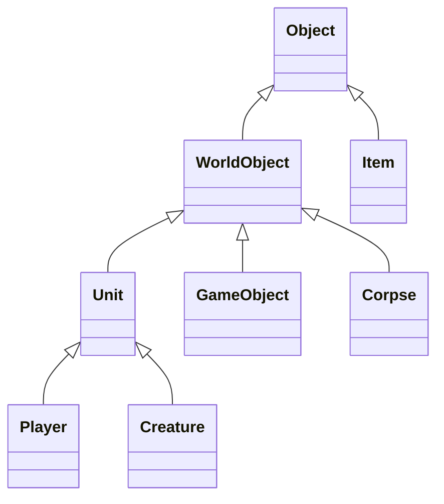

# 05. Eluna Scripting & Core Development Engine Handbook

> **Target Platform**: Turtle-WoW 1.18.1 (Build 7272) • CMaNGOS + Eluna Lua Engine
> **Source Verification**: `src/modules/Eluna/`, `hooks/Hooks.h`, **`methods/VMangos/`**, `mangosd.conf`, `src/game/Chat/Chat.cpp`
>
> ⚠️ **READ THIS BEFORE TRUSTING ANY METHOD NAME BELOW.** `src/modules/Eluna/methods/` contains **six** sibling adapter trees — `VMangos/`, `CMangos/`, `AzerothCore/`, `TrinityCore/`, `Mangos/`, plus `Methods.cpp`. Only **`methods/VMangos/`** is compiled. `src/game/CMakeLists.txt:527` globs `src/modules/Eluna/methods/VMangos/*.h` and nothing else, and `:681` defines `ELUNA_VMANGOS`. The other five trees are **dead code**: they are not compiled, not installed, and their APIs are *not* available to a live script. Several of them contain methods that VMangos lacks — `methods/AzerothCore/PlayerMethods.h` and `methods/TrinityCore/PlayerMethods.h` both carry full `SendAddonMessage` implementations that this build inherits only because VMangos happens to have its own. **Always open `methods/VMangos/<Class>Methods.h` before asserting that a method exists.** Every `file:line` in this document points at `methods/VMangos/` unless it says otherwise.
> **Security Coverage**: Security Levels 0–4 (Player, Moderator, GameMaster, Administrator, Console)
> **Master Portals**: [🏠 Master Portal (gm_commands.md)](../gm_commands.md) • [📜 Volume 01: GM Handbook](./01_game_master_handbook.md) • [🤖 Volume 02: Bot Automation](./02_playerbot_and_raid_automation.md) • [🗺️ Volume 03: World & Teleports](./03_turtle_world_and_teleports.md) • [⚔️ Volume 04: BiS Gear & Specs](./04_class_specs_and_endgame_gear.md) • [🤖 RandomBot Guide (rndbot_commands.md)](../rndbot_commands.md)

---

## 📑 Table of Contents

1. [Unified 5-Volume Master Reference Architecture](#unified-5-volume-master-reference-architecture)
2. [Orientation: What Eluna Can and Cannot Do Here](#0-orientation-what-eluna-can-and-cannot-do-here)
   - [The 16 registrars that actually exist](#16-registrars-actually-exist)
   - [Eluna vs. EventAI vs. SmartAI vs. C++](#eluna-vs-eventai-vs-smartai-vs-c--pick-the-right-tool)
   - [Where to start for raid and dungeon work](#where-to-start-for-raid-and-dungeon-work)
3. [Master Macro UI Cheat Sheet (Lua Developer & Server Ops)](#1-master-macro-ui-cheat-sheet-lua-developer--server-ops)
3. [Eluna Architecture & Runtime Configuration](#2-eluna-architecture--runtime-configuration)
   - [Engine Lifecycle & Script Discovery](#engine-lifecycle--script-discovery)
   - [Configuration Settings (mangosd.conf)](#configuration-settings-mangosdconf)
   - [In-Game Live Reload & Inspection Commands](#in-game-live-reload--inspection-commands)
4. [Exhaustive Event Registration Matrix (Hooks.h)](#3-exhaustive-event-registration-matrix-hooksh)
   - [⚠️ THE `RegisterMapEvent` TRAP — read before writing any hook](#-the-registermapevent-trap)
   - [Server & World Events (24 events)](#server--world-events-registerserverevent)
   - [Player Lifecycle & Combat Events (40+ IDs)](#player-lifecycle--combat-events-registerplayerevent)
   - [Creature & Boss AI Events (24 events)](#creature--boss-ai-events-registercreatureevent)
   - [GameObject & World Trigger Events (12 events)](#gameobject--world-trigger-events-registergameobjectevent)
   - [Spell System & Aura Hooks — ⛔ NOT AVAILABLE](#spell-system--aura-hooks-registerspellevent---not-available-in-this-build)
   - [Vehicle Events — ⛔ NOT AVAILABLE](#vehicle-events-registervehicleevent---not-available-in-this-build)
   - [⛔ Hook Registrars That Do Not Exist At All](#-hook-registrars-that-do-not-exist-at-all)
   - [Item Use & Equipment Events (8 events)](#item-use--equipment-events-registeritemevent)
   - [Gossip Dialog & Menu Interaction Events](#gossip-dialog--menu-interaction-events)
   - [Group, Guild, Battleground & Instance Events](#group-guild-battleground--instance-events)
5. [Complete Object & Entity Inheritance Architecture](#4-complete-object--entity-inheritance-architecture)
   - [Object Class (Base Entity)](#object-class-base-entity)
   - [WorldObject Class (Spatial 3D Coordinates & Radius)](#worldobject-class-spatial-3d-coordinates--radius)
   - [Unit Class (Combat, Health, Power, Auras & Immunities)](#unit-class-combat-health-power-auras--immunities)
   - [Player Class (Progression, Inventory, Teleports & UI)](#player-class-progression-inventory-teleports--ui)
   - [Creature Class (NPC AI, Waypoints & Boss Mechanics)](#creature-class-npc-ai-waypoints--boss-mechanics)
   - [GameObject Class (Interactive Chests, Doors & Nodes)](#gameobject-class-interactive-chests-doors--nodes)
   - [Item Class (Durability, Quality & Enchantments)](#item-class-durability-quality--enchantments)
   - [Spell & Aura Classes (Active Magic & Buffs)](#spell--aura-classes-active-magic--buffs)
   - [Map & BattleGround Classes (Spatial Environments)](#map--battleground-classes-spatial-environments)
   - [Guild & Group Classes (Social Organizations)](#guild--group-classes-social-organizations)
   - [WorldPacket Class & Addon Messaging Engine](#worldpacket-class--addon-messaging-engine)
   - [Quest Class (Progression & Flags)](#quest-class-progression--flags)
   - [Database Query Engine (WorldDBQuery & CharDBQuery)](#database-query-engine-worlddbquery--chardbquery)
   - [Object Variables Session Store — ✅ DEPLOYED (Session-Only)](#object-variables-session-store-objectvariablesext---deployed-session-only)
   - [Turtle-WoW SpellInfo Compatibility Layer](#turtle-wow-spellinfo-compatibility-layer)
6. [Complete Database Hot-Reload Target Catalog (.reload)](#5-complete-database-hot-reload-target-catalog-reload)
7. [Engine Pitfalls & Robust Scripting Patterns](#6-engine-pitfalls--robust-scripting-patterns)
   - [Engine Pitfalls: Consolidated Reference Table](#engine-pitfalls-consolidated-reference-table)
   - [The Timer API (`CreateLuaEvent` / `RegisterEvent`)](#the-timer-api-createluaevent--registerevent)
   - [Multi-Step Sequencing & Dry Run Patterns](#multi-step-sequencing--dry-run-patterns)
8. [Production Script Blueprints for Server Operators](#7-production-script-blueprints-for-server-operators)
   - [Blueprint 1: Custom In-Game Chat Commands (.buffme, .home, .unstuck)](#blueprint-1-custom-in-game-chat-commands-buffme-home-unstuck)
   - [Blueprint 2: World Boss Announcer, Reward Bounty & Realm Broadcast](#blueprint-2-world-boss-announcer-reward-bounty--realm-broadcast)
   - [Blueprint 3: First Login Starter Kit, Bags & Currency Grant](#blueprint-3-first-login-starter-kit-bags--currency-grant)
   - [Blueprint 4: Stateful Interactive Gossip Master (Teleporter & Healer)](#blueprint-4-stateful-interactive-gossip-master-teleporter--healer)
   - [Blueprint 5: Custom Instance Progression Gatekeeper & Key Validator](#blueprint-5-custom-instance-progression-gatekeeper--key-validator)
   - [Blueprint 6: Client Addon Communication Engine (SendAddonMessage)](#blueprint-6-client-addon-communication-engine-sendaddonmessage)
   - [Blueprint 7: Playerbot Coordinator via Eluna Engine](#blueprint-7-playerbot-coordinator-via-eluna-engine)
   - [Blueprint 8: Dynamic Loot Multiplier & Boss Bonus Drop Engine](#blueprint-8-dynamic-loot-multiplier--boss-bonus-drop-engine)

---

## Unified 5-Volume Master Reference Architecture

- **Volume 01: [Game Master & World Administration](./01_game_master_handbook.md)**
  -- 100% of GM commands, player progression, cheats, security, spawning, moderation, tickets, reloads & diagnostics.
- **Volume 02: [Playerbot & Raid Automation](./02_playerbot_and_raid_automation.md)**
  -- Complete .bot & .rndbot control, whisper shortcuts, strategy tokens (co/nc), .dc dungeon clear solver & raid macros.
- **Volume 03: [World, Dungeons & Teleports Directory](./03_turtle_world_and_teleports.md)**
  -- 647+ .tele tokens, Turtle-WoW 1.18.1 custom instances (Crescent Grove, Hateforge, Karazhan Crypts, Scarlet Citadel), keys & attunements.
- **Volume 04: [Class Specs & Endgame Gear Directory](./04_class_specs_and_endgame_gear.md)**
  -- All 9 Classes: per-class talent skeletons, 30 one-click gear loadout examples, Tier 1/2/3 set IDs, weapons, trinkets, enchants & DB-verified ability citations (spell IDs + talent rows).
- **Volume 05: Eluna Scripting & Core Development Engine** (Current File)
  -- Eluna Lua API, live reloads (.reload eluna), Event 42 Custom Command dispatch, SpellInfo layer & C++ hook mechanics.

---

## 0. Orientation: What Eluna Can and Cannot Do Here

Read this before §1. It answers "what is Eluna actually good for?" and — just
as important — where it will refuse to help.

### The one-paragraph version

Eluna is a **Lua event layer over the live world**. It reacts to things that
already happened (a player logged in, a creature died, a boss reached 50% HP)
and lets you run Lua in response. It is excellent for **convenience layers,
gating, orchestration and presentation**. It is **not** an encounter-state
machine, not a quest-content editor, and not a way to change what a spell or
item *is*.

### 16 registrars actually exist

This is the complete set. Anything not in this list does not exist as a Lua
global — calling it gives `attempt to call a nil value`.

```lua
-- World start/stop, config load, map lifecycle, weather, auctions, addon messages
RegisterServerEvent(eventId, function(event, ...) end)

-- Login, level, combat, loot, quest, trade, chat, talents, death/resurrect
RegisterPlayerEvent(eventId, function(event, player, ...) end)

-- Spawn, death, combat, damage, waypoints, emote, summons, AI update
RegisterCreatureEvent(entry, eventId, function(event, creature, ...) end)

-- Spawn, use, loot state, destroyed, damaged, dialog
RegisterGameObjectEvent(entry, eventId, function(event, go, ...) end)

-- Instance scripts (accepts event IDs 1-7, keyed on mapId)
RegisterMapEvent(mapId, eventId, function(event, instanceData, map, ...) end)

-- Use, equip, unequip, expire, quest accept
RegisterItemEvent(entry, eventId, function(event, player, item, ...) end)

-- Join, leave, leader change, disband, invite
RegisterGroupEvent(eventId, function(event, group, ...) end)

-- Create, disband, member add/remove, bank events, MOTD
RegisterGuildEvent(eventId, function(event, guild, ...) end)

-- Battleground start/end
RegisterBGEvent(eventId, function(event, bg, ...) end)

-- Raw client<->server packets (send and receive)
RegisterPacketEvent(opcode, function(event, packet, player) end)

-- Creature gossip menu
RegisterCreatureGossipEvent(entry, eventId, function(event, player, creature) end)

-- Player-opened gossip menu
RegisterPlayerGossipEvent(menuId, eventId, function(event, player, target) end)

-- GameObject gossip menu
RegisterGameObjectGossipEvent(entry, eventId, function(event, player, go) end)

-- Item-triggered gossip
RegisterItemGossipEvent(entry, eventId, function(event, player, item) end)

-- WARNING: Registers successfully but is NEVER REACHED -- use RegisterMapEvent instead
RegisterInstanceEvent(instanceId, eventId, function(event, instanceData, map) end)

-- One named creature by GUID
RegisterUniqueCreatureEvent(guid, instanceId, eventId, function(event, creature, ...) end)
```

Two more exist in the **AzerothCore and TrinityCore** trees but are **not
compiled**: `RegisterSpellEvent` and `RegisterVehicleEvent`. Spell and vehicle
*events* are enumerated in `hooks/Hooks.h` and appear in the Lua `events` table
— but there is no registrar to bind them, so subscribing is impossible. Do not
write them; see §3.

### ⚠️ The `RegisterMapEvent` trap

`RegisterInstanceEvent` accepts the call and returns success, but its bindings
are **never reached**. Use:

```lua
RegisterMapEvent(<mapId>, <1-7>, function(event, map, diff) ... end)
```

`RegisterInstanceEvent` registers successfully and then silently does nothing —
the worst possible failure mode, because it looks like it worked.

### ~915 methods are live, and Player dominates

Method counts taken from the compiled `methods/VMangos/*.h` registration tables:

```lua
-- Player: 267 methods
-- Unit: 168 methods
-- Globals: 91 methods
-- Creature: 85 methods
-- Item: 65 methods
-- WorldObject: 41 methods
-- Group: 27 methods
-- WorldPacket: 23 methods
-- GameObject: 20 methods
-- Object: 19 methods
```

`Player` and `Unit` together are the bulk of the surface, which is why most
useful automation is player- and creature-centric.

### Eluna vs. EventAI vs. SmartAI vs. C++ — pick the right tool

This is the decision that most often gets made wrong.

- **NPC combat behaviour, aggro, spell casts, follow** -> **EventAI / SmartAI**
  -- Data-driven, per-creature, zero code, already wired to every creature. Eluna's `on_ai_update` is a poor substitute — it fires on a tick and costs Lua time.
- **Boss phases, adds, doors, wipes** -> **C++ instance script**
  -- Eluna has no encounter state machine here. `InstanceData::GetBossState` is a read-only stub — there is no `SetBossState`. Writing a boss fight in Eluna means reimplementing state by hand.
- **Quest / item / spell content** -> **SQL**
  -- Eluna cannot create them. It reacts to them.
- **Gossip NPCs, teleporters, healers, vendors** -> **Eluna** (Recommended)
  -- The sweet spot — presentation and convenience, low risk.
- **Chat commands, broadcasts, onboarding** -> **Eluna** (Recommended)
  -- Pure convenience layer.
- **Cross-system orchestration (bots + dc + loot + rewards)** -> **Eluna** (Recommended)
  -- What `raid_automation.lua` is.
- **Loot tables, spawn placement, vendor inventories** -> **SQL**
  -- Data belongs in data.

The rule: **Eluna reacts, data defines, code simulates.** If you are reaching
for Eluna to *simulate* a boss, you want C++.

### What it genuinely cannot do

- **No encounter state machine.** No `SetBossState`, no `LoadObjectData`, no
  `UpdateCriteria`. All 35 instance scripts use the 1.12
  `SetData`/`GetData`/`Save`/`Load` pattern.
- **No spell or vehicle event subscription** (see registrars above).
- **No server-wide creature death hook.** `CreatureHooks.cpp` has no wildcard
  dispatch. Per-creature only.
- **No content authoring.** Quests, items, spells and loot tables are SQL.
- **No cross-thread work.** Lua runs on the world thread; never yield across an
  Eluna boundary (§7).

### Where to start for raid and dungeon work

Since raids and dungeons are the main interest, the realistic split is:

- **Encounter mechanics → C++** under `src/scripts/`, using `SetData`/`GetData`.
  See [Turtle WoW dungeon coverage](docs/core-audit/COVERAGE.md) for what
  already exists per map.
- **Bot orchestration and encounter helpers → Eluna.** Blueprint 7 in §8 is a
  working playerbot coordinator; `run/lua_scripts/raid_automation.lua` is a
  3,700-line production example of exactly this shape.
- **Roster, movement, pulling and wipe recovery → mod-dungeon-clear**, not
  Eluna. It already has a boss roster (`data/dc_roster.txt`), hazard grids,
  camp logic and a pull planner. Rebuilding those in Eluna would be strictly
  worse. See [Volume 02](./02_playerbot_and_raid_automation.md).

---

## 1. Master Macro UI Cheat Sheet (Lua Developer & Server Ops)

Copy and paste these macros directly into your World of Warcraft **Macro UI** (`/m`):

### 🔄 Macro 1: Hot-Reload Eluna Engine & Clear Script State

Instantly flushes the server Lua state, re-scans the script directory, and re-executes all scripts live without kicking players:

```lua
.reload eluna
.notify Eluna Lua scripts hot-reloaded successfully!
```

> 🛑 **Before any operator uses this macro, fix `Eluna.ReloadSecurityLevel`.** `run/mangosd.conf:2294` currently sets it to `0`, and the gate at `hooks/PlayerHooks.cpp:78` is `(!player || player->GetSession()->GetSecurity() >= ReloadSecurityLevel)`. With `0`, **every logged-in player, GM or not, can trigger this macro** — and each trigger wipes the entire Lua VM on every map, killing all timers and all script state. It should be `3` (Administrator). Also note this is a **whole-engine** operation: there is no per-script reload, so a syntax error in one file silently drops that file and nothing tells the player.
>
> 🛑 **`.notify` is ADMINISTRATOR-only, and so is this macro as a whole.** `Chat.cpp:885` registers `notify` at `SEC_ADMINISTRATOR` (a *different* top-level `notify` at `:204` maps to `HandleSuspiciousNotify` at `SEC_MODERATOR`, but that is not the one this macro calls). An ordinary player typing `.notify …` gets an access-denied message and no broadcast — the line simply does nothing. This is a **GM/operator console macro**, not a player macro.
>
> **A reload produces no client-visible confirmation.** Eluna logs `Executed %u Lua scripts in %u ms for map: %i, instance: %u` at INFO level (`LuaEngine.cpp:261`) — **check the server log**, not the chat window. Note that the log line names both a map id *and* an instance id: that is the per-`(map, instance)` state model at work.

### ⚡ Macro 2: Universal Content Hot-Reload Suite (Eluna + Creatures + GameObjects + Quests + Items)

Flushes and reloads all core content layers after editing database tables or Lua scripts:

```lua
.reload eluna
.reload quest_template
.reload creature_template
.reload item_template
.reload creature
.reload gameobject
.reload creature_loot_template
.reload gameobject_loot_template
.reload areatrigger_teleport
.notify Core database templates & Eluna reloaded!
```

> ⚠️ **Every subcommand below is verified present in the reload table at `src/game/Chat/Chat.cpp:537-649`.** An earlier revision of this macro used `.reload spell_template` and `.reload gameobject_template`, **neither of which exists in this fork** — both return *There is no such subcommand.* There is no `loot_tables` target either; loot is reloaded per family.

### 🔍 Macro 3: Live In-Game Target Inspection & GUID Probe

Outputs low-level runtime identifiers, coordinates, and entry IDs for scripting:

```lua
.npc info
.gobject target
.gps
```

---

## 2. Eluna Architecture & Runtime Configuration

### Engine Lifecycle & Script Discovery

Eluna embeds a Lua virtual machine inside the CMaNGOS world server (`mangosd`).

- **Runtime version:** **Lua 5.2.4** in this build. The version is a build-time choice, not a hardcoded fact: `CMakeLists.txt:45` declares `ELUNA_LUA_VERSION` with default `lua52` and allowed values `lua51|lua52|lua53|lua54`; `build/CMakeCache.txt` pins `ELUNA_LUA_VERSION:STRING=lua52`, and `dep/lualib/lua/CMakeLists.txt` fetches that tarball from lua.org with a pinned SHA256 and builds it as a static `lualib`. **If you reconfigure with a different `ELUNA_LUA_VERSION`, the 5.1 and >5.2 compatibility branches in `ElunaCompat.h:20-43` come into play** (notably `lua_pushglobaltable` is `#define`d to `LUA_GLOBALSINDEX` on 5.1).
- **One Lua state per (map, instance) pair** — *not* one per map. `Map` constructs its Eluna at `Map.cpp:231` as `m_elunaInfo = { ElunaInfoKey::MakeKey(GetId(), GetInstanceId()) }`, and `ElunaMgr.h:27-33` packs that key as `instanceId | (mapId << 32)`; `ElunaMgr::Create` (`ElunaMgr.cpp:24-31`) dedupes on it. **Every dungeon, raid and battleground instance therefore gets its own Eluna and its own `lua_State`, and every newly created instance re-runs every script from scratch.** A separate "global" state (key `GLOBAL_MAP_ID`=0xFFFFFFFF, instance 0) is created once at `World.cpp:2255-2259` with a null `Map`. **The practical consequence: file-scope `local`s, timers, and global tables are per-instance.** Two players in the same instance share one state; two players in two separate instances of the same dungeon do not. Any state a script wants to be world-wide must be re-derived or held in the database — it does not live in a per-instance Lua table. `ElunaConfig::ShouldMapLoadEluna()` gates which map *ids* are eligible at all, but it cannot filter by instance.

1. **Initialization** — at server startup, or on `.reload eluna`. `OpenLua()` creates the state with a plain `luaL_newstate()` (`LuaEngine.cpp:116`) and immediately calls `luaL_openlibs(L)` (`:124`), which is why the full standard library is reachable (**see pitfall #5 — there is no sandbox**).
2. **Script Discovery** — `ElunaLoader::ReadFiles` (`ElunaLoader.cpp:174-238`) recurses `Eluna.ScriptPath`, skipping dotfiles, and **derives a map id from the immediate subfolder name**. `lua_scripts/foo.lua` loads on every map; `lua_scripts/533/foo.lua` loads only on map 533. Paths are relative to the **process working directory**, which for `mangosd` is `run/`.
3. **Execution Order** — `.ext` extension files first, then `.lua` files, each sorted by path (`ElunaLoader.cpp:337-346`). `RunScripts` (`LuaEngine.cpp:212-265`) `require`s each one **individually**, inside its own `ExecuteCall`, and **continues past failures**. Duplicate basenames are rejected with an error and the later file is skipped (`:238-242`). Every registration is bound as the file runs.
4. **Thread Safety** — callbacks execute synchronously on the map's world-update thread, so there are no races on world entities. The cost of that model is that a slow or non-terminating script stalls the world update; **there is no VM guard to stop it** (pitfall #6).
5. **Object lifetime** — Eluna objects handed to Lua are valid **only for the duration of the call that received them**. They are stamped with a callstack id and invalidated when that call returns. Capturing one across a hook or timer boundary and using it later raises `... pointer to nonexisting (invalidated) object`. **Capture plain values (names, GUIDs, numbers) and re-resolve.** See Blueprint 7.

---

### Configuration Settings (`mangosd.conf`)

Every Eluna configuration key is registered in exactly one place: `src/modules/Eluna/ElunaConfig.cpp:32-53` (`ElunaConfig::Initialize`). Any key not in that function is **not read by the engine**, and any key in that function with a different spelling than shown here is **silently ignored** (`sConfig.GetBoolDefault` returns the supplied default for an unknown name — it does not warn).

Defaults below are the **code** defaults from `ElunaConfig::Initialize`, which are not always what `run/mangosd.conf` actually sets.

```ini
# Master switch. When false no map ever gets a Lua state (bool, default: true)
Eluna.Enabled = 1

# Installs a C traceback handler as the lua_pcall message handler (bool, default: false). Capital B.
Eluna.TraceBack = true

# Gates the .reload eluna interceptor in PlayerHooks.cpp (bool, default: true)
Eluna.ReloadCommand = true

# When false, replaces METHOD_FLAG_UNSAFE methods (WorldDBQuery, CharDBQuery, AuthDBQuery) with error closures (bool, default: true)
Eluna.UseUnsafeMethods = true

# Replaces METHOD_FLAG_DEPRECATED methods with error closures (bool, default: true, production: false)
Eluna.UseDeprecatedMethods = false

# DEAD KEY -- does nothing, no consumer exists in source (bool, default: false)
Eluna.ScriptReloader = false

# Root directory scanned for scripts relative to process working directory (string, default: "lua_scripts")
Eluna.ScriptPath = "./lua_scripts"

# Comma-separated map ids; empty means all maps. Tested against raw map id at map construction time (string, default: "")
Eluna.OnlyOnMaps = ""

# Extra package.path entries for Lua require (string, default: "")
Eluna.RequirePaths = ""

# Extra package.cpath entries for native shared objects (string, default: "")
Eluna.RequireCPaths = ""

# Minimum GetSecurity() required for .reload eluna: 1=Mod, 2=GM, 3=Admin (int, default: 3)
Eluna.ReloadSecurityLevel = 3
```

#### Dead and adjacent keys

- **`Eluna.ScriptReloader` is dead.** It is read into a config slot at `ElunaConfig.cpp:37`, but `grep -rn CONFIG_ELUNA_SCRIPT_RELOADER src/` returns only that read and the enum declaration at `ElunaConfig.h:16`. **Nothing consumes it.** There is no file-watcher, no change detection, no experimental auto-reload feature. Setting it to `1` does nothing whatsoever. Do not document it as a feature.
- **`ElunaErrorLogFile` is not an `Eluna.*` key.** It is a plain shared-Logging key, consumed at `src/shared/Log.cpp:384` under `#ifdef ENABLE_ELUNA` as `logFiles[LOG_ELUNA] = openLogFile("ElunaErrorLogFile", nullptr, "a+")`.

#### Live configuration in `run/mangosd.conf`

`run/mangosd.conf:2285-2295` currently contains:

```ini
Eluna.Enabled = 1
Eluna.TraceBack = true
Eluna.ReloadCommand = true
Eluna.UseUnsafeMethods = true
Eluna.UseDeprecatedMethods = false  ; <-- differs from code default (true)
Eluna.OnlyOnMaps = ""
Eluna.ScriptPath = "./lua_scripts"
Eluna.RequirePaths = ""
Eluna.RequireCPaths = ""
Eluna.ReloadSecurityLevel = 3
ElunaErrorLogFile = "ElunaErrors.log"
```

> ⚠️ **`Eluna.*` values are read once at world startup and never re-read.** `ElunaConfig::Initialize()` (`ElunaConfig.cpp:32-53`) is called from `World.cpp:2071-2072`, not from the `.reload config` handler. **Editing this block requires a full server restart to take effect** — `.reload config` will silently leave the old values in force.

Three keys were corrected from unsafe values on 2026-10-01. They are recorded here because the previous settings were live on a production realm and the reason for each choice matters:

1. **`Eluna.ReloadSecurityLevel = 3` (was `0`).** The gate at `PlayerHooks.cpp:78` is `(!player || player->GetSession()->GetSecurity() >= ReloadSecurityLevel)`, and `SEC_PLAYER` is `0` (`src/shared/Common.h:186`). A value of `0` therefore let **any logged-in player** type `.reload eluna` and trigger `_ReloadEluna` (`LuaEngine.cpp:32-52`), which erases **every timed event on every map**, closes the `lua_State`, reopens it, and re-runs every script — live, in front of them. `3` matches both the code default (`ElunaConfig.cpp:49`) and the shipped `mangosd.conf.dist.in:2431`. Note the `!player ||` clause: **console input bypasses this check entirely** regardless of the value.
2. **`Eluna.UseUnsafeMethods = true` (was `false`).** With it false, `WorldDBQuery` / `CharDBQuery` / `AuthDBQuery` are replaced by raising closures (`ElunaTemplate.h:336-341`), so Blueprint 8 fails to load. **Be aware this gate is only half-effective even when enabled:** the `WorldDBExecute` / `CharDBExecute` / `AuthDBExecute` variants are *not* flagged `METHOD_FLAG_UNSAFE` (verified identical in all four upstream method trees), so they remain callable regardless of this setting. The global `RunCommand` (`GlobalMethods.h:1189-1195`) is likewise unflagged and queues a `CliCommandHolder` at **`SEC_CONSOLE`** — any Lua script can run console-level GM commands.
3. **`Eluna.TraceBack = true` (was `false`).** Installs the C traceback handler as the `lua_pcall` message handler (`LuaEngine.cpp:326, 329-333`). Without it a Lua error logs only a bare message with no stack, which makes diagnosing a failing script during development materially harder.

> ⚠️ **`Eluna.UseDeprecatedMethods = false` is deliberately left as-is.** It differs from the code default (`true`) and that is correct — `true` re-enables methods upstream has marked for removal. Do not "fix" this one to match the code default.

---

### In-Game Live Reload & Inspection Commands

```lua
-- Flush Lua state, unbind all existing hooks, and re-execute all scripts (Gate: Eluna.ReloadSecurityLevel)
.reload eluna [map_id]

-- Broadcast a centered server-wide notice (Gate: SEC_ADMINISTRATOR = 3)
.notify <text>

-- Re-read mangosd.conf (Gate: SEC_ADMINISTRATOR = 3; Note: does not re-apply Eluna.* keys)
.reload config

-- Lua global log inspection functions (writes to server log file, never to chat window)
PrintInfo("Server log informational message")
PrintError("Server log error message")
PrintDebug("Server log debug message")
```

> ❌ **There is no `.eluna` chat command in this build.** Earlier revisions of this handbook listed one. It does not exist: there is no Eluna entry in the core chat command tables under `src/game/Chat/`, and `grep -rn '"eluna"' src/game/` returns nothing. Do not tell an operator to type it.

`.reload eluna` is worth understanding precisely, because it is **not a core command**. It is an interceptor *inside* Eluna:

1. The core parses `.reload eluna`, finds no such subcommand, and reaches the `CHAT_COMMAND_UNKNOWN_SUBCOMMAND` case at `src/game/Chat/Chat.cpp:1707-1720` (its sibling `CHAT_COMMAND_UNKNOWN` case, where a *top-level* unknown command such as `.buffme` actually lands, is at `:1721-1732`).
2. That branch calls `e->OnCommand(player, fullcmd)`.
3. `Eluna::OnCommand` (`hooks/PlayerHooks.cpp:75-99`) checks the security gate, and if the lowercase text starts with `reload eluna`, calls `sElunaLoader->ReloadElunaForMap(mapId)` and **returns `false`**.
4. Returning `false` makes `Chat.cpp` return immediately, suppressing the "no such subcommand" error.

Two consequences: an optional numeric argument becomes `RELOAD_ALL_STATES` when absent (`ElunaLoader.cpp:356-364`), and because `!player ||` short-circuits the gate, **console input always reloads regardless of `Eluna.ReloadSecurityLevel`**.

> ⚠️ `ElunaConfig::Initialize()` is called from world startup, not from the `.reload config` handler. **Reloading `mangosd.conf` does not re-apply `Eluna.*` values to a running process.** Eluna configuration changes require a server restart.

---

## 3. Exhaustive Event Registration Matrix (`Hooks.h`)

Verified directly against `src/modules/Eluna/hooks/Hooks.h`.

### Server & World Events (`RegisterServerEvent`)

> ### ⚠️ READ FIRST — which registrar to use
>
> **`Use `RegisterServerEvent(ev, fn)` for every world/map/player-lifecycle event. Use `RegisterMapEvent(mapId, ev, fn)` only for instance events 1-7. Never use `RegisterInstanceEvent`.**
>
> 🪦 **Corrected: an earlier revision of this box claimed `REGTYPE_MAP` "is read by nothing" and that `RegisterMapEvent` "would still never fire with correct arity". Both statements are FALSE.** `REGTYPE_MAP` is genuinely read, by `hooks/InstanceHooks.cpp:18` and `:28`. The real rule is different, and more useful:
>
> **`RegisterMapEvent` is not a map-event registrar at all — it is the *INSTANCE* event registrar, keyed on a map id.** `GlobalMethods.h:950-953` dispatches it to `RegisterEntryHelper(E, Hooks::REGTYPE_MAP)`, and `LuaEngine.cpp:875-877` accepts it only under `event_id < INSTANCE_EVENT_COUNT`:
> ```cpp
> case Hooks::REGTYPE_MAP:
> case Hooks::REGTYPE_INSTANCE:
>     if (event_id < Hooks::INSTANCE_EVENT_COUNT)
>         return RegisterEntryBinding<Hooks::InstanceEvents>(this, regtype, entry, event_id, functionRef, shots);
>     break;
> ```
> `INSTANCE_EVENT_COUNT` is **8** (`hooks/Hooks.h:494-509`). So the `MAP_EVENT_*` ids 17-35 that this document lists nearby are **rejected outright** — `RegisterMapEvent(45, 23, fn)` registers nothing and raises. And it takes **four** arguments: `RegisterMapEvent(mapId, ev, fn[, shots])`, because it goes through `RegisterEntryHelper` (`GlobalMethods.h:488-502`, reading stack 1,2,3,4) rather than `RegisterEventHelper` (`:504-517`, reading 1,2,3). Calling it with two arguments misreads the function as an event number:
> ```
> bad argument #2 to 'RegisterMapEvent' (number expected, got function)
> ```
> **This error has occurred in a live server log on this realm.**
>
> **`RegisterInstanceEvent` is the broken one.** It also targets `REGTYPE_INSTANCE` and *is* read by `InstanceHooks.cpp:19,29`, keyed on `GetInstanceId()`. But the gate that decides whether an `ElunaInstanceAI` is created at all (`LuaEngine.cpp:983-991`) probes with the **map id** against *both* registries:
> ```cpp
> auto key = Key(event_id, map->GetId());          // <-- map id, not instance id
> auto MapBindings      = GetBinding<Key>(Hooks::REGTYPE_MAP);
> auto InstanceBindings = GetBinding<Key>(Hooks::REGTYPE_INSTANCE);
> if (MapBindings->HasBindingsFor(key) || InstanceBindings->HasBindingsFor(key))
>     return new ElunaInstanceAI(map);
> ```
> So an instance-keyed registration only ever creates an AI when `instanceId == mapId`. Instance ids start at 101 (`src/game/Maps/Map.h:180`) while map ids are 0-600+, so **for any map with id < 101 the probe misses and no `ElunaInstanceAI` is ever created — your instance events silently do nothing.** This is inherited upstream (`eca1ccf`), not a fork change.
>
> **Practical rule for this realm:** drive instance behaviour off `RegisterMapEvent(<mapId>, <1-7>, fn)` — the map-id key matches the probe. Use `RegisterServerEvent` for everything else.
>
> The three registration helper families, for reference: `RegisterEventHelper` serves `RegisterServerEvent` (`:608`), `RegisterPlayerEvent` (`:687`), `RegisterGuildEvent` (`:724`), `RegisterGroupEvent` (`:756`), `RegisterBGEvent` (`:784`). `RegisterEntryHelper` serves the id-keyed ones: `RegisterPacketEvent`, `RegisterCreatureEvent`, `RegisterGameObjectEvent`, `RegisterItemEvent`, `RegisterMapEvent`, `RegisterInstanceEvent`, and the three gossip registrars. Third family, `RegisterUniqueHelper` (`:519`), serves `RegisterUniqueCreatureEvent` (keyed on `(event, ObjectGuid, instanceId)` — all three must match).

```lua
-- 1: SERVER_EVENT_ON_NETWORK_START - World socket network listener initialized
RegisterServerEvent(1, function(event) end)

-- 2: SERVER_EVENT_ON_NETWORK_STOP - Network listener stopped
RegisterServerEvent(2, function(event) end)

-- 3: SERVER_EVENT_ON_SOCKET_OPEN - Client TCP socket opened: (event, socket)
RegisterServerEvent(3, function(event, socket) end)

-- 4: SERVER_EVENT_ON_SOCKET_CLOSE - Client socket closed: (event, socket)
RegisterServerEvent(4, function(event, socket) end)

-- 5: SERVER_EVENT_ON_PACKET_RECEIVE - Raw packet received from client: (event, packet, player)
RegisterServerEvent(5, function(event, packet, player) end)

-- 6: SERVER_EVENT_ON_PACKET_RECEIVE_UNKNOWN - Unhandled packet opcode received: (event, packet, socket)
RegisterServerEvent(6, function(event, packet, socket) end)

-- 7: SERVER_EVENT_ON_PACKET_SEND - Packet dispatched to client: (event, packet, player)
RegisterServerEvent(7, function(event, packet, player) end)

-- 8: WORLD_EVENT_ON_OPEN_STATE_CHANGE - Realm open state altered: (event, openState)
RegisterServerEvent(8, function(event, openState) end)

-- 9: WORLD_EVENT_ON_CONFIG_LOAD - Configuration file reloaded: (event, reloadBool)
RegisterServerEvent(9, function(event, reloadBool) end)

-- 11: WORLD_EVENT_ON_SHUTDOWN_INIT - Clean server shutdown initiated: (event, code, mask)
RegisterServerEvent(11, function(event, code, mask) end)

-- 12: WORLD_EVENT_ON_SHUTDOWN_CANCEL - Server shutdown cancelled
RegisterServerEvent(12, function(event) end)

-- 13: WORLD_EVENT_ON_UPDATE - DEAD RAISER (never fires, zero call sites; use event 23 instead)
RegisterServerEvent(13, function(event) end)

-- 14: WORLD_EVENT_ON_STARTUP - World server finished initial boot sequence
RegisterServerEvent(14, function(event) end)

-- 15: WORLD_EVENT_ON_SHUTDOWN - World server process terminating
RegisterServerEvent(15, function(event) end)

-- 16: ELUNA_EVENT_ON_LUA_STATE_CLOSE - Lua state is tearing down
RegisterServerEvent(16, function(event) end)

-- 17: MAP_EVENT_ON_CREATE - Map loaded into memory: (event, map)
RegisterServerEvent(17, function(event, map) end)

-- 18: MAP_EVENT_ON_DESTROY - Map unloaded from memory: (event, map)
RegisterServerEvent(18, function(event, map) end)

-- 19: MAP_EVENT_ON_GRID_LOAD - Map grid cell loaded: (event, map, gridX, gridY)
RegisterServerEvent(19, function(event, map, gridX, gridY) end)

-- 20: MAP_EVENT_ON_GRID_UNLOAD - Map grid cell purged: (event, map, gridX, gridY)
RegisterServerEvent(20, function(event, map, gridX, gridY) end)

-- 21: MAP_EVENT_ON_PLAYER_ENTER - Player entered map: (event, map, player)
RegisterServerEvent(21, function(event, map, player) end)

-- 22: MAP_EVENT_ON_PLAYER_LEAVE - Player departed map: (event, map, player)
RegisterServerEvent(22, function(event, map, player) end)

-- 23: MAP_EVENT_ON_UPDATE - LIVE heartbeat tick (~50 ms per map): (event, map, diff_ms)
RegisterServerEvent(23, function(event, map, diff_ms) end)

-- 24: TRIGGER_EVENT_ON_TRIGGER - Player stepped into AreaTrigger: (event, player, triggerId)
RegisterServerEvent(24, function(event, player, triggerId) end)

-- 25: WEATHER_EVENT_ON_CHANGE - Zone weather altered: (event, zoneId, weatherState, grade)
RegisterServerEvent(25, function(event, zoneId, weatherState, grade) end)

-- 26: AUCTION_EVENT_ON_ADD - New auction listed: (event, auctionId, owner, item)
RegisterServerEvent(26, function(event, auctionId, owner, item) end)

-- 27: AUCTION_EVENT_ON_REMOVE - Auction cancelled or removed: (event, auctionId, owner, item)
RegisterServerEvent(27, function(event, auctionId, owner, item) end)

-- 28: AUCTION_EVENT_ON_SUCCESSFUL - Auction buyout/win processed: (event, auctionId, owner, buyer)
RegisterServerEvent(28, function(event, auctionId, owner, buyer) end)

-- 29: AUCTION_EVENT_ON_EXPIRE - Auction expired without buyer: (event, auctionId, owner, item)
RegisterServerEvent(29, function(event, auctionId, owner, item) end)

-- 30: ADDON_EVENT_ON_MESSAGE - Addon message received: (event, sender, type, prefix, msg, receiver)
RegisterServerEvent(30, function(event, sender, type, prefix, msg, receiver) end)

-- 31: WORLD_EVENT_ON_DELETE_CREATURE - Creature despawned/purged: (event, creature)
RegisterServerEvent(31, function(event, creature) end)

-- 32: WORLD_EVENT_ON_DELETE_GAMEOBJECT - GameObject despawned/purged: (event, gameobject)
RegisterServerEvent(32, function(event, gameobject) end)

-- 33: ELUNA_EVENT_ON_LUA_STATE_OPEN - Lua state initialized and ready
RegisterServerEvent(33, function(event) end)

-- 34: GAME_EVENT_START - Seasonal game event activated: (event, eventId)
RegisterServerEvent(34, function(event, eventId) end)

-- 35: GAME_EVENT_STOP - Seasonal game event stopped: (event, eventId)
RegisterServerEvent(35, function(event, eventId) end)
```

#### Why `MAP_EVENT_ON_UPDATE` (23) is the one to build on

`src/game/Maps/Map.cpp:1729-1733`:

```cpp
if (Eluna* eluna = GetEluna()) {
    eluna->UpdateEluna(t_diff);
    eluna->OnMapUpdate(this, t_diff);
}
```

Both calls happen on the same tick, and `UpdateEluna` runs **first**, which means timed events scheduled for this tick fire *before* the `MAP_EVENT_ON_UPDATE` handler. If a script mixes the two, a timer may have already mutated state that the tick handler then reads.

**Scope:** the `MAP_EVENT_ON_UPDATE` *callback* fires once per map tick, so a handler registered on map 0 runs for every instance of map 0 — **but each instance is backed by its own `lua_State`** (see *Engine Lifecycle*, defect above). Filter inside the handler (`map:GetInstanceId()`, `player:GetTypeId() == 4`) rather than assuming isolation.

#### `ADDON_EVENT_ON_MESSAGE` (30) — exact argument order

Verified against `hooks/ServerHooks.cpp:28-62`. The hook splits the incoming payload on the first tab character and pushes:

```cpp
HookPush(sender);        // Player
HookPush(type);          // uint32 chat channel
HookPush(prefix);        // text before the first '\t', or the whole msg if there is no tab
HookPush(content);       // text after the first '\t', or nil if there was no tab
// then exactly one of: receiver / guild / group / channelId / nil
```

So the Lua signature is `(event, sender, type, prefix, msg, receiver)` — note the fifth argument is the **message body**, and the sixth is polymorphic (a `Player`, `Guild`, `Group`, a bare channel id, or `nil`). `prefix` and `msg` are both non-nil only when the client sent a tab-separated payload.

---

### Player Lifecycle & Combat Events (`RegisterPlayerEvent`)

```lua
-- 1: PLAYER_EVENT_ON_CHARACTER_CREATE - Character created: (event, player)
RegisterPlayerEvent(1, function(event, player) end)

-- 2: PLAYER_EVENT_ON_CHARACTER_DELETE - Character deleted from realm: (event, guid)
RegisterPlayerEvent(2, function(event, guid) end)

-- 3: PLAYER_EVENT_ON_LOGIN - Player logged into game world: (event, player)
RegisterPlayerEvent(3, function(event, player) end)

-- 4: PLAYER_EVENT_ON_LOGOUT - Player logged out: (event, player)
RegisterPlayerEvent(4, function(event, player) end)

-- 5: PLAYER_EVENT_ON_SPELL_CAST - Spell successfully cast: (event, player, spell, skipCheck)
RegisterPlayerEvent(5, function(event, player, spell, skipCheck) end)

-- 6: PLAYER_EVENT_ON_KILL_PLAYER - Slain another player (PvP): (event, killer, victim)
RegisterPlayerEvent(6, function(event, killer, victim) end)

-- 7: PLAYER_EVENT_ON_KILL_CREATURE - Slain an NPC or boss: (event, killer, victim)
RegisterPlayerEvent(7, function(event, killer, victim) end)

-- 8: PLAYER_EVENT_ON_KILLED_BY_CREATURE - Slain by an NPC: (event, killer, victim)
RegisterPlayerEvent(8, function(event, killer, victim) end)

-- 9: PLAYER_EVENT_ON_DUEL_REQUEST - Duel challenged: (event, player, target)
RegisterPlayerEvent(9, function(event, player, target) end)

-- 10: PLAYER_EVENT_ON_DUEL_START - Duel started: (event, player, target)
RegisterPlayerEvent(10, function(event, player, target) end)

-- 11: PLAYER_EVENT_ON_DUEL_END - Duel finished: (event, winner, loser, duelType)
RegisterPlayerEvent(11, function(event, winner, loser, duelType) end)

-- 12: PLAYER_EVENT_ON_GIVE_XP - Experience gained: (event, player, amount, victim)
RegisterPlayerEvent(12, function(event, player, amount, victim) end)

-- 13: PLAYER_EVENT_ON_LEVEL_CHANGE - Level changed: (event, player, oldLevel)
RegisterPlayerEvent(13, function(event, player, oldLevel) end)

-- 14: PLAYER_EVENT_ON_MONEY_CHANGE - Gold/money altered: (event, player, amount)
RegisterPlayerEvent(14, function(event, player, amount) end)

-- 15: PLAYER_EVENT_ON_REPUTATION_CHANGE - Reputation gained: (event, player, factionId, standing, incremental)
RegisterPlayerEvent(15, function(event, player, factionId, standing, incremental) end)

-- 16: PLAYER_EVENT_ON_TALENTS_CHANGE - Talent tree modified: (event, player, points)
RegisterPlayerEvent(16, function(event, player, points) end)

-- 17: PLAYER_EVENT_ON_TALENTS_RESET - Talents reset at class trainer: (event, player, cost)
RegisterPlayerEvent(17, function(event, player, cost) end)

-- 18: PLAYER_EVENT_ON_CHAT - Public/say chat: (event, player, msg, type, lang)
RegisterPlayerEvent(18, function(event, player, msg, type, lang) end)

-- 19: PLAYER_EVENT_ON_WHISPER - Private whisper: (event, player, msg, type, lang, receiver)
RegisterPlayerEvent(19, function(event, player, msg, type, lang, receiver) end)

-- 20: PLAYER_EVENT_ON_GROUP_CHAT - Party chat: (event, player, msg, type, lang, group)
RegisterPlayerEvent(20, function(event, player, msg, type, lang, group) end)

-- 21: PLAYER_EVENT_ON_GUILD_CHAT - Guild chat: (event, player, msg, type, lang, guild)
RegisterPlayerEvent(21, function(event, player, msg, type, lang, guild) end)

-- 22: PLAYER_EVENT_ON_CHANNEL_CHAT - Custom channel chat: (event, player, msg, type, lang, channel)
RegisterPlayerEvent(22, function(event, player, msg, type, lang, channel) end)

-- 23: PLAYER_EVENT_ON_EMOTE - Visual emote played: (event, player, emoteId)
RegisterPlayerEvent(23, function(event, player, emoteId) end)

-- 24: PLAYER_EVENT_ON_TEXT_EMOTE - Text emote triggered: (event, player, textEmote, emoteNum, guid)
RegisterPlayerEvent(24, function(event, player, textEmote, emoteNum, guid) end)

-- 25: PLAYER_EVENT_ON_SAVE - Character saved to database: (event, player)
RegisterPlayerEvent(25, function(event, player) end)

-- 26: PLAYER_EVENT_ON_BIND_TO_INSTANCE - Saved/locked to instance ID: (event, player, difficulty, mapId, permanent)
RegisterPlayerEvent(26, function(event, player, difficulty, mapId, permanent) end)

-- 27: PLAYER_EVENT_ON_UPDATE_ZONE - Zone boundary crossed: (event, player, newZone, newArea)
RegisterPlayerEvent(27, function(event, player, newZone, newArea) end)

-- 28: PLAYER_EVENT_ON_MAP_CHANGE - Map transition completed: (event, player)
RegisterPlayerEvent(28, function(event, player) end)

-- 29: PLAYER_EVENT_ON_EQUIP - Item equipped: (event, player, item, bag, slot)
RegisterPlayerEvent(29, function(event, player, item, bag, slot) end)

-- 30: PLAYER_EVENT_ON_FIRST_LOGIN - Brand new character logged in for the very first time: (event, player)
RegisterPlayerEvent(30, function(event, player) end)

-- 31: PLAYER_EVENT_ON_CAN_USE_ITEM - Item validation check: (event, player, itemEntry)
RegisterPlayerEvent(31, function(event, player, itemEntry) end)

-- 32: PLAYER_EVENT_ON_LOOT_ITEM - Item picked up: (event, player, item, count)
RegisterPlayerEvent(32, function(event, player, item, count) end)

-- 33: PLAYER_EVENT_ON_ENTER_COMBAT - Entered combat: (event, player, enemy)
RegisterPlayerEvent(33, function(event, player, enemy) end)

-- 34: PLAYER_EVENT_ON_LEAVE_COMBAT - Dropped combat: (event, player)
RegisterPlayerEvent(34, function(event, player) end)

-- 35: PLAYER_EVENT_ON_REPOP - Released spirit after death: (event, player)
RegisterPlayerEvent(35, function(event, player) end)

-- 36: PLAYER_EVENT_ON_RESURRECT - Revived from corpse: (event, player)
RegisterPlayerEvent(36, function(event, player) end)

-- 37: PLAYER_EVENT_ON_LOOT_MONEY - Looted coin: (event, player, amount)
RegisterPlayerEvent(37, function(event, player, amount) end)

-- 38: PLAYER_EVENT_ON_QUEST_ABANDON - Quest abandoned: (event, player, questId)
RegisterPlayerEvent(38, function(event, player, questId) end)

-- 39: PLAYER_EVENT_ON_LEARN_TALENTS - Learned talent rank: (event, player, talentId, talentRank)
RegisterPlayerEvent(39, function(event, player, talentId, talentRank) end)

-- 40: PLAYER_EVENT_ON_ENVIRONMENTAL_DEATH - Died to falling/drowning/lava: (event, player, envType)
RegisterPlayerEvent(40, function(event, player, envType) end)

-- 41: PLAYER_EVENT_ON_TRADE_ACCEPT - Trade finalized: (event, player, target)
RegisterPlayerEvent(41, function(event, player, target) end)

-- 42: PLAYER_EVENT_ON_COMMAND - Custom chat command hook: (event, player, command). Return false to suppress core error
RegisterPlayerEvent(42, function(event, player, command) end)

-- 43: PLAYER_EVENT_ON_SKILL_CHANGE - Skill level advanced: (event, player, skillId, skillValue)
RegisterPlayerEvent(43, function(event, player, skillId, skillValue) end)

-- 44: PLAYER_EVENT_ON_LEARN_SPELL - Spell learned: (event, player, spellId)
RegisterPlayerEvent(44, function(event, player, spellId) end)

-- 45: PLAYER_EVENT_ON_ACHIEVEMENT_COMPLETE - Achievement earned: (event, player, achievementId)
RegisterPlayerEvent(45, function(event, player, achievementId) end)

-- 46: PLAYER_EVENT_ON_DISCOVER_AREA - Area discovered: (event, player, areaId)
RegisterPlayerEvent(46, function(event, player, areaId) end)

-- 47: PLAYER_EVENT_ON_UPDATE_AREA - Sub-area changed: (event, player, oldArea, newArea)
RegisterPlayerEvent(47, function(event, player, oldArea, newArea) end)

-- 48: PLAYER_EVENT_ON_TRADE_INIT - Trade window opened: (event, player, target)
RegisterPlayerEvent(48, function(event, player, target) end)

-- 49: PLAYER_EVENT_ON_SEND_MAIL - Mail sent: (event, player, recipientGuid)
RegisterPlayerEvent(49, function(event, player, recipientGuid) end)

-- 54: PLAYER_EVENT_ON_QUEST_STATUS_CHANGED - Quest state updated: (event, player, questId, status)
RegisterPlayerEvent(54, function(event, player, questId, status) end)
```

---

### Creature & Boss AI Events (`RegisterCreatureEvent`)

```lua
-- 1: CREATURE_EVENT_ON_ENTER_COMBAT - Engaged enemy target: (event, creature, target)
RegisterCreatureEvent(entry, 1, function(event, creature, target) end)

-- 2: CREATURE_EVENT_ON_LEAVE_COMBAT - Evaded or all enemies defeated: (event, creature)
RegisterCreatureEvent(entry, 2, function(event, creature) end)

-- 3: CREATURE_EVENT_ON_TARGET_DIED - Slain player or enemy: (event, creature, victim)
RegisterCreatureEvent(entry, 3, function(event, creature, victim) end)

-- 4: CREATURE_EVENT_ON_DIED - Boss or mob slain: (event, creature, killer)
RegisterCreatureEvent(entry, 4, function(event, creature, killer) end)

-- 5: CREATURE_EVENT_ON_SPAWN - Spawned into world: (event, creature)
RegisterCreatureEvent(entry, 5, function(event, creature) end)

-- 6: CREATURE_EVENT_ON_REACH_WP - Reached waypoint index: (event, creature, type, id)
RegisterCreatureEvent(entry, 6, function(event, creature, type, id) end)

-- 7: CREATURE_EVENT_ON_AIUPDATE - Creature AI tick (no underscore before UPDATE): (event, creature, diff_ms)
RegisterCreatureEvent(entry, 7, function(event, creature, diff_ms) end)

-- 8: CREATURE_EVENT_ON_RECEIVE_EMOTE - Received player emote: (event, creature, player, emoteId)
RegisterCreatureEvent(entry, 8, function(event, creature, player, emoteId) end)

-- 9: CREATURE_EVENT_ON_DAMAGE_TAKEN - Took damage: (event, creature, attacker, damage)
RegisterCreatureEvent(entry, 9, function(event, creature, attacker, damage) end)

-- 10: CREATURE_EVENT_ON_PRE_COMBAT - Threat calculated before aggro: (event, creature, target)
RegisterCreatureEvent(entry, 10, function(event, creature, target) end)

-- 11: (unused - no enum member)

-- 12: CREATURE_EVENT_ON_OWNER_ATTACKED - Minion's master was hit: (event, creature, target)
RegisterCreatureEvent(entry, 12, function(event, creature, target) end)

-- 13: CREATURE_EVENT_ON_OWNER_ATTACKED_AT - Minion's master attacked this creature: (event, creature, target)
RegisterCreatureEvent(entry, 13, function(event, creature, target) end)

-- 14: CREATURE_EVENT_ON_HIT_BY_SPELL - Hit by spell: (event, creature, caster, spellId)
RegisterCreatureEvent(entry, 14, function(event, creature, caster, spellId) end)

-- 15: CREATURE_EVENT_ON_SPELL_HIT_TARGET - Successfully cast spell on target: (event, creature, target, spellId)
RegisterCreatureEvent(entry, 15, function(event, creature, target, spellId) end)

-- 16-18: (unused - no enum members)

-- 19: CREATURE_EVENT_ON_JUST_SUMMONED_CREATURE - Creature spawned something: (event, creature, victim, summon)
RegisterCreatureEvent(entry, 19, function(event, creature, victim, summon) end)

-- 20: CREATURE_EVENT_ON_SUMMONED_CREATURE_DESPAWN - Its summon despawned: (event, creature, victim, summon)
RegisterCreatureEvent(entry, 20, function(event, creature, victim, summon) end)

-- 21: CREATURE_EVENT_ON_SUMMONED_CREATURE_DIED - Its summon died: (event, creature, victim, summon)
RegisterCreatureEvent(entry, 21, function(event, creature, victim, summon) end)

-- 22: CREATURE_EVENT_ON_SUMMONED - Spawned as minion/pet: (event, creature, summoner)
RegisterCreatureEvent(entry, 22, function(event, creature, summoner) end)

-- 23: CREATURE_EVENT_ON_RESET - Boss reset and evading back to home: (event, creature)
RegisterCreatureEvent(entry, 23, function(event, creature) end)

-- 24: CREATURE_EVENT_ON_REACH_HOME - Returned to spawn point: (event, creature)
RegisterCreatureEvent(entry, 24, function(event, creature) end)

-- 25: (unused - no enum member)

-- 26: CREATURE_EVENT_ON_CORPSE_REMOVED - Corpse cleaned from map: (event, creature)
RegisterCreatureEvent(entry, 26, function(event, creature) end)

-- 27: CREATURE_EVENT_ON_MOVE_IN_LOS - Moved into line of sight: (event, creature)
RegisterCreatureEvent(entry, 27, function(event, creature) end)

-- 28-29: (unused - no enum members)

-- 30: CREATURE_EVENT_ON_DUMMY_EFFECT - Scripted dummy effect: (event, creature, spellId, effIndex, target)
RegisterCreatureEvent(entry, 30, function(event, creature, spellId, effIndex, target) end)

-- 31: CREATURE_EVENT_ON_QUEST_ACCEPT - Quest started via this creature: (event, creature, player, quest)
RegisterCreatureEvent(entry, 31, function(event, creature, player, quest) end)

-- 32-33: (unused - no enum members)

-- 34: CREATURE_EVENT_ON_QUEST_REWARD - Quest finished via this creature: (event, creature, player, quest)
RegisterCreatureEvent(entry, 34, function(event, creature, player, quest) end)

-- 35: CREATURE_EVENT_ON_DIALOG_STATUS - Gossip dialog window state: (event, creature, player, status)
RegisterCreatureEvent(entry, 35, function(event, creature, player, status) end)

-- 36: CREATURE_EVENT_ON_ADD - Added to the world map: (event, creature)
RegisterCreatureEvent(entry, 36, function(event, creature) end)

-- 37: CREATURE_EVENT_ON_REMOVE - Removed from the world map: (event, creature)
RegisterCreatureEvent(entry, 37, function(event, creature) end)
```

---

### GameObject & World Trigger Events (`RegisterGameObjectEvent`)

```lua
-- 1: GAMEOBJECT_EVENT_ON_AIUPDATE - AI update tick (no underscore before UPDATE): (event, go, diff_ms)
RegisterGameObjectEvent(entry, 1, function(event, go, diff_ms) end)

-- 2: GAMEOBJECT_EVENT_ON_SPAWN - Spawned into map: (event, go)
RegisterGameObjectEvent(entry, 2, function(event, go) end)

-- 3: GAMEOBJECT_EVENT_ON_DUMMY_EFFECT - Scripted dummy effect: (event, go, spellId, effIndex)
RegisterGameObjectEvent(entry, 3, function(event, go, spellId, effIndex) end)

-- 4: GAMEOBJECT_EVENT_ON_QUEST_ACCEPT - Quest started via this GO: (event, go, player, quest)
RegisterGameObjectEvent(entry, 4, function(event, go, player, quest) end)

-- 5: GAMEOBJECT_EVENT_ON_QUEST_REWARD - Quest finished via this GO: (event, go, player, quest)
RegisterGameObjectEvent(entry, 5, function(event, go, player, quest) end)

-- 6: GAMEOBJECT_EVENT_ON_DIALOG_STATUS - Gossip dialog window state: (event, go, player, status)
RegisterGameObjectEvent(entry, 6, function(event, go, player, status) end)

-- 7: GAMEOBJECT_EVENT_ON_DESTROYED - Destructible GameObject destroyed: (event, go, player)
RegisterGameObjectEvent(entry, 7, function(event, go, player) end)

-- 8: GAMEOBJECT_EVENT_ON_DAMAGED - Destructible GameObject damaged: (event, go, player)
RegisterGameObjectEvent(entry, 8, function(event, go, player) end)

-- 9: GAMEOBJECT_EVENT_ON_LOOT_STATE_CHANGE - Loot state shifted: (event, go, state)
RegisterGameObjectEvent(entry, 9, function(event, go, state) end)

-- 10: GAMEOBJECT_EVENT_ON_GO_STATE_CHANGED - State altered (0=Active, 1=Ready): (event, go, state)
RegisterGameObjectEvent(entry, 10, function(event, go, state) end)

-- 11: (unused - no enum member)

-- 12: GAMEOBJECT_EVENT_ON_ADD - Added to world map: (event, go)
RegisterGameObjectEvent(entry, 12, function(event, go) end)

-- 13: GAMEOBJECT_EVENT_ON_REMOVE - Removed from world map: (event, go)
RegisterGameObjectEvent(entry, 13, function(event, go) end)

-- 14: GAMEOBJECT_EVENT_ON_USE - Player clicked/opened chest or door: (event, go, player)
RegisterGameObjectEvent(entry, 14, function(event, go, player) end)
```

---

### Spell System & Aura Hooks (`RegisterSpellEvent`) — ⛔ NOT AVAILABLE IN THIS BUILD

> ### 🪦 This entire table is documented-but-unreachable.
>
> **There is no `RegisterSpellEvent` function in this build.** It is not in `methods/VMangos/GlobalMethods.h`, and nothing ever populates the `REGTYPE_SPELL` bindings that `START_HOOK` reads.
>
> ⚠️ **Corrected mechanism:** an earlier revision claimed `hooks/SpellHooks.cpp` "is not compiled at all". That is wrong — `src/game/CMakeLists.txt:524-525` globs `src/modules/Eluna/hooks/*.cpp`, which **includes `SpellHooks.cpp` on every non-MSVC build**; `:552-553` only removes and re-adds a *substituted copy* under `if(MSVC)`. The file is built. **The hooks are unreachable for a different reason:** the missing registrar. Nothing in Lua can add a binding to `REGTYPE_SPELL`, so every `START_HOOK(SpellEvents)` lookup returns empty and each hook returns immediately.
>
> The event **IDs** below are transcribed from the `ELUNA_VMANGOS` branch of `SPELL_EVENTS_LIST` at `hooks/Hooks.h:388-412`. (Earlier revisions of this table were fabricated — `SPELL_EVENT_ON_PREPARE`, `_ON_CANCEL`, `_ON_FINISH` and `_ON_TAKE_POWER` **do not exist as enum members in this branch**.) Nothing in a Lua script can subscribe to any of them. **Do not write `RegisterSpellEvent(...)`.** It will fail with `attempt to call a nil value (global 'RegisterSpellEvent')`.
>
> The event-ID table is retained because it documents the enum, which is still the reference for what the spell hooks *would* be called if the registrar existed. It is **not** an API reference.
>
> **What to use instead:** the `Spell` and `Aura` object classes (see §4, *Spell & Aura Classes*) let you *read and act on* a cast or aura you were handed from another hook.
>
> ⚠️ **But you cannot pull a `Spell` object out of most of the events that do fire.** The creature spell hooks push `spell->Id` as a bare **uint32**, not a `Spell*` — `CreatureHooks.cpp:288` and `:298` are literally annotated `// Pass spell object?`. So `CREATURE_EVENT_ON_HIT_BY_SPELL` (14) and `CREATURE_EVENT_ON_SPELL_HIT_TARGET` (15) hand you a **number**, and you must re-resolve with `GetSpellInfo(spellId)` (a Turtle-local class, not the live `Spell`) if you want template data. There is also no `MAP_EVENT_ON_TRIGGER` enum member — the area-trigger event is `TRIGGER_EVENT_ON_TRIGGER` (24), and it pushes a **trigger id**, not a Spell.
>
> **`PLAYER_EVENT_ON_SPELL_CAST` (5) is the one source that pushes a real `Spell*`** (`PlayerHooks.cpp:408-414`), signature `(event, player, spell, skipCheck)`. If a live spell *object* is required, that is the only hook that provides one.

```lua
-- ⛔ NOTE: RegisterSpellEvent does not exist in this build. These enums document what would be called if registrar existed.
-- 1: SPELL_EVENT_ON_CAST - Spell initiated: (event, spell, skipCheck) [Status: no registrar]
-- 2: SPELL_EVENT_ON_AURA_APPLICATION - Aura applied: (event, spell, ...) [Status: no registrar]
-- 3: SPELL_EVENT_ON_DISPEL - Aura dispelled: (event, spell, ...) [Status: no registrar]
-- 4: SPELL_EVENT_ON_PERIODIC_TICK - Periodic tick fired: (event, spell, ...) [Status: no registrar]
-- 5: SPELL_EVENT_ON_PERIODIC_UPDATE - Periodic timer updated: (event, spell, ...) [Status: no registrar]
-- 6: SPELL_EVENT_ON_AURA_CALC_AMOUNT - Aura amount being calculated: (event, spell, ...) [Status: no registrar]
-- 7: SPELL_EVENT_ON_CALC_PERIODIC - Periodic interval being calculated: (event, spell, ...) [Status: no registrar]
-- 8-9: (invalid - Not valid for VMaNGOS)
-- 10: SPELL_EVENT_ON_CHECK_CAST - Pre-cast validation: (event, spell) [Status: no registrar]
-- 11: SPELL_EVENT_ON_BEFORE_CAST - Immediately before the cast executes: (event, spell) [Status: no registrar]
-- 12: SPELL_EVENT_ON_AFTER_CAST - After the cast executes: (event, spell) [Status: no registrar]
-- 13: SPELL_EVENT_ON_OBJECT_AREA_TARGET - Area-target set built: (event, spell, ...) [Status: no registrar]
-- 14: SPELL_EVENT_ON_OBJECT_TARGET - Object-target set built: (event, spell, ...) [Status: no registrar]
-- 15: (invalid - Not valid for VMaNGOS)
-- 16: SPELL_EVENT_ON_EFFECT_LAUNCH - Effect launched at caster: (event, spell, ...) [Status: no registrar]
-- 17: SPELL_EVENT_ON_EFFECT_LAUNCH_TARGET - Effect launched at target: (event, spell, ...) [Status: no registrar]
-- 18: (invalid - Not valid for VMaNGOS)
-- 19: SPELL_EVENT_ON_EFFECT_HIT - Effect damage/heal computed: (event, spell, ...) [Status: no registrar]
-- 20: SPELL_EVENT_ON_BEFORE_HIT - Immediately before the hit lands: (event, spell, ...) [Status: no registrar]
-- 21: SPELL_EVENT_ON_EFFECT_HIT_TARGET - Effect hit on target: (event, spell, ...) [Status: no registrar]
-- 22: SPELL_EVENT_ON_HIT - Hit applied: (event, spell, ...) [Status: no registrar]
-- 23: SPELL_EVENT_ON_AFTER_HIT - Hit finished: (event, spell, ...) [Status: no registrar]
```

### Vehicle Events (`RegisterVehicleEvent`) — ⛔ NOT AVAILABLE IN THIS BUILD

**There is no `RegisterVehicleEvent` function.** `methods/VMangos/VehicleMethods.h` is compiled (it is in the `:527` glob) but registers **no** hook-registration entry; `hooks/VehicleHooks.cpp` exists but is likewise not wired to any Lua registrar. Vehicle **object methods** from that header do exist — but the event subscription surface does not.

---

### ⛔ Hook Registrars That Do Not Exist At All

Verified by enumerating the complete `GlobalMethods[]` table at `methods/VMangos/GlobalMethods.h:2905-2923`, which is the exhaustive list of hook registrars this build exposes:

- `RegisterPacketEvent` -- Available (`RegisterEventHelper`)
- `RegisterServerEvent` -- Available (use this for all map/world/server hooks)
- `RegisterPlayerEvent` -- Available
- `RegisterGuildEvent` -- Available
- `RegisterGroupEvent` -- Available
- `RegisterBGEvent` -- Available
- `RegisterCreatureEvent` -- Available
- `RegisterUniqueCreatureEvent` -- Available (`RegisterUniqueHelper`)
- `RegisterGameObjectEvent` -- Available
- `RegisterItemEvent` -- Available
- `RegisterCreatureGossipEvent` -- Available
- `RegisterGameObjectGossipEvent` -- Available
- `RegisterItemGossipEvent` -- Available
- `RegisterPlayerGossipEvent` -- Available
- `RegisterInstanceEvent` -- Available (registered but effectively unreachable; AI-creation probe uses map ID, not instance ID)
- `RegisterMapEvent` -- Available (INSTANCE registrar keyed on map ID, accepting only event IDs 1-7)
- `RegisterSpellEvent` -- Does not exist (calling raises nil error)
- `RegisterVehicleEvent` -- Does not exist (calling raises nil error)
- `RegisterMapGossipEvent` -- Does not exist (calling raises nil error)

Each `Register*Event` also has a matching `Clear*Events` counterpart in the same table (`:2924-2941`).

---

### Item Use & Equipment Events (`RegisterItemEvent`)

```lua
-- 1: ITEM_EVENT_ON_DUMMY_EFFECT - Scripted dummy effect triggered: (event, player, spellId, effIndex, item)
RegisterItemEvent(entry, 1, function(event, player, spellId, effIndex, item) end)

-- 2: ITEM_EVENT_ON_USE - Item right-clicked: (event, player, item, target)
RegisterItemEvent(entry, 2, function(event, player, item, target) end)

-- 3: ITEM_EVENT_ON_QUEST_ACCEPT - Quest starter item clicked: (event, player, item, quest)
RegisterItemEvent(entry, 3, function(event, player, item, quest) end)

-- 4: ITEM_EVENT_ON_EXPIRE - Temporary item duration expired: (event, player, itemEntry)
RegisterItemEvent(entry, 4, function(event, player, itemEntry) end)

-- 5: ITEM_EVENT_ON_REMOVE - Item removed from a slot or destroyed: (event, player, item, slot)
RegisterItemEvent(entry, 5, function(event, player, item, slot) end)

-- 6: ITEM_EVENT_ON_ADD - Item added to an inventory slot: (event, player, item, slot)
RegisterItemEvent(entry, 6, function(event, player, item, slot) end)

-- 7: ITEM_EVENT_ON_EQUIP - Item placed into character equipment slot: (event, player, item, slot)
RegisterItemEvent(entry, 7, function(event, player, item, slot) end)

-- 8: ITEM_EVENT_ON_UNEQUIP - Item removed from equipment slot: (event, player, item, slot)
RegisterItemEvent(entry, 8, function(event, player, item, slot) end)
```

---

### Gossip Dialog & Menu Interaction Events

Create custom NPC, item, and player dialog trees with multi-page responses:

- `RegisterCreatureGossipEvent(creatureEntry, 1, OnHello)`: Fired on NPC right-click.
- `RegisterCreatureGossipEvent(creatureEntry, 2, OnSelect)`: Fired when player clicks gossip option.
- `RegisterGameObjectGossipEvent(goEntry, 1, OnHello)`: Fired on GameObject click.
- `RegisterGameObjectGossipEvent(goEntry, 2, OnSelect)`: Fired on GameObject option click.
- `RegisterItemGossipEvent(itemEntry, 1, OnHello)`: Fired when using scripted item with gossip.
- `RegisterItemGossipEvent(itemEntry, 2, OnSelect)`: Fired on item gossip selection.
- `RegisterPlayerGossipEvent(menuId, 2, OnSelect)`: Fired on player-to-player gossip dialogs.

---

### Group, Guild, Battleground & Instance Events

- **Group** (`RegisterGroupEvent`):
  - `1`: `GROUP_EVENT_ON_MEMBER_ADD` `(event, group, playerGuid)`
  - `2`: `GROUP_EVENT_ON_MEMBER_INVITE` `(event, group, playerGuid)`
  - `3`: `GROUP_EVENT_ON_MEMBER_REMOVE` `(event, group, playerGuid, method)`
  - `4`: `GROUP_EVENT_ON_LEADER_CHANGE` `(event, group, newLeaderGuid, oldLeaderGuid)`
  - `5`: `GROUP_EVENT_ON_DISBAND` `(event, group)`
- **Guild** (`RegisterGuildEvent`):
  - `1`: `GUILD_EVENT_ON_ADD_MEMBER` `(event, guild, player, rank)`
  - `2`: `GUILD_EVENT_ON_REMOVE_MEMBER` `(event, guild, player, isDisband)`
  - `5`: `GUILD_EVENT_ON_CREATE` `(event, guild, leader, guildName)`
  - `6`: `GUILD_EVENT_ON_DISBAND` `(event, guild)`
  - `7`: `GUILD_EVENT_ON_MONEY_WITHDRAW` `(event, guild, player, amount, isRepair)`
  - `8`: `GUILD_EVENT_ON_MONEY_DEPOSIT` `(event, guild, player, amount)`
- **Battleground** (`RegisterBGEvent`):
  - `1`: `BG_EVENT_ON_START` `(event, bg, bgId, instanceId)`
  - `2`: `BG_EVENT_ON_END` `(event, bg, bgId, instanceId, winnerTeam)`
- **Instance** (`RegisterInstanceEvent`):
  - `1`: `INSTANCE_EVENT_ON_INITIALIZE` `(event, instanceData, map)`
  - `2`: `INSTANCE_EVENT_ON_LOAD` `(event, instanceData, map)`
  - `3`: `INSTANCE_EVENT_ON_UPDATE` `(event, instanceData, map, diff_ms)`
  - `4`: `INSTANCE_EVENT_ON_PLAYER_ENTER` `(event, instanceData, map, player)`
  - `5`: `INSTANCE_EVENT_ON_CREATURE_CREATE` `(event, instanceData, map, creature)`
  - `6`: `INSTANCE_EVENT_ON_GAMEOBJECT_CREATE` `(event, instanceData, map, gameObject)`
  - `7`: `INSTANCE_EVENT_ON_CHECK_ENCOUNTER_IN_PROGRESS` `(event, instanceData, map)`

> ⚠️ **Register these with `RegisterMapEvent(<mapId>, <1-7>, fn)`, not `RegisterInstanceEvent`** — see the registrar box at the top of §3. `RegisterInstanceEvent` registers successfully but its bindings are never reached.

---

## 4. Complete Object & Entity Inheritance Architecture

Eluna mirrors the native CMaNGOS C++ class hierarchy. Understanding inheritance eliminates redundant code and unlocks the full power of the core:



---

### Object Class (Base Entity)

Base class for all entities in the game world, inventory, or memory (`ObjectMethods.h`):

```lua
obj:GetGUID()                                    -- 64-bit globally unique identifier
obj:GetEntry()                                   -- Template ID (creature_template, item_template)
obj:GetTypeId()                                  -- Type (TYPEID_OBJECT, TYPEID_ITEM, TYPEID_UNIT, etc.)
obj:IsInWorld()                                  -- True if entity is added to an active map grid
obj:GetScale(), obj:SetScale(scale)              -- Visual size scale factor (1.0 = normal)
obj:GetInt32Value(index), obj:SetInt32Value(index, val)   -- Low-level UpdateField access
obj:GetUInt32Value(index), obj:SetUInt32Value(index, val) -- Low-level UpdateField access
obj:GetFloatValue(index), obj:SetFloatValue(index, val)   -- Low-level UpdateField access
obj:HasFlag(index, flag), obj:SetFlag(index, flag)        -- Bitmask check and manipulation
obj:RemoveFlag(index, flag)                               -- Clears bitmask flag
```

---

### WorldObject Class (Spatial 3D Coordinates & Radius)

Inherits from `Object`. Represents any entity existing in 3D world space (`WorldObjectMethods.h`):

```lua
-- Coordinates & Orientation
wObj:GetMapId(), wObj:GetInstanceId()            -- Current map ID and instance ID
wObj:GetX(), wObj:GetY(), wObj:GetZ(), wObj:GetO() -- Exact 3D coordinates and facing orientation
wObj:GetZoneId(), wObj:GetAreaId()               -- Zone and sub-area IDs
wObj:GetMap()                                    -- Returns Map object

-- Spatial Calculations & Distances
wObj:GetDistance(target)                         -- 3D Euclidean distance in yards
wObj:GetDistance2d(target)                       -- 2D horizontal distance in yards
-- 🪦 wObj:GetDistanceZ(target) DOES NOT EXIST in this build. There is no
--    vertical-only distance method. Compute it yourself, or use GetDistance.
wObj:GetAngle(target)                            -- Absolute radian angle to target
-- 🪦 wObj:GetRelativeAngle(target) DOES NOT EXIST. Only the absolute GetAngle.
wObj:IsWithinDist(target, yards)                 -- Fast spherical radius distance check
wObj:IsWithinDist2d(target, yards)               -- Fast cylindrical radius distance check
wObj:IsWithinLoS(target)                         -- Line of Sight Raycast check (navmesh/vmap)

-- Radius Queries (Entity Gathering)
-- ✅ These four are the REAL set. There is no GetNearPlayers /
--    GetNearCreatures / GetNearGameObjects in this build -- use GetNearObjects
--    with a type filter, and the three GetNearest* single-object variants.
wObj:GetNearObjects(range, type)                 -- Lua array of WorldObjects within range
wObj:GetNearObject(range, type)                  -- Closest WorldObject of `type` within range
wObj:GetNearestPlayer(range)                     -- Closest Player object
wObj:GetNearestCreature(range, entry)            -- Closest Creature matching template entry
wObj:GetNearestGameObject(range, entry)          -- Closest GameObject matching template entry

-- In-World Spawning & Media
-- 🪦 SpawnCreature takes SEVEN optional-after-entry arguments, and the 6th is
--    NOT the despawn timer (WorldObjectMethods.h:643-651):
--      SpawnCreature(entry, x, y, z, o, spawnType, despawnTimer)
--    spawnType defaults to 8, despawnTimer defaults to 0. Passing only 6 args
--    puts your timer into spawnType and silently changes the despawn policy
--    (a timer value is not in 1..8, so it hits the `default:` arm and raises
--    `valid SpawnType expected` -- or, for a small in-range value, gets a
--    despawn policy you did not ask for). spawnType values, mapped from
--    TempSummonType (src/game/Objects/Object.h:86-99):
--      1 = timed or dead despawn    2 = timed or corpse       3 = timed
--      4 = timed, out of combat     5 = corpse                6 = corpse, timed
--      7 = dead                     8 = manual / default
--    Values 9-11 exist in the C++ enum but are NOT accepted by the switch --
--    anything outside 1..8 raises `valid SpawnType expected`.
wObj:SpawnCreature(entry, x, y, z, o, spawnType, despawnTimer) -- Spawns dynamic NPC at coordinates
wObj:SummonGameObject(entry, x, y, z, o, respawnTime) -- Spawns dynamic GO at coordinates
wObj:PlayDirectSound(soundId, player)            -- Plays client UI sound directly
wObj:PlayDistanceSound(soundId, player)          -- Plays spatial 3D audio in world
```

---

### Unit Class (Combat, Health, Power, Auras & Immunities)

Inherits from `WorldObject`. Core class for all living combatants (`Player` and `Creature`) (`UnitMethods.h`):

```lua
-- Health & Power
unit:GetHealth(), unit:SetHealth(hp)             -- Current hit points
unit:GetMaxHealth(), unit:SetMaxHealth(maxHp)    -- Maximum hit points
unit:GetPower(type), unit:SetPower(type, val)    -- 0=Mana, 1=Rage, 2=Focus, 3=Energy, 4=Happiness
unit:GetMaxPower(type)                           -- Maximum power capacity
unit:IsAlive(), unit:IsDead(), unit:IsDying()    -- Vitality states

-- Combat & Threat
unit:Attack(target, meleeAttack)                 -- Engages target in melee combat
unit:AttackStop()                                -- Terminate current attack
unit:GetVictim()                                 -- Current combat focus target
-- 🪦 unit:SetVictim(target) DOES NOT EXIST. GetVictim is read-only; there is
--    no victim setter. Use Attack()/SetInCombatWith() to change engagement.
unit:IsInCombat()                                -- True if unit has active threat entries
unit:ClearInCombat()                             -- Drops the unit out of combat
unit:SetInCombatWith(target)                     -- Forces mutual combat state
unit:IsStopped(), unit:MoveStop()                -- Movement halt state / command

-- Spellcasting & Auras
unit:CastSpell(target, spellId, triggered)       -- Casts spell (triggered=true skips cast time/mana)
-- 🪦 CastSpell RETURNS NOTHING, EVER, AND FAILS SILENTLY on a bad id. It ends
--    `return 0;` on BOTH paths (UnitMethods.h:1948-1960), and on an unknown
--    spell id it returns before casting anything:
--        SpellEntry const* spellEntry = sSpellMgr.GetSpellEntry(spell);
--        if (!spellEntry)
--            return 0;
--    No error, no nil, no log -- the call just does nothing. NEVER document it as
--    returning bool and NEVER write `if unit:CastSpell(...) then`: the test would
--    always read false, so a legitimate cast looks like a failure. Validate the id
--    yourself first (GetSpellInfo raises on an unknown id, so use it as a probe
--    inside a pcall, or keep your own id list).
-- 🪦 CastCustomSpell arg order (UnitMethods.h:1975-1988) — `triggered` is NOT
--    the last argument. Reads: target(2), spellId(3), triggered(4),
--    bp0(5), bp1(6), bp2(7), castItem(8), originalCaster(9).
--    Passing bp0 in the triggered slot coerces it to bool and shifts every
--    basepoint by one.
unit:CastCustomSpell(target, spellId, triggered, bp0, bp1, bp2, castItem, originalCaster)
unit:AddAura(spellId, target)                    -- Applies buff/debuff aura
unit:RemoveAura(spellId)                         -- Dispels active aura
unit:HasAura(spellId)                            -- True if aura is active
unit:GetAura(spellId)                            -- Returns Aura object

-- Immunities & Mechanics
-- 🪦 unit:SetImmuneTo(mechanicId, apply) IS AN ERROR STUB (METHOD_REG_NONE).
--    There is NO way to set a CC immunity from Lua in this build. Calling it
--    raises "attempt to call method 'SetImmuneTo' that is not implemented for
--    this emulator". See pitfall #3.
-- 🪦 unit:IsStandState() takes ZERO ARGUMENTS and returns a BOOLEAN. It is a
--    "is this unit currently standing up" test, NOT a getter for the state value
--    (UnitMethods.h:47-51):
--        int IsStandState(Eluna* E, Unit* unit)
--        {
--            E->Push(unit->IsStandingUp());
--            return 1;
--        }
--    There is no way to READ a unit's stand state from Lua -- only to set it.
-- ⚠️ SetStandState(state) takes one REQUIRED uint8 (UnitMethods.h:1529-1535) and
--    performs NO bounds validation, so an out-of-range value is passed straight
--    through to unit->SetStandState().
-- ⚠️ StandState values (UnitDefines.h:75-88): 0=Stand, 1=Sit, 2=SitChair,
--    3=Sleep, 4=SitLowChair, 5=SitMediumChair, 6=SitHighChair, 7=Dead, 8=Kneel
--    (MAX_UNIT_STAND_STATE = 9). This fork's enum carries FOUR distinct chair
--    states plus Sleep/Dead/Kneel -- it is NOT the retail UnitStandState set, so
--    any retail-derived table copied into a script will be wrong.
unit:IsStandState()                             -- 🪦 zero args; true if the unit is standing
unit:SetStandState(state)                       -- ⚠️ 7 is DEAD, not Sleep; Sleep is 3; 8 is Kneel

-- Visuals, Morphs & Faction
unit:SetFaction(factionId)                       -- Changes hostility/friendship reaction
unit:GetFaction()                                -- Returns active faction template ID
unit:SetDisplayId(modelId)                       -- Morphs visual model
unit:DeMorph()                                   -- Restores native creature/player model
-- ✅ The real emote methods are PerformEmote / SendUnitEmote / EmoteState.
--    There is no bare unit:Emote(emoteId) in this build.
unit:PerformEmote(emoteId)                       -- Plays a full animation emote
unit:SendUnitEmote(emoteId)                      -- Plays a one-shot visual emote
-- 🪦 FLIGHT SPEED IS NOT SETTABLE FROM LUA. The accepted range is 0-5 ONLY
--    (UnitDefines.h:22-32): 0=Walk, 1=Run, 2=RunBack, 3=Swim, 4=SwimBack,
--    5=TurnRate. MAX_MOVE_TYPE=6, and BOTH accessors reject anything >= 6 with a
--    raised luaL_argerror rather than silently clamping --
--    "valid UnitMoveType expected":
--        uint32 type = E->CHECKVAL<uint32>(2);
--        if (type >= MAX_MOVE_TYPE)
--            return luaL_argerror(E->L, 2, "valid UnitMoveType expected");
--    (UnitMethods.h:1117-1118 in GetSpeed, :1252-1253 in SetSpeed.) So types 6/7/8
--    -- MOVE_FLIGHT, MOVE_FLIGHT_BACK, MOVE_PITCH_RATE -- RAISE and are simply
--    unreachable from Lua; there is no way to set a flight or pitch rate here.
--    🪦 The doc-comments inside Eluna's own headers advertise flight types, which
--    is where the mistake comes from. Writing "4 = Flight" does not set flight
--    either -- 4 is legitimately SWIM-BACK.
-- 🪦 The third argument `forced` is INERT. It is read and then explicitly
--    discarded with `(void)forced;` (UnitMethods.h:1250-1251), so it has no effect.
unit:SetSpeed(speedType, speed, forced)          -- 0=Walk, 1=Run, 2=RunBack, 3=Swim, 4=SwimBack, 5=TurnRate
unit:GetSpeed(speedType)                         -- Same 0-5 range; same error on type >= 6
```

---

### Player Class (Progression, Inventory, Teleports & UI)

Inherits from `Unit`. Represents an active human player character (`PlayerMethods.h`):

```lua
-- Movement & Location
player:Teleport(mapId, x, y, z, o)               -- Teleports player. ALL FIVE ARGS REQUIRED (PlayerMethods.h:2729)
player:GetAreaId(), player:GetZoneId()           -- Zone and sub-area IDs
-- 🪦 player:GetHomebindCoordinates() DOES NOT EXIST in this build. The only
--    homebind method is the setter, player:SetBindPoint(x, y, z, mapId, areaId)
--    (PlayerMethods.h:1728-1740). Reading a homebind requires a CharDBQuery
--    against `character_homebind` -- which is UNSAFE-gated and therefore an
--    error stub under the live run/mangosd.conf. See Blueprint 1.

-- Items & Economy
player:AddItem(itemId, count)                    -- Adds item to inventory bags (count defaults to 1)
player:RemoveItem(itemId, count)                 -- Removes item from inventory
player:HasItem(itemId, count)                    -- Checks item possession
player:GetItemCount(itemId)                      -- Returns quantity owned
player:EquipItem(item, slotId)                   -- Equips item into designated slot
player:ModifyMoney(copper)                       -- Adds or subtracts money (10000 = 1 Gold)
-- 🪦 ModifyMoney RETURNS A VALUE THAT WAS NEVER PUSHED -- it is a real defect.
--    PlayerMethods.h:2952-2958 ends `return 1;` with no matching E->Push, so the
--    single stack slot it claims to return holds undefined content (whatever was
--    already on the stack), NOT the new balance. Do NOT write
--    `if player:ModifyMoney(amt) then` and do not read a return value from it; use
--    GetCoinage() afterwards if you need to confirm the resulting balance.
player:GetCoinage(), player:SetCoinage(copper)   -- 🪦 the currency accessors are GetCoinage/SetCoinage; there is NO GetMoney()
player:DurabilityRepairAll(takeCost, discountMod, guildBank) -- Restores 100% equipment durability
                                                  -- ⚠️ PlayerMethods.h:2058-2061. The FIRST
                                                  -- arg is takeCost (bool, default true) --
                                                  -- NOT a discount. discountMod is arg 2
                                                  -- (float, default 1.0), guildBank arg 3.
                                                  -- DurabilityRepairAll(false) = free.

-- Progression & Talents
player:GetLevel(), player:SetLevel(level)        -- Reads or alters character level
player:LearnSpell(spellId)                       -- Teaches spell permanently
player:HasSpell(spellId)                         -- Checks learned spellbook
player:ResetTalents(no_cost)                     -- Unlearns talent trees
                                                  -- ⚠️ PlayerMethods.h:2181-2185. The
                                                  -- param is `no_cost` (bool, default
                                                  -- TRUE), not `cost`. Passing 0/nil means
                                                  -- "do NOT charge", i.e. free. Pass false
                                                  -- to charge the refund cost.
player:GetGuild(), player:GetGroup()             -- Returns Guild or Group object
-- 🪦 player:HasTalent and player:GetActiveSpec are METHOD_REG_NONE stubs --
--    the name resolves but the call raises. No script can test talent
--    ownership or read a specialization. See pitfall #3.

-- Messaging & UI
player:SendBroadcastMessage(text)                -- White chat log message
player:SendAreaTriggerMessage(text)              -- Yellow center-screen banner
player:SendNotification(text)                    -- Pop-up modal alert box
player:SendAddonMessage(prefix, text, channel, receiver) -- Sends to `receiver` ONLY (PlayerMethods.h:2918)
player:SaveToDB()                                -- Forces character database save

-- Command dispatch
player:RunCommand(command)                       -- Runs a chat command AS this player.
                                                  -- PlayerMethods.h:3381. Prefends '.' if absent.
                                                  -- The GLOBAL RunCommand(text) is a DIFFERENT
                                                  -- function and is unsuitable here -- it queues
                                                  -- a console command with no player attached.
```

---

### Creature Class (NPC AI, Waypoints & Boss Mechanics)

Inherits from `Unit`. Represents monsters, bosses, and friendly NPCs (`CreatureMethods.h`):

```lua
creature:DespawnOrUnsummon(msTimeToDespawn)      -- Despawns creature after delay
creature:Respawn()                               -- Forces instant respawn
creature:MoveTo(id, x, y, z, generatePath)       -- Paths creature to coordinates
creature:MoveFollow(target, dist, angle)         -- Locks creature into following unit
creature:MoveHome()                              -- Orders creature to return to spawn
creature:SetWalk(enable)                         -- Toggles run vs walk speed
-- 🪦 creature:Say(text, lang) / creature:Yell(text) DO NOT EXIST. Say and Yell
--    are Player-only methods (PlayerMethods.h). A Creature exposes the
--    Unit-level chat senders instead (UnitMethods.h):
creature:SendUnitSay(text, lang)                 -- Local NPC speech
creature:SendUnitYell(text)                      -- Local NPC yelling
creature:SendUnitWhisper(text, target)           -- One-target whisper
creature:SendChatMessageToPlayer(text, player)   -- Text targeted at one player
creature:GetAITargets()                          -- Lua table array of all units on threat table
creature:GetAITargetsCount()                     -- Count of active enemies
creature:CallAssistance()                        -- Alerts nearby friendly pack mobs
creature:SetRespawnDelay(seconds)                -- Adjusts dynamic respawn timer
```

---

### GameObject Class (Interactive Chests, Doors & Nodes)

Inherits from `WorldObject`. Represents doors, levers, chests, and ritual nodes (`GameObjectMethods.h`):

```lua
-- 🪦 go:Use(unit) DOES NOT EXIST in this build. Use UseDoorOrButton() below,
--    or drive the state through SetGoState / SetLootState.
go:SetGoState(state)                             -- 0 = Active/Open, 1 = Ready/Closed, 2 = Destroyed
go:GetGoState()                                  -- Returns current physical state
go:SetLootState(state)                           -- 0 = Not Ready, 1 = Ready, 2 = Activated, 3 = Just Deactivated
go:GetLootState()                                -- Returns loot readiness state
go:Despawn()                                     -- Removes GameObject from world
go:Respawn()                                     -- Respawn GameObject at coordinates
go:UseDoorOrButton()                             -- Automatically toggles door open/closed
go:HasQuest(questId)                             -- Checks if GO starts or completes quest
```

---

### Item Class (Durability, Quality & Enchantments)

Inherits from `Object`. Represents inventory and equipment items (`ItemMethods.h`):

```lua
item:GetOwner()                                  -- Returns Player object holding the item
item:GetCount(), item:SetCount(count)            -- Stack count
item:GetItemLevel(), item:GetRequiredLevel()     -- Item level and min player level
item:GetQuality()                                -- 0=Poor, 1=Common, 2=Uncommon, 3=Rare, 4=Epic, 5=Legendary
item:IsSoulBound(), item:IsBoundByEnchant()      -- Binding states
item:SetEnchantment(enchantId, slot)             -- Applies permanent or temporary item enchant
item:ClearEnchantment(slot)                      -- Strips active enchantment
item:GetItemLink()                               -- Formatted clickable hyperlinked item string
```

---

### Spell & Aura Classes (Active Magic & Buffs)

Represents active spell instances and lasting aura states (`SpellMethods.h`, `AuraMethods.h`):

```lua
-- Spell Object
spell:GetCaster()                                -- Unit that casted spell
spell:GetTarget()                                -- Targeted Unit or GameObject
spell:GetEntry()                                 -- Spell ID from DBC
spell:GetCastTime()                              -- Base cast duration in milliseconds
spell:Cancel()                                   -- Aborts casting
spell:Finish()                                   -- Immediately completes spell

-- Aura Object
aura:GetCaster()                                 -- Unit that applied aura
aura:GetAuraId()                                 -- Spell ID of aura (AuraMethods.h:179)
aura:GetDuration(), aura:SetDuration(ms)         -- Remaining duration in milliseconds
aura:GetMaxDuration(), aura:SetMaxDuration(ms)   -- Total duration
aura:GetStackAmount(), aura:SetStackAmount(n)    -- Stacking charges (e.g. 5x Sunder Armor)
aura:Remove()                                    -- Strips aura from unit

-- 🪦 Spell-template data comes from a SEPARATE class, and its Lua type name is
--    `ElunaSpellInfo`, NOT `SpellInfo` (CustomMethods.h:396-399). Both the global
--    GetSpellInfo(spellId) and the per-object spell:GetSpellInfo() / aura:GetSpellInfo()
--    (CustomMethods.h:373,378) hand back that userdata. `type(x) == "SpellInfo"` is
--    therefore always false -- see "Turtle-WoW SpellInfo Compatibility Layer".
```

---

### Map & BattleGround Classes (Spatial Environments)

Controls world map instances and PvP battlegrounds (`MapMethods.h`, `BattleGroundMethods.h`):

```lua
-- Map Object
map:GetMapId()                                   -- Map ID (0=EK, 1=Kalimdor, 45=Scarlet Citadel)
map:GetInstanceId()                              -- Unique instance save ID
map:GetPlayerCount()                             -- Active players inside map
map:GetPlayers()                                 -- Lua array table of all players in map
map:IsRaid(), map:IsDungeon()                    -- Boolean map classification
map:IsBattleground(), map:IsArena()              -- 🪦 IsArena is a METHOD_REG_NONE error stub; use IsBattleground plus a map-id list
map:GetHeight(x, y)                              -- Ground terrain Z height at coordinates
-- 🪦 GetHeight CAN RETURN UNDEFINED STACK CONTENT, NOT nil (MapMethods.h:84-92).
--    On an invalid height (z == INVALID_HEIGHT, -100000.0f, GridMap.h:36) it skips
--    the E->Push and still `return 1;`:
--        float z = map->GetHeight(x, y, MAX_HEIGHT);
--        if (z != INVALID_HEIGHT)
--            E->Push(z);
--        return 1;
--    Its own doc-comment promises "In case of no height found nil is returned" --
--    that promise is FALSE on this build. So `if map:GetHeight(x,y) then` is
--    UNSAFE (it reads a garbage value, not nil). Treat any returned value below
--    -100000 as "no height", or call it inside a pcall.
-- 🪦 SetWeather IS (zoneId, weatherType, grade) -- ZONE FIRST -- and ALL THREE
--    ARGUMENTS ARE REQUIRED (MapMethods.h:190-200):
--        uint32 zoneId      = E->CHECKVAL<uint32>(2);
--        uint32 weatherType = E->CHECKVAL<uint32>(3);
--        float grade        = E->CHECKVAL<float>(4);
--        if (Weather::IsValidWeatherType(weatherType))
--            map->SetWeather(zoneId, (WeatherType)weatherType, grade, false);
--    Weather::IsValidWeatherType (Weather.h:70-82) accepts ONLY four values:
--    0=Fine, 1=Rain, 2=Snow, 3=Storm. There is NO "Sandstorm" type. `grade` is the
--    intensity from 0 to 1.
-- 🪦 Passing type 0 (FINE) CLEARS the weather. And an invalid type -- including
--    the WEATHER_TYPE_THUNDERS = 86 and WEATHER_TYPE_BLACKRAIN = 90 that Eluna's own
--    doc-comment advertises -- is a SILENT NO-OP: no error, no nil, just nothing
--    happening. Do not rely on those two values working.

-- BattleGround Object
bg:GetName()                                     -- Name (Warsong Gulch, Arathi Basin)
bg:GetAlivePlayersCountByTeam(team)              -- Alive combatants (0=Alliance, 1=Horde)
bg:GetWinner()                                   -- Winning faction team ID
```

---

### Guild & Group Classes (Social Organizations)

Controls player parties, raids, and guilds (`GroupMethods.h`, `GuildMethods.h`):

```lua
-- Group Object
-- 🪦 group:GetLeader, group:GetMemberCount and group:IsRaid DO NOT EXIST.
--    They are Guild methods (implemented GuildMethods.h:53,:64; registered
--    :229-236) — this line was copied from the wrong class. The real Group
--    surface is registered at GroupMethods.h:356-375:
--      GetMembers :356   GetLeaderGUID :357   GetMemberGUID :360
--      GetMembersCount :361 (PLURAL 'Members')   IsLeader :369   IsRaidGroup :374
group:GetLeaderGUID(), group:IsLeader(guid)     -- Current group leader (GUID) / leadership test
group:GetMembers(), group:GetMembersCount()     -- Lua table of Player objects / total members
group:GetMemberGUID(index)                       -- GUID of the member at `index`
group:AddMember(player)                          -- Party roster manipulation (Player is correct)
-- ⚠️ RemoveMember CHECKVALs an ObjectGuid (GroupMethods.h:280-286); a Player
--    userdata raises `bad argument : ObjectGuid expected, got Player`.
group:RemoveMember(player:GetGUID())             -- GUID, not a Player object
group:IsRaidGroup()                              -- True if converted to a 40-man raid group
group:Disband()                                  -- Dissolves party immediately

-- Guild Object
guild:GetLeader(), guild:GetLeaderGUID()         -- Guild Master
guild:GetMemberCount(), guild:GetMembers()       -- Total roster and Player table
guild:AddMember(player, rankId)                  -- Enrolls player at designated rank
guild:DeleteMember(player)                       -- Removes member from guild
-- 🪦 guild:GetBankMoney() / guild:SetBankMoney() DO NOT EXIST. GuildMethods.h
--    registers only GetMembers, GetLeader, GetLeaderGUID, GetId, GetName,
--    GetMOTD, GetInfo, GetMemberCount, SetMemberRank, SetLeader, Disband,
--    AddMember, DeleteMember -- plus SetBankTabText, which is an error stub.
--    There is no guild bank API in this build.
```

---

### WorldPacket Class & Addon Messaging Engine

Inspects and crafts network packets sent between server and client (`WorldPacketMethods.h`):

```lua
local packet = CreatePacket(opcode, size)        -- Instantiates raw network packet
packet:GetOpcode(), packet:SetOpcode(opcode)     -- Reads or alters opcode header
packet:WriteByte(val), packet:ReadByte()         -- 8-bit unsigned integer
packet:WriteShort(val), packet:ReadShort()       -- 16-bit integer
packet:WriteLong(val), packet:ReadLong()         -- 32-bit integer
packet:WriteFloat(val), packet:ReadFloat()       -- 32-bit floating point
-- ⚠️ WriteString/ReadString are LENGTH-PREFIXED, not null-terminated
--    (WorldPacketMethods.h:180-187 / :206-211 delegate to
--    `ByteBuffer operator<< / >> std::string`): uint32 length, then the bytes,
--    then a trailing NUL. Do not hand-write a NUL-terminated payload.
packet:WriteString(str), packet:ReadString()     -- uint32 length prefix + bytes + NUL
packet:WriteGUID(guid), packet:ReadGUID()        -- 64-bit entity GUID
player:SendPacket(packet)                        -- Dispatches packet to client session
```

---

### Quest Class (Progression & Flags)

Inspects quest template parameters (`QuestMethods.h`):

```lua
quest:GetId()                                    -- Quest entry ID
quest:GetLevel(), quest:GetMinLevel()            -- Target and prerequisite character levels
quest:GetNextQuestId(), quest:GetPrevQuestId()   -- Quest chain sequence pointers
-- 🪦 quest:IsDaily() IS A METHOD_REG_NONE ERROR STUB. There is no daily-quest
--    helper in this build; read the quest template's SpecialFlags yourself.
quest:HasFlag(flagBit)                           -- Evaluates quest attribute flags
```

---

### Database Query Engine (`WorldDBQuery` & `CharDBQuery`)

Eluna can read and write directly to the MySQL databases at runtime.

> ⚠️ **Corrected: the `…DBQuery` variants are SYNCHRONOUS and DO block the calling world-update thread.** An earlier revision said "without blocking server threads"; that is false, and it contradicted this document's own note. The doc-comment above `WorldDBQuery` in `GlobalMethods.h` states it plainly: *"The query is always executed synchronously (i.e. execution halts until the query has finished…)"*. Every Lua frame that calls a `Query` variant stalls its map's world update for the duration of the round trip. **The `…DBExecute` variants are dispatched asynchronously.** Never issue a query from inside a per-tick handler or a `CREATURE_EVENT_ON_DIED` hook on a busy server — resolve at load time and cache in a Lua table (see Blueprint 8).

- `WorldDBQuery(sql)`: Queries the `tw_world` game database. (`GlobalMethods.h:2990`)
- `CharDBQuery(sql)`: Queries the `tw_char` character database. (`GlobalMethods.h:2992`)
- `AuthDBQuery(sql)`: Queries the **login** database — `LoginDatabase.QueryNamed(...)`, and `run/mangosd.conf:40` sets `LoginDatabase.Info = "...;tw_logon"`. **Not** `tw_realmd`. (`GlobalMethods.h:2994`)
- `WorldDBExecute(sql)` / `CharDBExecute(sql)` / `AuthDBExecute(sql)`: Execute INSERT, UPDATE, DELETE. **Asynchronous.** (`AuthDBExecute` at `GlobalMethods.h:2995`)

#### Iteration Pattern over `ElunaQuery` Result Sets

```lua
local query = WorldDBQuery("SELECT entry, name, minlevel, maxlevel FROM creature_template WHERE rank = 3")
if query then
    repeat
        local entry = query:GetUInt32(0)
        local name = query:GetString(1)
        local minLvl = query:GetUInt32(2)
        local maxLvl = query:GetUInt32(3)
        print(string.format("World Boss: %s (ID: %d) Level: %d-%d", name, entry, minLvl, maxLvl))
    until not query:NextRow()
end
```

**`ElunaQuery` Methods**:

- `query:GetRowCount()`: Total rows returned.
- `query:GetColumnCount()`: Total columns returned.
- `query:IsNull(colIndex)`: Returns `true` if column is SQL NULL.
- `query:GetUInt32(col)`, `query:GetUInt64(col)`: Unsigned integer values.
- `query:GetInt32(col)`, `query:GetInt64(col)`: Signed integer values.
- `query:GetFloat(col)`: Double/float floating point value.
- `query:GetString(col)`: UTF-8 string value.
- `query:GetBool(col)`: Boolean true/false value.
- `query:NextRow()`: Advances cursor to next row (returns `false` at end).

---

### Object Variables Session Store (`ObjectVariables.ext`) — ✅ DEPLOYED (Session-Only)

> 🪦 **Three corrections to earlier revisions of this section.**
>
> **1. `SetData` / `GetData` are not compiled C++ methods.** `grep -rn 'SetData\|GetData' src/modules/Eluna/methods/` finds nothing. They are injected at runtime by a pure-Lua extension file, `src/modules/Eluna/extensions/ObjectVariables.ext`, which ends with:
> ```lua
> for k, v in pairs(variableStores) do
>     _G[k].GetData = GetData
>     _G[k].SetData = SetData
> end
> ```
> `.ext` files are loaded **before** `.lua` files (`ElunaLoader.cpp:289`, pushes at `:303` and `:305`, merged into the script cache at `:341`) and only if the file is inside the configured `ScriptPath`.
>
> **2. It IS deployed in this tree — the earlier "NOT CURRENTLY DEPLOYED" claim is now stale.** `run/lua_scripts/` contains `ObjectVariables.ext`, `_Misc.ext` and `StackTracePlus/StackTracePlus.ext` (the deployed copies are byte-identical to `src/modules/Eluna/extensions/`), so `obj:SetData(...)` / `obj:GetData(...)` **work live**. `_Misc.ext` seeds `math.randomseed` from a time-derived value and **replaces `debug.traceback` globally** with the StackTracePlus implementation, so tracebacks you see in logs are the enhanced ones. It was previously missing because of a **path mismatch, not a build problem**: `src/game/CMakeLists.txt:691-695` has an `install()` rule copying `src/modules/Eluna/extensions` → `${BIN_DIR}/lua_scripts`, and that rule runs only on `make install`, not on a normal build — and `${BIN_DIR}` (`/home/sam/server/bin`) is a **different tree** from the `run/lua_scripts` the server actually reads. Copying the files into `run/lua_scripts/` is the fix that was applied; expect the same gap to reopen on any fresh checkout until the files are copied again.
>
> **3. 🪦 The methods exist on only FOUR classes, not on "objects" generally.** Because they are plain Lua closures assigned onto four class tables, they are present on **`Map`, `Player`, `Creature`, `GameObject`** only — that is the literal key set of `variableStores` (`ObjectVariables.ext:23-28`). They are **NOT** on `Unit`, `Item`, `Corpse`, `Group`, `Guild` or `BattleGround`; a `Unit` that is not one of the three concrete classes, or any `item:GetData(...)`, raises `attempt to call a nil value (method 'SetData')`.
>
> 🪦 **There is no downcast constructor.** You cannot write `Creature(unit)` or `Player(unit)` to reach it: a class table's `__call` is an error stub (`ElunaTemplate.h:517` → `attempt to call a %s value`). In practice this rarely bites, because an object already carries its **concrete** class userdata — the `creature` pushed by a creature event really is a `Creature` and already answers `GetData`. What fails is a variable you know is a creature but typed as a generic `Unit`, or any `Item`/`Corpse`/`Group`/`Guild`.
>
> **Also corrected: data does NOT survive a script reload.** The earlier text claimed it "persists across script reloads". It does not. The store is a plain Lua table (`local variableStores = { Map = {}, Player = {}, Creature = {}, GameObject = {} }`), and `.reload eluna` throws away the entire `lua_State` including every table in it (pitfall #7). Values are also purged on player logout, creature delete, gameobject delete, and map create/destroy — so they do **not** survive logout/login either.

The API is:

```lua
-- Attach custom data
player:SetData("dungeon_keys_found", 3)
player:SetData("current_quest_phase", "infiltrate")

-- Retrieve a specific key (nil if unset)
local keys = player:GetData("dungeon_keys_found") or 0
local phase = player:GetData("current_quest_phase")

-- Retrieve the whole table for that object
local stateTable = player:GetData()
```

Real semantics, from the extension source:

- **Storage**: A **Lua table**, not persistent storage. Lost on reload, logout, or process restart.
- **Supported types**: `Map`, `Player`, `Creature`, `GameObject` only — the loop covers exactly those four.
- **Keying**: `Player` is keyed by `GetGUIDLow()`. All other types are keyed `map → instance → guid`. `Map` is keyed by the constant `1`.
- **Cleanup**: Cleared on player logout (event 4), creature delete (31), GameObject delete (32), and map create/destroy (17/18).
- **Prerequisite**: Requires `GetObjectType()`, which is installed on the shared object metatable at `ElunaTemplate.h:287`.
- **Global namespace**: Assigned onto the **shared global table**, so it is another reason the `local`-everything convention matters (pitfall #8).

**If you need state that outlives a reload, do not use this** — keep it in a database table, or re-derive it on `ELUNA_EVENT_ON_LUA_STATE_OPEN` (33).

---

### Turtle-WoW `SpellInfo` Compatibility Layer

Tortoise-WoW ships a native C++ wrapper exposing 1.18.1 spell attributes to Lua. It is **not** part of upstream Eluna — it is a Turtle-local extension registered from `src/game/Eluna/CustomMethods.h` (compiled because `src/game/CMakeLists.txt:517-518` adds `ElunaScriptBridge.cpp` and `Eluna/CustomMethods.h` to the Eluna source set).

The global constructor is real:

```lua
local si = GetSpellInfo(2050)   -- Holy Light
if si then
    print(si:GetSchoolMask(), si:GetMaxRange(), si:IsPassive())
end
```

`GetSpellInfo(spellId)` is registered at `CustomMethods.h:383`, implemented at `:323-331`. **It raises `invalid spell id` (a `luaL_argerror`) for an unknown id — it does not return `nil`**, so an existence check on the id must happen before the call.

> ⚠️ **The returned userdata's type name is `ElunaSpellInfo`, not `SpellInfo`.** `CustomMethods.h:396-399` registers the class as `ElunaSpellInfo`:
> ```cpp
> if (!HasGlobal(E, "ElunaSpellInfo"))
> {
>     ElunaTemplate<ElunaSpellInfo>::Register(E, "ElunaSpellInfo");
>     ElunaTemplate<ElunaSpellInfo>::SetMethods(E, SpellInfoCompat::Methods);
> }
> ```
> You never construct it by name — `GetSpellInfo(spellId)` is the only entry point — so this only bites if you write `type(x) == "SpellInfo"` or pass the object to something expecting that metatable name. `IsRankOf` / `IsDifferentRankOf` / `IsHighRankOf` accept it as a peer object (`CustomMethods.h:184-208`).

> ⚠️ **Corrected twice.** The *previous* version of this section claimed there is no `GetManaCost`, `GetAttributes` or `GetAttributesEx` on this class. **That was wrong** — all three are registered (`CustomMethods.h:215-219`), along with `GetManaCostPerlevel` (:243), `GetManaPerSecond` (:244), `GetManaCostPercentage` (:246) and `GetSpeed` (:247). The genuinely absent names are only **`GetSchool`** (use `GetSchoolMask`) and **`GetRangeMax`** (use `GetMaxRange`), plus **`GetCastTime`**. Verified shape of the real API:

```lua
local si = GetSpellInfo(spellId)   -- raises "invalid spell id" if unknown

-- School / range
local mask      = si:GetSchoolMask()   -- bitmask (was wrongly documented as GetSchool -> a single school index)
local minR      = si:GetMinRange()
local maxR      = si:GetMaxRange()     -- was wrongly documented as GetRangeMax
local dur       = si:GetDuration()
local maxDur    = si:GetMaxDuration()
local maxTicks  = si:GetMaxTicks()

-- Classification
-- ⚠️ Indexed getters REQUIRE an explicit index -- CHECKVAL has no default.
--    GetSpellFamilyFlags -> CheckIndex(E, 3, ...), i in 0..2 (CustomMethods.h:148-154).
local famName   = si:GetSpellFamilyName()
local famFlags  = si:GetSpellFamilyFlags(0)
local rank      = si:GetRank()
local dmgClass  = si:GetDmgClass()
local attackType= si:GetAttackType()
local prevent   = si:GetPreventionType()
local priority  = si:GetPriority()
local maxTargets= si:GetMaxAffectedTargets()
local maxTargetLvl = si:GetMaxTargetLevel()
local mechMask  = si:GetAllEffectsMechanicMask()

-- Behavioural predicates
local passive   = si:IsPassive()
local inCombat  = si:CanBeUsedInCombat()
local positive  = si:IsPositive()
local channeled = si:IsChanneled()
local comboPts  = si:NeedsComboPoints()
local autoRepeat= si:IsAutoRepeatRangedSpell()
local aoe       = si:IsAffectingArea()
local ranked    = si:IsRanked()

-- 1.18.1-specific fields (these are the Turtle additions)
local iconID    = si:GetSpellIconID()
local activeIcon= si:GetActiveIconID()
local visual    = si:GetSpellVisual()
-- ⚠️ Reagent getters are indexed too -- MAX_SPELL_REAGENTS wide, no default
--    (CustomMethods.h:128-129). Calling them bare raises.
local reagent   = si:GetReagent(i)       -- for i in 0..MAX_SPELL_REAGENTS-1
local reagCount = si:GetReagentCount(i)  -- for i in 0..MAX_SPELL_REAGENTS-1
local eqClass   = si:GetEquippedItemClass()
local eqSubMask = si:GetEquippedItemSubClassMask()
local eqInvMask = si:GetEquippedItemInventoryTypeMask()

-- Per-effect inspection
local hasEff    = si:HasEffect(effectIndex)
local effType   = si:GetEffectType(effectIndex)
local basePts   = si:GetEffectBasePoints(effectIndex)
local trigSpell = si:GetEffectTriggerSpell(effectIndex)
local effMech   = si:GetEffectMechanic(effectIndex)
local miscValue = si:GetEffectMiscValue(effectIndex)
```

**What is genuinely missing** (do not write these): `GetSchool` (use `GetSchoolMask`), `GetRangeMax` (use `GetMaxRange`), and `GetCastTime`. For cast time on a **live cast**, use the `Spell` object (`spell:GetCastTime()`). **Spell-template mana cost and attributes ARE exposed** — `si:GetManaCost()`, `si:GetManaCostPerlevel()`, `si:GetManaPerSecond()`, `si:GetManaCostPercentage()`, `si:GetAttributes()`, `si:GetAttributesEx()`, `si:GetAttributesEx2()`, `si:GetAttributesEx3()`, `si:GetAttributesEx4()` (`CustomMethods.h:215-219,242-247`) — so there is no need to fall back to a `spell_template` query. The `Aura` and `Spell` classes each also expose `GetSpellInfo()` (`CustomMethods.h:373,378`), so a spell reached through a hook can hand you the same object.

> ⚠️ **Indexed getters need an index.** `GetSpellFamilyFlags(i)` takes `i` in 0..2 (`CustomMethods.h:148-154`), and `GetReagent(i)` / `GetReagentCount(i)` iterate `MAX_SPELL_REAGENTS` (`CustomMethods.h:128-129`). All three use `CHECKVAL<uint32>(2)` with **no default**, so calling them without a bracket raises. Every `GetEffect*(…)` below likewise takes `effectIndex` in 0..2 (`MAX_EFFECT_INDEX`).

---

## 5. Complete Database Hot-Reload Target Catalog (`.reload`)

Flushes server memory caches and re-reads world database tables without server restart (`src/game/Chat/Chat.cpp`):

### Essential Core Content & Dynamic Module Reloads

```bash
.reload eluna                   # Flushes Lua state and reloads all Eluna scripts & hooks (NOT a core target)
.reload quest_template          # Reloads quest objectives, prerequisites, and rewards
.reload creature_template       # Reloads NPC attributes, damage, armor, and base stats
.reload creature                # Reloads in-world creature placement and spawns
.reload gameobject              # Reloads in-world GameObject placement and spawns
.reload item_template           # Reloads item stats, weapon damage, requirements, and prices
.reload creature_loot_template      # Re-reads creature drop tables
.reload gameobject_loot_template    # Re-reads chest/GO drop tables
.reload areatrigger_teleport    # Reloads dungeon and world teleport entrance triggers
.reload config                  # Re-reads mangosd.conf server configuration values
```

> ⚠️ **There is no `.reload loot_tables` and no `.reload spell_template` and no `.reload gameobject_template`.** These are per-table in this fork: loot is split across `creature_loot_template` / `gameobject_loot_template` / `item_loot_template` / `reference_loot_template` / `fishing_loot_template` / `skinning_loot_template` / `mail_loot_template` / `pickpocketing_loot_template` / `disenchant_loot_template`; GameObject *metadata* has no reload target at all (only in-world placement via `.reload gameobject`). An earlier revision of this macro listed `spell_template` and `gameobject_template`, both of which return **"There is no such subcommand."**

### Complete Alphabetic Target Directory (`.reload <target>`)

> ℹ️ **`eluna` is not a core `.reload` subcommand and is therefore NOT in the list below.** Unlike every entry here, `.reload eluna` is handled **by Eluna itself** as an interceptor on an otherwise-unknown subcommand (`hooks/PlayerHooks.cpp:75-99`, reached from `Chat.cpp:1721-1732`). It is gated by `Eluna.ReloadCommand` and `Eluna.ReloadSecurityLevel`, not by the core reload table — so it behaves differently from everything else listed here. See *In-Game Live Reload & Inspection Commands*.
>
> ⚠️ **Corrected: the list below was substantially wrong.** This is regenerated verbatim from the reload table at **`src/game/Chat/Chat.cpp:537-649` — all 106 entries**. An earlier revision claimed "everything else in this list is a genuine core reload target", but **31 of its names do not exist** in this build and return *There is no such subcommand.*, while **~55 real targets were missing**. The most damaging omission for scripters: `.reload gameobject` (in-world placement) and `.reload creature` exist, but **there is no `gameobject_template` target at all**, and **there is no `loot_tables` target** — loot tables are reloaded per-family.
>
> **Names that were invented and must never be used:** `battleground_template`, `command`, `creature_ai_scripts` (real: `creature_ai_events`), `creature_linking`, `creature_movement`, `creature_spawns` (real: `creature`), `db_script_string`, `disables` (real: `spell_disabled`), `faction_change`, `gameobject_spawns` (real: `gameobject`), `gameobject_template`, `guild_housing` (real: `housing`), `hailed_events`, `instance_template`, `pool_template`, `scripted_areatrigger`, `skill_discovery_template`, `skill_extra_item_template`, `spell_bonus_data`, `spell_template`, `spell_threat` (**real name is `spell_threats`**), `spell_warn`, `taxipath` (real: `taxi_path_transitions`), `titles`, `warden_data`, `weather` (real: `game_weather`), `world_loot_template`, `world_map_info`, `world_template`.
>
> **Real targets that were missing:** `creature`, `gameobject`, `config`, `mail_loot_template`, `creature_spells`, `creature_spells_scripts`, `creature_battleground`, `gameobject_battleground`, `gameobject_requirement`, `gameobject_scripts`, `generic_scripts`, `gossip_scripts`, `creature_groups`, `creature_display_info_addon`, `character_pet`, `cinematic_waypoints`, `housing`, `visibilities`, `taxi_path_transitions`, `trainer_greeting`, `petitions`, `pet_name_generation`, `instance_buff_removal`, `map_loot_disabled`, `module_string` (+ `module_string_locale`), `gmlevels`, `gm_ticket_template`, `ip_banned`, `account_banned`, `bgplayers`, `reputation_reward_rate`, `reputation_spillover_template`, `exploration_basexp`, `shop`, all 8 `locales_*`, all 5 `player_factionchange_*`, and every loot family (`disenchant_`, `fishing_`, `mail_`, `pickpocketing_`, `skinning_`).

```text
account_banned    areatrigger_involvedrelation    areatrigger_tavern    areatrigger_teleport    autobroadcast    bgplayers
character_pet    cinematic_waypoints    conditions    config    creature    creature_ai_events
creature_battleground    creature_display_info_addon    creature_groups    creature_involvedrelation    creature_loot_template    creature_onkill_reputation
creature_questrelation    creature_spells    creature_spells_scripts    creature_template    disenchant_loot_template    event_scripts
exploration_basexp    fishing_loot_template    game_graveyard_zone    gameobject    gameobject_battleground    gameobject_involvedrelation
gameobject_loot_template    gameobject_questrelation    gameobject_requirement    gameobject_scripts    game_tele    game_weather
generic_scripts    gmlevels    gm_ticket_template    gossip_menu    gossip_menu_option    gossip_scripts
housing    instance_buff_removal    ip_banned    item_enchantment_template    item_loot_template    item_required_target
item_template    locales_creature    locales_gameobject    locales_gossip_menu_option    locales_item    locales_page_text
locales_points_of_interest    locales_quest    mail_loot_template    mangos_string    map_loot_disabled    module_string
module_string_locale    npc_gossip    npc_text    npc_trainer    npc_vendor    page_text
petitions    pet_name_generation    pickpocketing_loot_template    player_factionchange_items    player_factionchange_mounts    player_factionchange_quests
player_factionchange_reputations    player_factionchange_spells    points_of_interest    quest_end_scripts    quest_greeting    quest_start_scripts
quest_template    reference_loot_template    reputation_reward_rate    reputation_spillover_template    reserved_name    shop
skill_fishing_base_level    skinning_loot_template    spell_affect    spell_area    spell_chain    spell_disabled
spell_elixir    spell_group    spell_group_stack_rules    spell_learn_spell    spell_mod    spell_pet_auras
spell_proc_event    spell_proc_item_enchant    spell_scripts    spell_script_target    spell_target_position    spell_threats
taxi_path_transitions    trainer_greeting    variables    visibilities
```

---

## 6. Engine Pitfalls & Robust Scripting Patterns

Everything in this section was verified by reading the source named in each row. Where a behaviour could not be confirmed, the row says so rather than guessing.

### Engine Pitfalls: Consolidated Reference Table

1. **`RegisterMapEvent` never fires**
   -- **Verified behaviour**: Takes `(mapId, event, fn, shots)` via `RegisterEntryHelper`; `RegisterServerEvent` takes `(event, fn, shots)` via `RegisterEventHelper`. Passing `(23, fn)` fails with `bad argument #2 to 'RegisterMapEvent' (number expected, got function)`. Even with correct arity it dispatches out of `REGTYPE_SERVER`, never `REGTYPE_MAP`. **Always use `RegisterServerEvent`.**
   -- **Source**: `GlobalMethods.h:488,504` · `ServerHooks.cpp:17-19`

2. **`WORLD_EVENT_ON_UPDATE` (13) is dead**
   -- **Verified behaviour**: Declared and defined; **zero call sites**. Registers fine, never invoked. Use `MAP_EVENT_ON_UPDATE` (23).
   -- **Source**: `LuaEngine.h:422` · `ServerHooks.cpp:291`

3. **114 method names are error stubs**
   -- **Verified behaviour**: Registered with `METHOD_REG_NONE`, which pushes a closure that raises on call. **The name still resolves**, so `if player.HasTalent then` passes. Message: `attempt to call method 'X' that is not implemented for this emulator`. Only the server log records it. (There are **116** `METHOD_REG_NONE` *registration lines*, but `IsFlying` and `SetFFA` are each registered twice — on `Unit` and on `Player` — so **114 distinct names**.)
   -- **Source**: `ElunaTemplate.h:327-332,520`

4. **No LFG binding at all**
   -- **Verified behaviour**: `Group:IsLFGGroup`, `Group:ConvertToLFG`, `Unit:IsUsingLfg`, `Unit:InRandomLfgDungeon` are all `METHOD_REG_NONE` stubs. There is no queue join/leave/status API in any form.
   -- **Source**: `GroupMethods.h:386,388`

5. **No sandbox whatsoever**
   -- **Verified behaviour**: `luaL_openlibs(L)` opens `os`, `io`, `debug`, `package`/`require`. `package.cpath` is seeded with `?.dll;?.so;` and the script directory, so `require()` can load **native shared objects** from the script tree. There is no filesystem or process restriction.
   -- **Source**: `LuaEngine.cpp:124` · `ElunaLoader.cpp:189-192`

6. **No VM guards — infinite loop = hung world**
   -- **Verified behaviour**: `grep -rn -e lua_sethook -e lua_setallocf src/modules/Eluna/` returns **zero hits**. No instruction-count hook, therefore no CPU budget; no custom allocator, therefore no memory cap. The state is created with plain `luaL_newstate()`. **Every loop in every script needs a hard, explicit bound.**
   -- **Source**: `LuaEngine.cpp:116`

7. **`.reload eluna` is all-or-nothing, and per-(map, instance)**
   -- **Verified behaviour**: `_ReloadEluna` erases **all** timed events (`SetAllEventStates(LUAEVENT_STATE_ERASE)`), closes the whole `lua_State`, reopens it, and re-runs every script. There is **no single-script reload**. ⚠️ An earlier version named this pitfall `.eluna reload`, which is **not a command in this build** — there is no `.eluna` chat command at all (see the note above). The command is `.reload eluna`.
   -- **Source**: `LuaEngine.cpp:32-52`

8. **One shared global table per map**
   -- **Verified behaviour**: `SetMethods` pushes global methods straight onto `lua_getglobaltable(L)`. Every script `require`s into the **same** global environment, so a global you define in one file is visible in all of them. **This build has no `AIO` table** — it is a post-AIO fork using bare globals and colon-method style, so the convention is `local` for everything. Duplicate basenames are rejected with an error and the second file is skipped.
   -- **Source**: `ElunaTemplate.h:293-294,306` · `LuaEngine.cpp:238-242`

9. **Script discovery is map-scoped by folder name**
   -- **Verified behaviour**: `ReadFiles` recurses `ScriptPath`, skips dotfiles, and parses the immediate **subfolder** name as an integer map id, defaulting to `-1` = all maps. `lua_scripts/foo.lua` loads everywhere; `lua_scripts/533/foo.lua` loads only on map 533. Filtering is by **map**, not by instance.
   -- **Source**: `ElunaLoader.cpp:174-238`

10. **Error visibility is zero by default**
    -- **Verified behaviour**: `ExecuteCall` is the single funnel: it `lua_pcall`s, logs via `ELUNA_LOG_ERROR`, pushes `nil` for each expected result, and returns `false`. `RunScripts` wraps each file in its own `ExecuteCall` and **continues on failure**, so one bad file does not abort the others — it just silently doesn't load. Nothing ever reaches a player's chat.
    -- **Source**: `LuaEngine.cpp:311-365,212-265`

11. **`Player:RunCommand` — was a stub, now real**
    -- **Verified behaviour**: Was `METHOD_REG_NONE` until this project's fix; it is now implemented as `ChatHandler(player->GetSession()).ParseCommands(cmd.c_str())`, prepending `.` when absent (or leaving `!`). Uses **public** `ParseCommands`, not `ExecuteCommand` — the latter is `protected:` in this fork's `Chat.h`, so upstream Eluna's version does not compile here. The **global** `RunCommand(text)` is a different function and is unsuitable: it queues a `CliCommandHolder(0, SEC_CONSOLE, nullptr, ...)` with no player attached, breaking every command needing a player context.
    -- **Source**: `PlayerMethods.h:3381-3396` · `GlobalMethods.h:1189-1195` · `Chat.h:118,165,186`

12. **`RemoveEventById` misreads its second argument**
    -- **Verified behaviour**: `bool all_Events = E->CHECKVAL<bool>(1, false);` reads stack index **1** (the event id) where index **2** is intended. Passing a second argument therefore never has any effect, and `CHECKVAL<bool>(1,...)` on an integer is truthy-dependent. This is an upstream Eluna defect reproduced here. Prefer `WorldObject:RemoveEventById`, which reads index 2 correctly.
    -- **Source**: `GlobalMethods.h:1405-1416` · `WorldObjectMethods.h:757,759`

13. **Config-gated methods are also error stubs**
    -- **Verified behaviour**: `METHOD_FLAG_UNSAFE` and `METHOD_FLAG_DEPRECATED` methods become raising closures when their config key is off, with messages `attempt to call method 'X' that is flagged as unsafe!…` and `…flagged as deprecated!…`. **The name still resolves.** With the live `run/mangosd.conf` (`UseUnsafeMethods=false`), `WorldDBQuery` / `CharDBQuery` / `AuthDBQuery` are in this category.
    -- **Source**: `ElunaTemplate.h:336-351,521-522`

14. **Map/world-scoped methods resolve but refuse to call**
    -- **Verified behaviour**: `METHOD_REG_MAP` and `METHOD_REG_WORLD` methods are installed with a closure that raises `attempt to call method 'X' that does not exist for state: N` if the bound map id does not match. Affects methods flagged map-only used from world state.
    -- **Source**: `ElunaTemplate.h:354-366,519`

15. **`.reload config` does not re-apply Eluna keys**
    -- **Verified behaviour**: `ElunaConfig::Initialize()` runs at world startup, not from the `.reload config` handler. Editing `Eluna.*` in `mangosd.conf` requires a **server restart**.
    -- **Source**: `ElunaConfig.cpp:32-53`

#### The 114 unimplemented method names

Registered as `METHOD_REG_NONE` in `methods/VMangos/*.h`. **Any of these will raise if called**, and the name resolves as if it worked:

```text
AddLootMode AddTalent BindToInstance CanCompleteRepeatableQuest CanFly CanFlyInZone
CanRewardQuest CanStartAttack CanTitanGrip ConvertToLFG DisableMelee GainSpellComboPoints
GetActiveSpec GetArenaPoints GetChampioningFaction GetCritterGUID GetFlags2 GetHonorPoints
GetLootMode GetMailCount GetMailItem GetMaxLevel GetMemberFlags GetPhaseMask
GetPhaseMaskForSpawn GetRandomSuffix GetRecruiterId GetSpecsCount GetStatsCount GetVehicle
GetVehicleKit GetWaypointPath GetXP GetXPForNextLevel GossipMenuAddItemData HasAchieved
HasAtLoginFlag HasLootMode HasPendingBind HasReceivedQuestReward HasRecruited HasTalent
HasTitle InArena InRandomLfgDungeon IsARecruiter IsArena IsArmorVellum IsBFGroup
IsBoundAccountWide IsCurrencyToken IsDaily IsDamageEnoughForLootingAndReward IsDestructible
IsDungeonBoss IsFlying IsHeroic IsImmuneToEnvironmentalDamage IsInArenaTeam
IsLFGGroup IsMoving IsNeverVisible IsOnVehicle IsOutdoorPvPActive IsPotion IsRecruited
IsRefundExpired IsTrigger IsUsingLfg IsVisible IsWeaponVellum KilledPlayerCredit
KillGOCredit ModifyArenaPoints ModifyHonorPoints MoveJump RemoveActiveQuest
RemoveArenaAuras RemoveArenaSpellCooldowns RemoveBindSightAuras RemoveCharmAuras
RemoveFromWorld RemoveLootMode RemovePet RemoveRewardedQuest ResetAchievements
ResetLootMode ResetPetTalents RestoreDisplayId RestoreFaction SendMovieStart
SetAchievement SetArenaPoints SetAtLoginFlag SetBankTabText SetCanFly SetCritterGUID
SetFFA SetHonorPoints SetImmuneTo SetKnownTitle SetLootMode SetMemberFlag SetMovement
SetPhaseMask SetRandomSuffix SetReactState SetRegeneratingHealth SetSanctuary SetStunned
SetVisible SummonGuardian SummonPet UnsetKnownTitle
```

Two of these matter especially in this project:

- **`Player:HasTalent`** (`PlayerMethods.h:3639`) — no script can test talent ownership.
- **`Player:GetActiveSpec`** (`PlayerMethods.h:3625`) — **no script can read a bot's or a player's specialization.** Anything that branches on spec (tank/healer/DPS roles) must be driven by an external signal instead.

`Player:RunCommand` was also on this list until this project's fix; it is now implemented.

#### Script-scoping rules that follow from #8 and #9

```text
run/lua_scripts/
├── helper.lua            → loaded on EVERY map. Must be self-contained.
├── 0/
│   └── intro.lua         → loaded only on map 0
├── 533/
│   └── stalkard.lua      → loaded only on map 533 (Stratholme)
└── onboarding.lua        → collides with ./onboarding.lua; the second is SKIPPED
```

- One `lua_State` per **(map, instance)** pair, not per map — and each new instance re-runs every script from scratch (`Map.cpp:231`, `ElunaMgr.h:27-33`). Two players in the *same* instance share one global table; two players in *two separate instances of the same dungeon* each get a different one. A file-scope `local` is therefore **not** shared between instances of the same map, and anything you cache in it is re-initialised per instance.
- Because globals are shared, a `local` at file scope is private to that file, but a bare assignment (`x = 1`) is a global visible to every other script. Use `local` for everything; that is the whole convention.
- Because reloading wipes everything, **never** assume a global set at load time survives a `.reload eluna`. Re-initialise inside a registration function or on `ELUNA_EVENT_ON_LUA_STATE_OPEN` (33).

---

### The Timer API (`CreateLuaEvent` / `RegisterEvent`)

> **Eluna has a timer API.** It is not documented in most Eluna references, and it has existed here for a long time. This section is the reference for it.

#### Global timers

```lua
local id = CreateLuaEvent(function(eventId, delay, repeats, obj) ... end,
                           delay_ms | {min, max},
                           repeats)
```

- `GlobalMethods.h:1368-1403`, registered at `:2996`.
- 🪦 **Corrected: these are BARE GLOBAL functions, not members of an `Eluna` table.** An earlier revision wrote `Eluna.CreateLuaEvent`, `Eluna.RemoveEventById` and `Eluna.RemoveEvents` — **there is no `Eluna` table in this build at all.** The only globals Eluna installs are `events` (`LuaEngine.cpp:192-210`), `LuaVal` (`LuaValue.cpp:76`), and the per-class userdata tables (`ElunaTemplate.h:218`). Calling `Eluna.CreateLuaEvent(...)` raises `attempt to index a nil value (global 'Eluna')`.
- `delay` is in **milliseconds**. Passing a table `{min, max}` randomises the delay uniformly in that range via `urand` (`ElunaEventMgr.h:65-68`).
- `repeats` defaults to **1**. **`repeats = 0` means infinite.**
- Returns an `eventId` (which is the Lua function ref), or `nil` if the ref could not be taken.
- The callback is invoked with **four** arguments: `(eventId, delay, repeats, obj)`. `obj` is `nil` for global events. Declaring a zero-argument function is fine — Lua discards extras.
- If `min > max`, `luaL_argerror` is raised: `min is bigger than max delay`.

```lua
RemoveEventById(id)   -- cancel one  ⚠️ SEE WARNING BELOW
RemoveEvents()        -- cancel all global timers
```

> 🚩 **`RemoveEventById(id)` is buggy in this build and is the most dangerous API in this document.** `GlobalMethods.h:1405-1416` reads its second argument from the **wrong stack index**:
> ```cpp
> int eventId = E->CHECKVAL<int>(1);
> bool all_Events = E->CHECKVAL<bool>(1, false);   // <-- should be index 2
> ```
> Index 1 always holds `eventId`, which is non-zero for any real event, so `all_Events` is **always true**. Every call therefore takes the `SetEventState` branch, aborting that event id across **all** processors on **every** map — not just your global one. The `all_Events = false` branch at `:1414` is unreachable. The sibling `RemoveEvents` 15 lines below (`:1423-1426`) reads index 1 **correctly**, because a global function takes no `self` argument — so this is a one-character typo inherited from upstream.
>
> **Guidance until it is patched: prefer `RemoveEvents()` (it has no id argument to get wrong), or scope cancellation to an object with `worldObject:RemoveEventById(id)`, which reads index 2 correctly (`WorldObjectMethods.h:757-767`).** The deployed `run/lua_scripts/raid_automation.lua` calls `CreateLuaEvent` **zero** times and uses no timers, so it is unaffected.

#### Object-scoped timers

```lua
local id = worldObject:RegisterEvent(function(eventId, delay, repeats, obj) ... end,
                                     delay_ms | {min, max},
                                     repeats)
worldObject:RemoveEventById(id)   -- note the object receiver
worldObject:RemoveEvents()
```

`WorldObjectMethods.h:713-748`, registered at `:1127`. Same argument shape, same callback signature. Differences that matter:

- **Scope**:
  -- Global (`CreateLuaEvent`): Whole map
  -- Object (`WorldObject:RegisterEvent`): One object
- **Lifetime**:
  -- Global: Until cancelled or reloaded
  -- Object: **Ends when the object leaves the world.** A `Player`'s timers are removed on logout.
- **Creature/GameObject ticking**:
  -- Global: Always
  -- Object: **Only while in sight of someone** (documented at `WorldObjectMethods.h:694`)
- **Cancellation**:
  -- Global: `RemoveEventById` (**buggy** — see warning above)
  -- Object: `worldObject:RemoveEventById` (correct)
- **Returns `nil` when**:
  -- Global: ref fails
  -- Object: the object has no event processor for the bound map (`WorldObjectMethods.h:739-743`)

> ⚠️ **No name collision here — an earlier revision invented one.** It claimed a global `Eluna.RegisterEvent(eventId, fn, shots)` hook registrar shared its name with the object timer method. **No such global exists.** The two real functions are `WorldObject:RegisterEvent` (object-scoped **timer**) and bare `CreateLuaEvent` (global **timer**); the hook registrars are all `Register<Something>Event` (`RegisterServerEvent`, `RegisterCreatureEvent`, …) and none is a bare `RegisterEvent`. The genuine trap is the opposite of what was claimed: writing `RegisterEvent(...)` raises `attempt to call a nil value (global 'RegisterEvent')`.

#### Engine mechanics

`src/modules/Eluna/ElunaEventMgr.h:54-121` and `ElunaEventMgr.cpp:26-121`:

- `EventList` is a `std::multimap<uint64, LuaEvent*>` keyed on **absolute fire time** (`ElunaEventMgr.h:82`).
- `Update(uint32 diff)` advances `m_time += diff` and drains every entry whose key is `<= m_time` (`ElunaEventMgr.cpp:30-31`).
- Re-arming happens **before** the call (`:45`), and `AddEvent` re-bases on the *current* `m_time` (`:118-119`). **Repetition is therefore drift-compensated** — a slow handler does not accumulate lag across repeats.
- `repeats` is decremented only when non-zero (`:49`), which is what makes `0` mean infinite.
- If the owning object is not in the world, the callback is skipped but the event is still re-armed (`:48`).

#### Cancellation is cooperative, never immediate

`SetState(id, LUAEVENT_STATE_ABORT)` marks the event; it is not freed at that moment. If the processor is mid-`Update`, the request is deferred through `QueueDeferredOp` (declared `ElunaEventMgr.h:108`; the `SetState` deferral site is `ElunaEventMgr.cpp:98`) and applied after the current pass, so container iterators stay valid. **Consequence: an event cancelled from inside its own callback may still be visible to the current pass.** Do not rely on synchronous cancellation; use a state flag in your own Lua if you need the timing to be exact.

#### 🪦 Re-entrancy is forbidden — do not yield across an Eluna boundary

`hooks/ServerHooks.cpp:62-79` brackets every timer dispatch with an assertion:

```cpp
void Eluna::OnTimedEvent(int funcRef, uint32 delay, uint32 calls, WorldObject* obj)
{
    ASSERT(!event_level);
    ...
    ExecuteCall(4, 0);
    ASSERT(!event_level);
```

`event_level` is the C-call depth. A handler must **not** re-enter the timer pump — not by calling a handler that pumps, not by yielding across a C boundary. In practice:

- `lua_pcall` does **not** suspend across a C frame, so **`coroutine.yield` is not a scheduling strategy here.** A coroutine that yields out of a timer callback cannot be resumed by any Eluna hook.
- Do not call `RemoveEvents()` and expect the in-flight event to stop.
- Do not design a timer that hands off to another timer and expects it to run before the current callback returns.

#### Reload destroys every timer

`_ReloadEluna` (`LuaEngine.cpp:32-52`) begins with `eventMgr->SetAllEventStates(LUAEVENT_STATE_ERASE)`. **No timer survives `.reload eluna`**, and neither does any `lua_State`-resident value. Anything scheduled must be re-armed by script re-execution.

---

### Multi-Step Sequencing & Dry Run Patterns

These are the two patterns worth reusing in any script that acts on the world in more than one step. Both are generalised from the live `run/lua_scripts/raid_automation.lua` (v1.4.0, `SCRIPT_VERSION` at `:632`), which is a working reference implementation — read it for the full version, don't copy it wholesale.

> ⚠️ **Confirm which file you are actually editing before reading either one.** A `run/lua_scripts/raid_automation.lua.v1.3.0.bak` snapshot (3388 lines, v1.3.0) sits **beside** the live 3705-line v1.4.0 file. A glob for `lua_scripts/*.lua*` therefore returns **three** matches (`.lua`, `.lua.v1.3.0.bak`, and the git-tracked stale `lua_scripts/raid_automation.lua` at the repo root in older checkouts). `Eluna.ScriptPath = "./lua_scripts"` resolves to `run/lua_scripts`, and `ElunaLoader` skips dotfiles — **only the un-prefixed `.lua` is executed.** The `.bak` is an archive, never loaded.

#### Pattern A — Bounded step queue, one step per tick

A multi-action routine (teleport → summon → buff → verify → clear) must **not** run to completion inside one hook. Instead, enqueue named steps and advance exactly one per `MAP_EVENT_ON_UPDATE` tick.

```lua
local MAP_EVENT_ON_UPDATE = 23
local PLAYER_EVENT_ON_COMMAND = 42

local MAX_QUEUE  = 32    -- bound 1: queue depth
local MAX_AGE_MS = 30000 -- bound 2: age of the oldest pending step

local queue = {}          -- file-scope local: survives ticks, NOT reloads
local nextId = 0
local MAP_TIME = 0        -- monotonic ms clock, advanced by the tick below

-- Single choke point. Every action the script can take goes through here.
local ACTIONS = {
    teleport = function(p, arg) p:Teleport(0, arg.x, arg.y, arg.z, arg.o) end,
    buff     = function(p, arg) p:AddAura(21564, p) end,
    verify   = function(p, arg) return p:IsInCombat() == false end,
}

local function Enqueue(p, steps)
    if #queue + #steps > MAX_QUEUE then
        p:SendNotification("Sequence too large; ignored.")
        return
    end
    nextId = nextId + 1
    for _, s in ipairs(steps) do
        queue[#queue + 1] = { id = nextId, action = s[1], arg = s[2],
                              player = p, born = MAP_TIME }
    end
end

-- A step is only reachable through a trigger. Without this call site the
-- queue below is always empty and the tick handler returns at `#queue == 0`.
RegisterPlayerEvent(PLAYER_EVENT_ON_COMMAND, function(event, player, command)
    if command:lower() == "seqme" then
        Enqueue(player, {
            { "teleport", { x = -8949.95, y = -118.90, z = 80.60, o = 3.81 } },
            { "buff" },
            { "verify" },
        })
        return false
    end
    return true
end)

RegisterServerEvent(MAP_EVENT_ON_UPDATE, function(event, map, diff)
    MAP_TIME = MAP_TIME + diff   -- MUST advance, or every step ages instantly

    if #queue == 0 then return end

    -- Drop steps whose player has left the world.
    -- (Eluna objects are invalidated when event_level returns to 0.)
    -- ⚠️ obj:IsPlayer() does NOT exist in this build -- use GetTypeId() == 4.
    if not queue[1].player or queue[1].player:GetTypeId() ~= 4 then
        queue = {}
        return
    end

    -- Bound 2: expire the whole batch if it has been sitting too long.
    if MAP_TIME - queue[1].born > MAX_AGE_MS then
        queue = {}
        return
    end

    local step = table.remove(queue, 1)     -- exactly ONE step per tick
    local fn = ACTIONS[step.action]
    if not fn then return end

    -- Each step is independently guarded. On failure, ABORT the rest of the
    -- batch rather than continuing with a half-applied sequence.
    local ok, err = pcall(fn, step.player, step.arg)
    if not ok then
        PrintError("[seq] step " .. step.action .. " failed: " .. tostring(err))
        queue = {}                            -- abort, do not continue
    end
end)
```

> 🪦 **Corrected: this snippet did not run as written.** An earlier revision had three defects that made it inert: (1) `MAP_TIME` was **never defined**, so the age comparison at the expiry check raised `attempt to compare number with nil`; (2) `MAP_TIME` was never **advanced**, so even a definition would have made every step expire on its first tick; and (3) `Enqueue` was **defined but never called from anywhere**, so the queue was permanently empty and the handler returned at `if #queue == 0` on every single tick. The version above defines the clock, advances it from the `diff` argument of `MAP_EVENT_ON_UPDATE`, and shows the missing `Enqueue` call site on a `PLAYER_EVENT_ON_COMMAND` handler. It also replaces `obj:IsPlayer()` with `obj:GetTypeId() == 4`, because `IsPlayer()` is not a registered Lua method in this build (see the blueprint preamble).

**Why one step per tick — all three reasons are real, not stylistic:**

1. **It satisfies the re-entrancy assert.** Step handlers must not re-enter the timer pump or the tick pump. Advancing one step from the tick handler and returning immediately keeps the handler shallow and non-nested.
2. **Each step's outcome is checkable before the next begins.** A step can return a boolean; the next step can branch on it. That is what makes "teleport, *wait until the map actually changed*, then do X" expressible at all.
3. **A single slow or erroring step cannot take down the sequence.** A `pcall` boundary per step localises the damage.

**The bounds are mandatory, not defensive decoration.** There is no VM guard (pitfall #6), so an unbounded queue driven by repeated triggers is an unbounded amount of work per tick. `MAX_QUEUE` caps work per tick; `MAX_AGE_MS` caps work per request. Both are needed — depth alone does not stop a slow drain, and age alone does not stop a burst.

**On failure, abort the batch.** Continuing after a failed intermediate step means later steps run against state that was never established. Half-applied sequences are harder to diagnose than ones that stopped.

#### Pattern B — Dry run through a single emission choke point

The engine **silently ignores what it does not recognise.** A typo in a command name and a successful command are indistinguishable at runtime: no exception, no return value, no log line. Long sequences of chat commands are exactly where this bites.

The fix is structural: never emit directly from step code. Route every emission through one function that can be switched into recording mode.

```lua
local DRY      = false
local DRY_LOG  = {}
local DRY_LOG_MAX = 200          -- bound: the log must not grow without limit

-- THE choke point. Nothing in this script emits except through here.
local function Emit(player, cmd)
    if DRY then
        if #DRY_LOG < DRY_LOG_MAX then
            DRY_LOG[#DRY_LOG + 1] = cmd
        end
        return
    end
    player:RunCommand(cmd)
end

local function SetDry(on, player)
    DRY = on
    DRY_LOG = {}
    if not on and player then
        player:SendNotification(("Dry run: %d command(s) would have been sent."):format(#DRY_LOG))
        for i, line in ipairs(DRY_LOG) do
            PrintInfo(("[dry] %d: %s"):format(i, line))
        end
        DRY_LOG = {}
    end
end
```

Two properties make this worth the indirection:

- **Turning dry-run on and off changes exactly one boolean.** No code path can bypass the choke point, because there is no second emission site.
- **The dry log is bounded** (`DRY_LOG_MAX`), because a recording mode that itself is unbounded reintroduces the problem it was built to detect.

The same choke point serves three purposes: dry-run capture, a single place to add logging, and a single place to route through a future confirmation step.

#### Checklist for any script that acts on the world

- [ ] Every loop has a hard numeric bound. (No VM guard exists.)
- [ ] Every step that can fail is inside a `pcall`.
- [ ] Failure aborts the batch rather than continuing it.
- [ ] Every emission goes through one function.
- [ ] All state is in file-scope `local`s, re-established on load.
- [ ] Registration uses `RegisterServerEvent` — never `RegisterMapEvent`.
- [ ] Timers are re-armed by re-execution, never assumed to survive a reload.
- [ ] Log output uses `PrintInfo`/`PrintError` (server log) **and** a player-visible method — they are different audiences.

---

## 7. Production Script Blueprints for Server Operators

Copy, paste, and customize these Lua scripts inside your `lua_scripts/` directory. Each has been checked against `methods/VMangos/` for method existence and argument arity, but they are **patterns, not live-tested deployments** — read each note before shipping it.

> **Before using any blueprint:** each has been checked against `methods/VMangos/` for method existence and argument arity. Three defects found in earlier revisions are fixed below and marked. **Blueprint 8 requires `WorldDBQuery`**, which is gated on `Eluna.UseUnsafeMethods` — that key is now `true` on this realm, so the blueprint loads; if you deploy it elsewhere, check that key first. Two mistakes recur across all of them and are worth knowing before you write your own:
>
> - **`obj:IsPlayer()` does not exist** on any Eluna object in this build. Use `obj:GetTypeId() == 4` (`TYPEID_PLAYER`, `src/game/ObjectGuid.h:39`).
> - **A `Player`/`Creature` object must not be captured across a hook or timer boundary.** See Blueprint 7 — this one is easy to get wrong and fails at runtime, not load time.
>
> `PrintInfo` is real and writes to the **server log**, not to chat (`methods/VMangos/GlobalMethods.h:2253-2257`). It is not an error.

### Blueprint 1: Custom In-Game Chat Commands (`.buffme`, `.home`, `.unstuck`)

Demonstrates how to intercept custom commands using `PLAYER_EVENT_ON_COMMAND = 42`. The Lua signature is `(event, player, command)` (verified at `hooks/PlayerHooks.cpp:93-98`); **return `false` to suppress** the core's "no such command" error, `true` to let the core continue.

> 🪦 **`GetHomebindCoordinates()` DOES NOT EXIST IN THIS BUILD.** Earlier revisions of this blueprint used it. `grep -rn "Homebind" src/modules/Eluna/methods/VMangos/` finds only `SetBindPoint` — the *setter*. Calling the getter raises `attempt to call a nil value (method 'GetHomebindCoordinates')`, and because `.home` has no `pcall`, it takes down the whole command handler. The corrected version below uses an explicit destination table.
>
> A `CharDBQuery` against `character_homebind` (`map, zone, position_x, position_y, position_z` — see `src/game/Objects/Player.cpp:18260`) would work, but `CharDBQuery` is `METHOD_FLAG_UNSAFE` and therefore needs `Eluna.UseUnsafeMethods = 1` (which this realm now sets). The table below has no such dependency.

```lua
-- File: lua_scripts/commands_player_qol.lua
local PLAYER_EVENT_ON_COMMAND = 42

-- Destinations per faction. There is no homebind getter exposed to Lua, so the
-- hearthstone location is explicit. Expand as needed.
local HEARTHSTONE = {
    [0] = { map = 0,  x = -8949.95, y = -118.90, z = 80.60, o = 3.81 }, -- Stormwind
    [1] = { map = 1,  x =  -596.00, y = 4949.42, z = 24.12,  o = 0.71 }, -- Orgrimmar
}

local function TeleportHome(player)
    local dest = HEARTHSTONE[player:GetTeam()] or HEARTHSTONE[0]
    player:Teleport(dest.map, dest.x, dest.y, dest.z, dest.o)
end

local function OnPlayerCommand(event, player, command)
    local cmd = command:lower()

    if cmd == "buffme" then
        if player:IsInCombat() then
            player:SendNotification("You cannot receive blessings while in combat!")
            return false
        end
        player:AddAura(25898, player) -- Greater Blessing of Kings
        player:AddAura(21564, player) -- Prayer of Fortitude
        player:AddAura(25894, player) -- Greater Blessing of Might
        player:SendAreaTriggerMessage("You have been granted raid blessings!")
        return false -- Suppresses CMaNGOS "There is no such command"

    elseif cmd == "home" then
        if player:IsInCombat() then
            player:SendNotification("You cannot teleport home while in combat!")
            return false
        end
        TeleportHome(player)
        player:SendAreaTriggerMessage("Teleported to your hearthstone location.")
        return false

    elseif cmd == "unstuck" then
        local x, y, z = player:GetX(), player:GetY(), player:GetZ()
        player:Teleport(player:GetMapId(), x, y, z + 2.0, player:GetO())
        player:SendAreaTriggerMessage("Nudged you out of the terrain.")
        return false

    elseif cmd == "repair" then
        -- DurabilityRepairAll(takeCost, discountMod, guildBank). The first arg
        -- is takeCost (PlayerMethods.h:2058-2061) -- false means FREE repair.
        -- It is NOT a discount multiplier; that is the second argument.
        player:DurabilityRepairAll(false)
        player:SendAreaTriggerMessage("All equipped items and bags fully repaired!")
        return false
    end

    return true -- Allow standard CMaNGOS commands (.help, .tele, etc.) to process
end

RegisterPlayerEvent(PLAYER_EVENT_ON_COMMAND, OnPlayerCommand)
-- PrintInfo writes to the SERVER LOG, not to chat. Verified at
-- methods/VMangos/GlobalMethods.h:2253-2257.
PrintInfo("[Eluna] Loaded Player QoL Custom Commands (.buffme, .home, .unstuck, .repair)")
```

---

### Blueprint 2: World Boss Announcer, Reward Bounty & Realm Broadcast

Announces world boss takedowns realm-wide and grants all raid members bonus gold.

> ✅ **This is the correct pattern for "watch a set of entries": iterate real entries.** See Blueprint 8 for why the entry-`0` shortcut does not work.
>
> 🪦 **Fixed:** `killer:IsPlayer()` does not exist in this build (`grep -rn 'IsPlayer' src/modules/Eluna/methods/VMangos/` finds only internal C++ `ObjectGuid::IsPlayer()` calls, never a registered Lua method). It would have raised `attempt to call a nil value (method 'IsPlayer')`. Replaced with a `GetTypeId()` test.

```lua
-- File: lua_scripts/boss_announcer.lua
local CREATURE_EVENT_ON_DIED = 4
local TYPEID_PLAYER = 4            -- src/game/ObjectGuid.h:39

local WORLD_BOSSES = {
    [14887] = { name = "Ysondre",      rewardMoney = 100000, repFaction = 609 },
    [14888] = { name = "Lethon",      rewardMoney = 100000, repFaction = 609 },
    [14889] = { name = "Emeriss",     rewardMoney = 100000, repFaction = 609 },
    [14890] = { name = "Taerar",      rewardMoney = 100000, repFaction = 609 },
    [12397] = { name = "Lord Kazzak", rewardMoney = 150000, repFaction = 609 },
    [6109]  = { name = "Azuregos",    rewardMoney = 120000, repFaction = 609 }
}

local function OnWorldBossDied(event, creature, killer)
    local bossData = WORLD_BOSSES[creature:GetEntry()]
    if not bossData then return end

    -- Objects are invalidated when a hook returns; re-check before use.
    if not creature:IsInWorld() then return end

    local killerName = "A brave raid group"
    local isPlayerKiller = false
    if killer and killer:IsInWorld() then
        killerName = killer:GetName()
        isPlayerKiller = (killer:GetTypeId() == TYPEID_PLAYER)
    end

    local map = creature:GetMap()
    local mapName = (map and map:GetName()) or "Azeroth"

    SendWorldMessage(string.format(
        "|cFFFF0000[Server Alert]|r |cFF00FFFF%s|r and their raid have slain |cFFFFD700%s|r in %s!",
        killerName, bossData.name, mapName))

    if isPlayerKiller then
        local group = killer:GetGroup()
        if group then
            for _, member in ipairs(group:GetMembers()) do
                if member:IsInWorld() then
                    member:ModifyMoney(bossData.rewardMoney)
                    member:SendNotification(string.format(
                        "Awarded %d gold bounty for defeating %s!",
                        bossData.rewardMoney / 10000, bossData.name))
                end
            end
        else
            killer:ModifyMoney(bossData.rewardMoney)
        end
    end
end

-- Register one hook per real entry. There is no wildcard (see Blueprint 8).
for entry in pairs(WORLD_BOSSES) do
    RegisterCreatureEvent(entry, CREATURE_EVENT_ON_DIED, OnWorldBossDied)
end

PrintInfo("[Eluna] World Boss Announcer and Bounty system initialized.")
```

---

### Blueprint 3: First Login Starter Kit, Bags & Currency Grant

Equips newly created characters with starting capital, four 16-slot Traveler's Backpacks, and food:

> ✅ **Verified correct as written.** `PLAYER_EVENT_ON_FIRST_LOGIN = 30`, and `ModifyMoney` (`:2952`), `AddItem(itemId, count)` (`:2760`, count defaults to 1), `SendBroadcastMessage` (`:2858`), `SendAreaTriggerMessage` (`:2871`) and `PrintInfo` (`:2253`) all exist in `methods/VMangos/PlayerMethods.h`. The `ModifyMoney` calls below are used as **statements**, which is the only safe way to call it — see the 🪦 note on its §4 entry about the unpushed return value.
>
> One behavioural note: event 30 fires on the character's **first login only**, so re-logging will not re-grant the kit — which is what you want. If you need to re-run it deliberately, gate it on your own `GetData`/flag or issue the grants from an explicit `.starterkit` command. `Player:GetData` is live (`ObjectVariables.ext` is deployed) but **session-only**, and event 30 already fires once per character, so either mechanism works here.

```lua
-- File: lua_scripts/player_starter_kit.lua
local PLAYER_EVENT_ON_FIRST_LOGIN = 30

local function OnPlayerFirstLogin(event, player)
    -- Grant 10 Gold starting cash
    player:ModifyMoney(100000)

    -- Grant 4x 16-Slot Traveler's Backpacks (Item ID: 4500)
    player:AddItem(4500, 4)

    -- Grant Level 1 Consumables (Bread & Water)
    player:AddItem(4540, 20) -- Tough Hunk of Bread (sql/base/tw_world_item_template.sql)
    player:AddItem(159, 20)  -- Refreshing Spring Water

    -- Center screen welcome banner
    player:SendAreaTriggerMessage("Welcome to Tortoise-WoW 1.18.1!")
    player:SendBroadcastMessage("|cFF00FF00[Server]:|r Starter kit and 16-slot bags added to your inventory.")
end

RegisterPlayerEvent(PLAYER_EVENT_ON_FIRST_LOGIN, OnPlayerFirstLogin)
PrintInfo("[Eluna] First Login Starter Kit system initialized.")
```

---

### Blueprint 4: Stateful Interactive Gossip Master (Teleporter & Healer)

Creates an NPC that offers instant healing, repairs, and multi-destination zone teleportation.

> ✅ **All four gossip calls used below are real and correctly ar argu'd** — verified individually in `methods/VMangos/PlayerMethods.h`:
>
> | Call | Implementation | Registration | Signature |
> | :--- | :--- | :--- | :--- |
> | `player:GossipClearMenu()` | `:3080` | `:3541` | no args |
> | `player:GossipMenuAddItem(icon, msg, sender, intid, ...)` | `:3021` | `:3537` | `(icon, msg, sender, intid [, code [, popup [, money]]])` |
> | `player:GossipSendMenu(npc_text, sender)` | `:3059` | `:3539` | `(npc_text, sender [, menu_id])` |
> | `player:GossipComplete()` | `:3039` | `:3540` | no args |
>
> Earlier revisions flagged these as suspect. They are correct. Two things to know: `menu_id` in `GossipSendMenu` is only read when `sender` is a `Player` (a creature sender ignores it), and the `money` parameter of `GossipMenuAddItem` is **client-side display only — it is never deducted**, so re-check affordability yourself in the handler.
>
> The select handler signature `(event, player, creature, sender, action)` is verified against `hooks/GossipHooks.cpp:140-153`.

```lua
-- File: lua_scripts/npc_travel_master.lua
local NPC_ENTRY = 99999 -- Assign to custom creature template ID

local function OnGossipHello(event, player, creature)
    player:GossipClearMenu()
    player:GossipMenuAddItem(0, "|TInterface\\Icons\\Spell_Holy_Renew:24|t Full Health & Mana Restore", 1, 1)
    player:GossipMenuAddItem(0, "|TInterface\\Icons\\INV_Hammer_20:24|t Repair All Equipment", 1, 2)
    player:GossipMenuAddItem(0, "|TInterface\\Icons\\Spell_Arcane_PortalIronForge:24|t Teleport: Capital Cities", 1, 3)
    player:GossipMenuAddItem(0, "|TInterface\\Icons\\Spell_Nature_AstralRecal:24|t Teleport: Custom Raids", 1, 4)
    player:GossipSendMenu(1, creature)
end

local function OnGossipSelect(event, player, creature, sender, action)
    if action == 1 then
        player:SetHealth(player:GetMaxHealth())
        player:SetPower(0, player:GetMaxPower(0)) -- 0 = Mana
        player:SendAreaTriggerMessage("Fully restored!")
        player:GossipComplete()
    elseif action == 2 then
        player:DurabilityRepairAll(false)   -- takeCost=false -> free repair
        player:SendAreaTriggerMessage("All gear repaired!")
        player:GossipComplete()
    elseif action == 3 then
        player:GossipClearMenu()
        player:GossipMenuAddItem(0, "Stormwind City", 2, 101)
        player:GossipMenuAddItem(0, "Ironforge", 2, 102)
        player:GossipMenuAddItem(0, "Orgrimmar", 2, 103)
        player:GossipMenuAddItem(0, "Thunder Bluff", 2, 104)
        player:GossipSendMenu(2, creature)
    elseif action == 4 then
        player:GossipClearMenu()
        player:GossipMenuAddItem(0, "Karazhan Crypts (Level 60)", 3, 201)
        player:GossipMenuAddItem(0, "Scarlet Citadel (Level 60)", 3, 202)
        player:GossipSendMenu(3, creature)
    elseif sender == 2 then
        -- Teleport(mapId, x, y, z, o) -- all five arguments are required.
        if action == 101 then player:Teleport(0, -8913.23, 554.63, 93.79, 0.6) end -- Stormwind
        if action == 102 then player:Teleport(0, -4918.88, -940.40, 501.54, 5.4) end -- Ironforge
        if action == 103 then player:Teleport(1, 1629.36, -4373.39, 31.55, 3.6) end -- Orgrimmar
        if action == 104 then player:Teleport(1, -1277.37, 123.66, 131.26, 5.2) end -- Thunder Bluff
        player:GossipComplete()
    elseif sender == 3 then
        if action == 201 then player:Teleport(0, -11118.8, -1902.2, 38.8, 1.2) end -- Karazhan Crypts
        if action == 202 then player:Teleport(0, 2872.2, -676.8, 140.2, 5.6) end -- Scarlet Citadel
        player:GossipComplete()
    end
end

RegisterCreatureGossipEvent(NPC_ENTRY, 1, OnGossipHello)
RegisterCreatureGossipEvent(NPC_ENTRY, 2, OnGossipSelect)
PrintInfo("[Eluna] NPC Travel Master gossip menu bound to entry " .. NPC_ENTRY)
```

---

### Blueprint 5: Custom Instance Progression Gatekeeper & Key Validator

Intercepts players entering a high-end custom dungeon and enforces level and key prerequisites.

> 🪦 **Two real defects fixed here.**
>
> **1. `player:Teleport(player:GetHomebindCoordinates())` could never have worked.** `Teleport` takes **five required arguments** with no defaults (`PlayerMethods.h:2729-2735`: `mapId, x, y, z, o`). Passing a single function calls `CHECKVAL<float>(3)` on a function value and raises `bad argument #3 to 'Teleport' (number expected, got function)`. Worse, `GetHomebindCoordinates` **does not exist in this build at all** (see Blueprint 1), so the call raises before that. The handler had **no `pcall`**, so the error propagated out of the hook. Both call sites are replaced by a proper 5-argument `BounceHome` helper.
>
> **2. The hook was registered with the wrong name.** `MAP_EVENT_ON_PLAYER_ENTER` is a **server** event (id 21) and `RegisterServerEvent` is correct here — but that is worth stating explicitly, because the *instinct* is to reach for `RegisterMapEvent`, which would silently never fire. This is the one blueprint that got it right.
>
> Note also that `MAP_EVENT_ON_PLAYER_ENTER` fires per map, **not** per instance. A player entering map 45 (Scarlet Citadel) triggers this for the map object; if you need instance-scoped logic, check `map:GetInstanceId()` inside the handler.

```lua
-- File: lua_scripts/instance_gatekeeper.lua
local MAP_EVENT_ON_PLAYER_ENTER = 21
local TYPEID_PLAYER = 4

local RESTRICTED_MAPS = {
    -- Map ids from `map_template` (sql/base/tw_world_map_template.sql).
    -- This table previously used 811 / 812, neither of which is a map id in
    -- this database: 45 is `instance_scarlet_citadel` (player_limit 40) and
    -- 800 is `instance_karazhan_crypt` (player_limit 5).
    [45]  = { name = "Scarlet Citadel",  minLevel = 60, requiredKey = 92001 },
    [800] = { name = "Karazhan Crypt",   minLevel = 60, requiredKey = 92002 }
}

-- There is no homebind getter exposed to Lua; see Blueprint 1.
local HEARTHSTONE = {
    [0] = { map = 0, x = -8949.95, y = -118.90, z = 80.60, o = 3.81 }, -- Stormwind
    [1] = { map = 1, x =  -596.00, y = 4949.42, z = 24.12,  o = 0.71 }, -- Orgrimmar
}

local function BounceHome(player)
    local dest = HEARTHSTONE[player:GetTeam()] or HEARTHSTONE[0]
    -- Teleport(mapId, x, y, z, o) -- five required arguments.
    player:Teleport(dest.map, dest.x, dest.y, dest.z, dest.o)
end

local function OnPlayerEnterMap(event, map, player)
    local restriction = RESTRICTED_MAPS[map:GetMapId()]
    if not restriction then return end

    -- Not every MAP_EVENT_ON_PLAYER_ENTER argument is a player; the hook also
    -- fires for non-player entries in some builds. Guard before calling methods.
    if not player or player:GetTypeId() ~= TYPEID_PLAYER then return end

    if player:GetLevel() < restriction.minLevel then
        player:SendNotification(string.format(
            "You must be level %d to enter %s!", restriction.minLevel, restriction.name))
        BounceHome(player)
        return
    end

    if restriction.requiredKey and not player:HasItem(restriction.requiredKey, 1) then
        player:SendNotification(string.format(
            "You lack the required attunement key to enter %s!", restriction.name))
        BounceHome(player)
        return
    end

    player:SendAreaTriggerMessage("Welcome to " .. restriction.name)
end

RegisterServerEvent(MAP_EVENT_ON_PLAYER_ENTER, OnPlayerEnterMap)
PrintInfo("[Eluna] Custom Instance Gatekeeper initialized.")
```

---

### Blueprint 6: Client Addon Communication Engine (`SendAddonMessage`)

Enables bidirectional communication between custom client UI addons and Eluna.

> 🪦 **Two corrections.**
>
> **1. The channel number was wrong.** The earlier version used channel `7` with the comment "WHISPER channel". In this fork `CHAT_MSG_WHISPER = 0x06` and **`7` is `CHAT_MSG_WHISPER_INFORM`** (`src/game/SharedDefines.h:1374-1375`) — the "X whispers to you" *notification*, which a client addon listening on the whisper channel does not receive. Use **`6`**.
>
> **2. 🪦 `sender:GetData(...)` DOES work, but only because `sender` is a Player.** `ObjectVariables.ext` is **deployed** in `run/lua_scripts` (see *Object Variables Session Store*), so `Player:GetData`/`SetData` are live. The version below still uses a file-scope table instead, which is the better choice here regardless: `GetData` only needs the `killCount` value to survive within the session, not across a `.reload eluna` — and `GetData` is wiped by exactly that, so a file-scope `local` behaves the same while needing no deployed extension and no extra global-state coupling. If you do use `GetData` instead, remember it exists on `Map`/`Player`/`Creature`/`GameObject` **only**, and there is no downcast constructor to reach it from a generic `Unit`.
>
> ✅ **Verified correct as written:** `ADDON_EVENT_ON_MESSAGE = 30` (`hooks/Hooks.h:115`), the handler signature `(event, sender, type, prefix, msg, receiver)` (`hooks/ServerHooks.cpp:28-62`), and `SendAddonMessage(prefix, text, channel, receiver)` argument order (`PlayerMethods.h:2918-2922` — prefix at index 2, message at 3, channel at 4, receiver at 5). `GetGameTime()` is registered at `GlobalMethods.h:2950`.

```lua
-- File: lua_scripts/addon_sync_engine.lua
local ADDON_EVENT_ON_MESSAGE = 30
local ADDON_PREFIX = "TORTOISE_UI"

-- CHAT_MSG_WHISPER = 0x06 (src/game/SharedDefines.h:1374).
-- 7 is CHAT_MSG_WHISPER_INFORM and will NOT reach an addon listener.
local CHANNEL_WHISPER = 6

-- Session-local store. A file-scope `local` table: private to this script, and
-- re-created on every load (i.e. after any .reload eluna).
local STATS = {}

local function OnAddonMessageReceived(event, sender, msgType, prefix, msg, receiver)
    if prefix ~= ADDON_PREFIX then return end
    if not msg then return end          -- prefix is non-nil; msg is nil if no '\t'

    -- Format: COMMAND:ARG
    local cmd, args = msg:match("^([^:]+):?(.*)$")
    if not cmd then return end

    if cmd == "BUMP_KILLS" then
        STATS[sender:GetName()] = (STATS[sender:GetName()] or 0) + (tonumber(args) or 1)
        return

    elseif cmd == "REQUEST_STATS" then
        local killCount = STATS[sender:GetName()] or 0
        local response = ("STATS_DATA:%d"):format(killCount)
        -- SendAddonMessage(prefix, text, channel, receiver). This transmits to
        -- `receiver`'s session only -- it is not a broadcast.
        sender:SendAddonMessage(ADDON_PREFIX, response, CHANNEL_WHISPER, sender)

    elseif cmd == "PING" then
        sender:SendAddonMessage(ADDON_PREFIX, "PONG:" .. GetGameTime(), CHANNEL_WHISPER, sender)
    end
end

RegisterServerEvent(ADDON_EVENT_ON_MESSAGE, OnAddonMessageReceived)
PrintInfo("[Eluna] Custom Addon Sync Engine listening on prefix: " .. ADDON_PREFIX)
```

> ℹ️ `SendAddonMessage` is a **server-to-client** one-shot: it writes `SMSG_MESSAGECHAT` straight into the receiver's session (`PlayerMethods.h:2927-2935`). It does **not** deliver to the sending player's own client unless you pass the sender as the receiver, as above. It also does not loop back through `ADDON_EVENT_ON_MESSAGE`, so replies cannot recurse.

---

### Blueprint 7: Playerbot Coordinator via Eluna Engine

Demonstrates how Eluna scripts can coordinate with playerbot commands by dispatching them against the player's own session.

> 🪦 **Two things to know before copying the earlier version of this blueprint.**
>
> **1. `Player:RunCommand` silently did nothing until this project's fix.** It was registered `METHOD_REG_NONE` — a stub whose *name* resolved but whose *call* raised, logged only to the server log. Any script built on it had never emitted a single command. It is now implemented at `PlayerMethods.h:3381-3396`. (Prior project context recorded this as `run/lua_scripts/raid_automation.lua`'s only emission primitive, meaning that script had never worked live either.)
>
> **2. You must NOT capture the `player` object inside the timer closure.** This is the real trap. Every Eluna object is stamped with the callstack id at the moment it is pushed to Lua (`ElunaTemplate.h:108`), and `GetObjIfValid()` returns `nullptr` once that id no longer matches (`:112-117`). `InvalidateObjects()` is called at the **end of every timed event dispatch** (`hooks/ServerHooks.cpp:81`), which bumps the id. So the `player` captured when you call `CreateLuaEvent` is **already stale by the time the timer fires**, and the first method call on it raises:
> ```
> Player expected, got pointer to nonexisting (invalidated) object (userdata). Check your code.
> ```
> **Capture a plain Lua value instead** — a name or GUID — and re-resolve inside the callback with `GetPlayerByName` (`GlobalMethods.h:118`) or `GetPlayerByGUID` (`:105`). Those return a *fresh*, valid object.

```lua
-- File: lua_scripts/bot_party_coordinator.lua
local PLAYER_EVENT_ON_COMMAND = 42

local function OnBotCommand(event, player, command)
    local cmd, arg = command:match("^(%S+)%s*(.*)$")
    if not cmd then return true end

    if cmd:lower() == "botparty" then
        if player:IsInCombat() then
            player:SendNotification("Cannot spawn bot party in combat!")
            return false
        end

        -- Capture a STRING, not the player object. Eluna objects are invalidated
        -- when the current hook returns, so a captured `player` is stale by the
        -- time the timer fires.
        local playerName = player:GetName()

        -- Dispatch the first command now, while the object is still valid.
        player:RunCommand("rndbot group")

        -- Callback signature is (eventId, delay, repeats, obj); extra params may
        -- simply be omitted. Delay and repeats are in milliseconds / a count.
        CreateLuaEvent(function()
            -- Re-resolve. `p` is valid for the duration of THIS call only.
            local p = GetPlayerByName(playerName)
            if not p or not p:IsInWorld() then return end

            p:RunCommand("rndbot prep *")
            p:RunCommand("rndbot gear * epic")
            p:SendAreaTriggerMessage("Balanced 5-man bot party assembled and geared!")
        end, 1500, 1)

        return false
    end

    return true
end

RegisterPlayerEvent(PLAYER_EVENT_ON_COMMAND, OnBotCommand)
PrintInfo("[Eluna] Bot Party Coordinator (.botparty) initialized.")
```

---

### Blueprint 8: Dynamic Loot Multiplier & Boss Bonus Drop Engine

Hooks into creature death to award a bonus token for rank-3 bosses.

> 🪦 **This blueprint could never have worked. Three separate defects, all fixed below.**
>
> **1. `RegisterCreatureEvent(0, ...)` does NOT mean "all creatures."** This is the most damaging claim in the earlier version. `START_HOOK` in `hooks/CreatureHooks.cpp:16-23` builds its lookup key from the **actual** creature:
> ```cpp
> auto entry_key = EntryKey<CreatureEvents>(EVENT, CREATURE->GetEntry());
> if (!CreatureEventBindings->HasBindingsFor(entry_key))
>     if (!CreatureUniqueBindings->HasBindingsFor(unique_key))
>         return;
> ```
> A registration for entry `0` therefore only matches creatures whose template entry is literally `0` — which does not exist. **The handler never fires, for any creature.** There is no wildcard entry. If you need breadth, enumerate entries (Blueprint 2's approach) or use `RegisterUniqueCreatureEvent`.
>
> **2. `killer:IsPlayer()` does not exist.** Use `GetTypeId() == 4`.
>
> **3. `WorldDBQuery` is `METHOD_FLAG_UNSAFE`, and the live `run/mangosd.conf` sets `Eluna.UseUnsafeMethods = false`.** Under the live config the call becomes a raising stub (`ElunaTemplate.h:336-341`) and this script fails on its first kill. The corrected version below needs `UseUnsafeMethods=1`, and queries **once at load** rather than per kill.
>
> **On cost, honestly:** the earlier version did a synchronous `WorldDBQuery` **on every creature death server-wide**. On a busy server that is thousands of MySQL round trips a minute from the world update thread. Even had the entry-`0` wildcard worked, it would have been a serious performance defect. The corrected version resolves the boss list once and does one hash lookup per kill.

```lua
-- File: lua_scripts/dynamic_boss_loot.lua
local CREATURE_EVENT_ON_DIED = 4
local TYPEID_PLAYER = 4

-- Resolve the boss list ONCE at load time rather than per kill. This query is
-- only available when Eluna.UseUnsafeMethods = 1; under the live run/mangosd.conf
-- it is an error stub and this script will not load.
local function LoadBossEntries()
    local bosses = {}
    local q = WorldDBQuery("SELECT entry FROM creature_template WHERE rank = 3")
    if q then
        repeat
            bosses[q:GetUInt32(0)] = true
        until not q:NextRow()
    end
    return bosses
end

local function OnCreatureDied(event, creature, killer)
    -- One hash lookup instead of a synchronous database round trip.
    if not BOSS_ENTRIES[creature:GetEntry()] then return end

    -- IsPlayer() does not exist in this build.
    if not killer or killer:GetTypeId() ~= TYPEID_PLAYER then return end
    if not killer:IsInWorld() then return end

    local BONUS_TOKEN_ID = 20558 -- Warsong Gulch Mark of Honor
    local group = killer:GetGroup()
    if group then
        for _, member in ipairs(group:GetMembers()) do
            if member:IsInWorld() then
                member:AddItem(BONUS_TOKEN_ID, 2)
                member:SendNotification("Bonus Boss Victory Tokens awarded!")
            end
        end
    else
        killer:AddItem(BONUS_TOKEN_ID, 2)
        killer:SendNotification("Bonus Boss Victory Tokens awarded!")
    end
end

-- There is no wildcard entry. Register one hook per resolved boss entry.
local BOSS_ENTRIES = LoadBossEntries()
local bossCount = 0
for entry in pairs(BOSS_ENTRIES) do
    RegisterCreatureEvent(entry, CREATURE_EVENT_ON_DIED, OnCreatureDied)
    bossCount = bossCount + 1
end
PrintInfo("[Eluna] Dynamic Boss Bonus Loot engine initialized for "
    .. bossCount .. " boss entries.")
```

> 💡 If you genuinely need a server-wide death hook, that capability does not exist in this build's Eluna: `hooks/CreatureHooks.cpp` has no wildcard dispatch path. Adding one is an engine change, not a script change.
