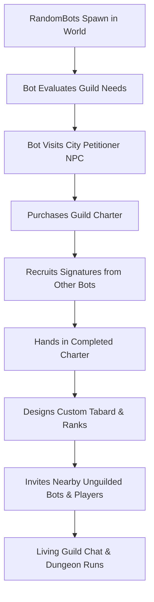

# Volume 07: Guilds, Guild Bots & Autonomous Guild Operations

> **Target Core**: Turtle-WoW 1.18.1 (Build 7272) • CMaNGOS + PlayerBots Framework + Eluna Engine  
> **Quick Navigation**: [🏠 Master Portal (gm_commands.md)](../gm_commands.md) • [📖 Server Operations (commands.md)](../commands.md) • [🤖 Volume 02: Bot Automation](./02_playerbot_and_raid_automation.md) • [🗺️ Volume 08: Open World & Strategies](./08_open_world_control_and_strategies.md)

---

## 📑 Table of Contents

1. [Architecture & Engine Realities](#1-architecture--engine-realities)
2. [Universal Guild Targeting Scope (`guild`)](#2-universal-guild-targeting-scope-guild)
   - [Supported Guild Operations](#supported-guild-operations)
3. [Master Guild Macro UI Cheat Sheet](#3-master-guild-macro-ui-cheat-sheet)
   - [🌟 Macro 1: 1-Click Full Guild Raid Preparation](#-macro-1-1-click-full-guild-raid-preparation)
   - [⚔️ Macro 2: Equip Best-in-Slot Gear on All Guild Bots](#-macro-2-equip-best-in-slot-gear-on-all-guild-bots)
   - [📍 Macro 3: Assemble All Guild Bots](#-macro-3-assemble-all-guild-bots) · [💬 Macro 4: Query Guild Roster](#-macro-4-query-guild-roster--metadata)
4. [Guild Whispers & Bot Management Actions](#4-guild-whispers--bot-management-actions)
   - [Bot Guild Command Directory](#bot-guild-command-directory)
   - [Signing Guild Charters](#signing-guild-charters)
5. [In-Game Guild Chat & Two-Way Bot Communication](#5-in-game-guild-chat--two-way-bot-communication)
   - [A. Bot Responses in Guild Chat](#a-bot-responses-in-guild-chat)
   - [B. Forcing Bots to Speak in Guild Chat](#b-forcing-bots-to-speak-in-guild-chat)
6. [Guild Bank Interaction (`gb`)](#6-guild-bank-interaction-gb)
7. [Guild Crafting Orders (Autonomous)](#7-guild-crafting-orders-autonomous)
   - [The Flow](#the-flow)
8. [Autonomous Realm Bot Guilds Simulation](#8-autonomous-realm-bot-guilds-simulation)
   - [Key Simulation Mechanics](#key-simulation-mechanics)
9. [Configuration Parameters (`aiplayerbot.conf`)](#9-configuration-parameters-aiplayerbotconf)

---

## 1. Architecture & Engine Realities

The playerbot subsystem features an enterprise-grade guild engine integrated into `PlayerbotMgr.cpp`, `GuildManagementActions.cpp`, and `RandomPlayerbotMgr.cpp`:

1. **Bots as True Guild Members**: Bots are not client-side illusions. When a bot joins a guild, its record is written to the core database table `guild_member`. It receives rank IDs, permissions, tabard visuals, and guild chat packets.
2. **Autonomous Guild Life**: The realm simulation maintains up to 25 autonomous bot guilds (`AiPlayerbot.RandomBotGuildCount = 25`, `run/aiplayerbot.conf:123`; compiled default 20). Bots purchase charters from petitioner NPCs, gather signatures from fellow bots, design tabards, and recruit nearby unguilded players and bots.
3. **Guild Orders**: Bots can fulfill profession crafting orders placed in guild chat and share guild task quest rewards.

---

## 2. Universal Guild Targeting Scope (`guild`)

When executing a `.bot` command **in game**, you can pass **`guild`** as the target. The engine runs one query — `SELECT m.guid, (select name from characters c where c.guid = m.guid) FROM guild_member m WHERE guildid = '%u'` (`PlayerbotMgr.cpp:1194`) — so it resolves **every member row in the core `guild_member` table for your guild, bots and real players alike**. Only the issuing master's own GUID is skipped (`PlayerbotMgr.cpp:1207`).

```lua
.bot <command> guild [parameters]
```

> ⚠️ **Two limits on the `guild` target**
>
> 1. **In-game only.** The branch is gated on a master existing: `if (charname == "guild" && master)` (`PlayerbotMgr.cpp:1195`). A console invocation has no master, so `"guild"` falls straight through to the ordinary account/character-name lookup and resolves to nothing.
> 2. **`.bot` only.** `.rndbot` player-level sub-commands match bots by name prefix (`RandomPlayerbotMgr.cpp:4051-4088`) and have no `guild` target at all.
>
> Note there is no `PlayerbotHolder.cpp` in this tree — every `PlayerbotHolder::*` handler lives in `modules/mod-playerbots/src/playerbot/PlayerbotMgr.cpp`.

### Supported Guild Operations

```lua
-- Supported Guild Operations (.bot <command> guild [parameters])

-- Equip Best Gear: Scans item database and equips highest ilvl BiS gear on every resolved guild target
.bot gear guild best

-- Gear by Quality: Equips complete level-appropriate sets matching uncommon (green), rare (blue), or epic (purple)
.bot gear guild <quality>
-- Example:
.bot gear guild epic

-- Master 1-Click Prep: Restocks consumables and reagents on all guild bots via PlayerbotFactory::Refresh().
-- NOTE: Takes no quality argument — any 'epic' parameter is discarded.
.bot prep guild

-- Level Guild Bots: Sets character level for all guild members in your guild (1-60)
.bot level guild 60

-- Summon Guild Bots: Teleports guild bots to your position.
-- Refuses bots in combat, in BG/BG queue, on different instanceable map, or bots you do not own.
.bot summon guild

-- Train Spells: Forces all guild bots to learn all class spells up to current level (learnClassLevelSpells()).
-- Note: Proficiencies must be learned separately.
.bot train guild

-- Enchant Equipment: Applies optimal permanent enchantments to all equipped gear across resolved guild targets.
.bot enchants guild

-- Restock Consumables: Fills inventory bags with flasks, elixirs, scrolls, food, water, and class reagents.
.bot consumes guild
```

---

## 3. Master Guild Macro UI Cheat Sheet

Copy and paste these macros into your World of Warcraft **Macro UI** (`/m`):

### 🌟 Macro 1: 1-Click Full Guild Raid Preparation

Restocks consumables and reagents, enchants gear, and trains class spells across every resolved guild target. `prep` takes **no** gear-quality argument — add the `.bot gear guild epic` line if you also want epic gear:

```lua
.bot prep guild
.bot enchants guild
.bot train guild
.bot gear guild epic
```

### ⚔️ Macro 2: Equip Best-in-Slot Gear on All Guild Bots

Forces all guild members to equip the absolute highest stat items available for their class:

```lua
.bot gear guild best
```

### 📍 Macro 3: Assemble All Guild Bots

Teleports every resolvable bot in the guild to your position. Bots in combat, in a battleground or BG queue, or in a different instanceable map are skipped with an explanatory message rather than pulled:

```lua
.bot summon guild
```

### 💬 Macro 4: Query Guild Roster & Metadata

Dumps guild name, leader character name, and member count:

```lua
.bot g
```

---

## 4. Guild Whispers & Bot Management Actions

You can issue direct guild management orders to any bot via whisper (`GuildManagementActions.cpp`):

### Bot Guild Command Directory

```lua
-- Direct Whisper Guild Management Actions (GuildManagementActions.cpp)

-- Invite Player: Orders bot officer to invite specified player or bot to guild (GuildInviteAction)
/w %t guild invite <player>
-- Example:
/w %t guild invite Sam

-- Request Guild Invitation: Commands bot officer to request invitation to join your guild (GuildJoinAction)
/w %t guild join

-- Promote Member: Orders bot officer to promote target member (GuildPromoteAction)
/w %t guild promote <player>
-- Example:
/w %t guild promote Dunpriest

-- Demote Member: Orders bot officer to demote target member (GuildDemoteAction)
/w %t guild demote <player>
-- Example:
/w %t guild demote Dunpriest

-- Remove/Kick Member: Orders bot officer to kick specified member from guild (GuildRemoveAction)
/w %t guild remove <player>
-- Example:
/w %t guild remove Dunpriest

-- Leave Guild: Commands target bot to leave its current guild (GuildLeaveAction)
/w %t guild leave

-- Transfer Guild Leadership: Transfers guild leadership from bot leader to specified player (GuildLeaderAction)
/w %t guild leader <player>
-- Example:
/w %t guild leader Sam

-- Invite All Guild to Group: Orders bot to invite all online guild members to party/raid (InviteGuildToGroupAction)
/w %t invite guild

-- Set Preferred Guild Size Bracket: Configures bot's preferred guild size bracket (SetValueAction)
-- Values: N in {-1, 0, 30, 50, 70, 120, 250}. (-1 resets to random). Input snaps UP to nearest bracket.
/w %t set value guild size <N>
-- Example:
/w %t set value guild size 70
```

> ⚠️ **`set value` is a two-word command.** The chat trigger is `set value` (`ChatTriggerContext.h:147`), not `value`. `ExternalEventHelper::ParseChatCommand` (`ExternalEventHelper.h:28-41`) probes the command text right-to-left, trying only the names `value guild size`, `value guild`, and `value` — none of which is a trigger, so `HandleCommand` returns `false` (`ExternalEventHelper.h:84`) and **the line is dropped with no feedback at all**.
>
> The accepted values are also not a 0–5 scale. `SetValueAction.cpp:74-101` clamps the input to `[-1, 250]` and then **snaps it *up* to the first entry of `ranges = { 0, 30, 50, 70, 120, 250 }`** (`SetValueAction.cpp:84`), where `-1` means "reset to random". So `set value guild size 3` yields `30`, not `3`.

### Signing Guild Charters

When creating a new guild charter, you can ask unguilded bots to sign your charter:

1. Purchase a Guild Charter from a Guild Petitioner NPC in any major city.
2. Target an unguilded bot nearby.
3. Open the charter and request their signature.
4. The bot evaluates your security level and automatically signs the charter (`PetitionSignAction.cpp`).

---

## 5. In-Game Guild Chat & Two-Way Bot Communication

Bots in your guild actively monitor and participate in Guild Chat (`/g`):

### A. Bot Responses in Guild Chat

- When players speak in `/g`, guild bots listen and reply based on their configured personality cards and lore backgrounds.
- **Config Trigger**: `AiPlayerbot.GuildRepliesRate = 100` in `run/aiplayerbot.conf`.
- **Talent Notes**: Bots automatically post their talent spec into Guild Public Notes when they respec or train.

### B. Forcing Bots to Speak in Guild Chat

`.bot g` routes to `PlayerbotHolder::HandleGuild` (`PlayerbotMgr.cpp:2178`). Note that it is a **guild chat broadcast, not a whisper relay**, and the two caller modes parse the parameter differently:

```lua
-- In game — broadcast to guild chat as yourself.
-- CAVEAT: the first word is always eaten as a bot name and discarded,
-- so this actually transmits "guild members!", not "Hello guild members!".
.bot g Hello guild members!

-- Console only — resolve <BotName> via FindPlayerByName and send the
-- remainder to guild chat AS that character.
.bot g Dunpriest Ready for tonight's raid!
```

**In game** (master already set): the bot-name lookup is skipped, but `HandleGuild` still strips everything up to and including the first space (`PlayerbotMgr.cpp:2192-2195`). The `.bot g <BotName> <message>` form therefore **does not work in game** — `<BotName>` is swallowed as the first word and the rest goes to guild chat under your own name.

**From console** (no master): the first word *is* resolved as a character name (`PlayerbotMgr.cpp:2183-2187`) and, if that character is in a guild, the remainder is sent to guild chat as them (`:2213-2221`). If the character is not found you get `No sender found`; if they are not in a guild, `Sender is not in a guild`.

---

## 6. Guild Bank Interaction (`gb`)

Bots interact with Guild Vaults through `GuildBankAction` (`strategy/actions/GuildBankAction.cpp`):

- **The only valid token is `gb`** (alias `gbank`). Both whisper forms build the *same* trigger — `creators["gb"]` and `creators["gbank"]` each construct `ChatCommandTrigger(ai, "gb")` (`ChatTriggerContext.h:75-76`) — and `gb` sits in `supported` (`ChatCommandHandlerStrategy.cpp:67`), reaching `GuildBankAction` (`ChatActionContext.h:151`).
- **There is no `guild bank` chat command.** That string is only the action's *internal* display name (`GuildBankAction.h:9`), and no strategy installs a node for it either: `GuildStrategy.cpp` registers `guild craft order`, `guild share item`, `guild ah buy`, `guild accept quest order`, `guild manage nearby`, `guild leave`, `buy tabard`, `offer petition nearby`, `turn in petition` and `leave large guild` — but no `guild bank`.
- **What it actually does**: takes a free-text item filter (`InventoryParseItems`), finds the nearest interactable `GAMEOBJECT_TYPE_GUILD_BANK`, checks `GUILD_BANK_RIGHT_DEPOSIT_ITEM`, and moves the matching items **from the bot's bags into the guild bank** (`MoveFromCharToBank`). It is **deposit-only** — there is no withdraw path, and it does not list stored tabs or report their contents. The bot must share your guild, or it replies `I'm not in your guild!`.

> ⚠️ **`gb` is inert in this build.** The entire body of `GuildBankAction::Execute(Event&)` is wrapped in `#ifndef MANGOSBOT_ZERO` (`GuildBankAction.cpp:13-39`), and our playerbot target defines `MANGOSBOT_ZERO` unconditionally (`mod-playerbots.cmake:45`), so the action compiles down to `return false`. The command is parsed and dispatched correctly but performs no transfer in this fork.

---

## 7. Guild Crafting Orders (Autonomous)

Guild crafting orders are **autonomous, not a whisper command**. `guild craft order` is only an *action* name, registered at `ChatActionContext.h:191` (`GuildCraftOrderAction`) — there is **no chat trigger of that name**, so whispering it is trimmed down and silently dropped. The action is instead fired by `GuildStrategy`'s `very often` node on a 10-second priority (`generic/GuildStrategy.cpp:28-30`).

### The Flow

1. **Order Placed**: A guild member writes an order into guild chat in bracketed form (e.g. `[Lesser Healing Potion]`, `[Iron Buckler]`).
2. **Parsed & Published**: `GuildOrderValue` (`strategy/values/GuildValues.cpp`) parses the chat notes and `GuildOrderValue::Calculate()` (`GuildValues.cpp:309`) publishes the order as the AI value `guild order`.
3. **Node Fires**: `GuildStrategy`'s `very often` node dispatches `guild craft order` every 10 s.
4. **Execution**: `GuildCraftOrderAction::Execute` (`GuildCraftOrderAction.cpp:30`) resolves the item id, then aborts with a debug line if the bot already holds enough, if the item id is unknown, if no `SPELL_EFFECT_CREATE_ITEM` spell in its spellbook creates that item, or if reagents are missing. Otherwise it casts the craft spell for the remaining shortfall.

The finished items **stay in the bot's bags** — this action does *not* deposit them into the guild bank and does *not* trade them to the requester. Hand-off is the separate `guild share item` action, on its own `very often` node at 9 s (`GuildStrategy.cpp:32-34`).

**Always Active**: `AiPlayerbot.GuildOrderAlwaysActive = 1` (`run/aiplayerbot.conf:105`); the compiled default is also `true` (`PlayerbotAIConfig.cpp:661`).

---

## 8. Autonomous Realm Bot Guilds Simulation

The server runs an automated guild lifecycle simulation across all open-world RandomBots:



### Key Simulation Mechanics

- **Guild Cap**: Maintained up to **25 living guilds** (`AiPlayerbot.RandomBotGuildCount = 25`, `run/aiplayerbot.conf:123`) — the *compiled* default if that line is absent is **20** (`PlayerbotAIConfig.cpp:640`).
- **Autonomous Charter Hand-in**: Bots purchase charters, solicit signatures from nearby bots via `PetitionSignAction`, and hand them in (`AiPlayerbot.RandomBotFormGuild = 1`).
- **Nearby Player Recruitment**: Bots in guilds will whisper nearby unguilded players and invite them to their guild (`AiPlayerbot.RandomBotGuildNearby = 1`). (Turn on `/dnd` if you wish to decline invitations automatically).
- **Tabards**: Guilds design randomized tabards and bots equip guild tabards proudly (`AiPlayerbot.RandomGearTabardsReplaceGuild = 0`).

---

## 9. Configuration Parameters (`aiplayerbot.conf`)

Tune guild behavior in [`run/aiplayerbot.conf`](file:///home/sam/tortoise-wow/run/aiplayerbot.conf):

```ini
# Force bots to become active when guild orders are enabled
AiPlayerbot.GuildOrderAlwaysActive = 1

# Total number of autonomous bot guilds on realm
AiPlayerbot.RandomBotGuildCount = 25

# Allow bots to form guilds autonomously from charters
AiPlayerbot.RandomBotFormGuild = 1

# Bots invite nearby unguilded players/bots to their guild
AiPlayerbot.RandomBotGuildNearby = 1

# Reply percentage when players speak in guild chat (0-100)
AiPlayerbot.GuildRepliesRate = 100

# Allow players to invite and command bots from their own guild
AiPlayerbot.AllowGuildBots = 1

# Prefer logging in bots belonging to the player's guild
# ⚠️ SHIPPED COMMENTED OUT at run/aiplayerbot.conf:1304 — uncomment to activate.
#    As shipped the conf key is INACTIVE; the engine falls back to the compiled
#    list at PlayerbotAIConfig.cpp:446-454, which supplies "guild" as its 4th
#    criterion anyway. The effective behaviour matches; only the knob is gone.
# AiPlayerbot.LoginCriteria.4 = guild
```

> ⚠️ **Code defaults vs. shipped config.** Every value above is also read with a compiled fallback in `PlayerbotAIConfig.cpp`. `RandomBotGuildCount` is the one that bites: the conf file says **25** (`run/aiplayerbot.conf:123`) but the compiled default is **20** (`PlayerbotAIConfig.cpp:640`) — so commenting the line out silently drops the realm to 20 guilds.
