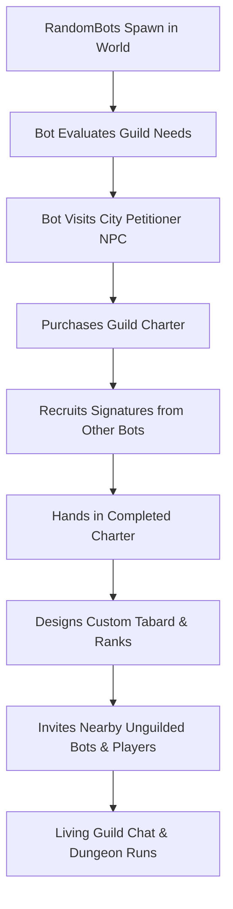

# Volume 07: Guilds, Guild Bots & Autonomous Guild Operations

> **Target Core**: Turtle-WoW 1.18.1 (Build 7272) • CMaNGOS + PlayerBots Framework + Eluna Engine  
> **Quick Navigation**: [🏠 Master Portal (gm_commands.md)](../gm_commands.md) • [📖 Server Operations (commands.md)](../commands.md) • [🤖 Volume 02: Bot Automation](./02_playerbot_and_raid_automation.md) • [🗺️ Volume 08: Open World & Strategies](./08_open_world_control_and_strategies.md)

---

## 📑 Table of Contents

1. [Architecture & Engine Realities](#1-architecture--engine-realities)
2. [Universal Guild Targeting Scope (`guild`)](#2-universal-guild-targeting-scope-guild)
3. [Master Guild Macro UI Cheat Sheet](#3-master-guild-macro-ui-cheat-sheet)
4. [Guild Whispers & Bot Management Actions](#4-guild-whispers--bot-management-actions)
5. [In-Game Guild Chat & Two-Way Bot Communication](#5-in-game-guild-chat--two-way-bot-communication)
6. [Guild Bank Interaction (`guild bank` / `gb`)](#6-guild-bank-interaction-guild-bank--gb)
7. [Guild Crafting Orders (`guild craft order`)](#7-guild-crafting-orders-guild-craft-order)
8. [Autonomous Realm Bot Guilds Simulation](#8-autonomous-realm-bot-guilds-simulation)
9. [Configuration Parameters (`aiplayerbot.conf`)](#9-configuration-parameters-aiplayerbotconf)

---

## 1. Architecture & Engine Realities

The playerbot subsystem features an enterprise-grade guild engine integrated into `PlayerbotMgr.cpp`, `GuildManagementActions.cpp`, and `RandomPlayerbotMgr.cpp`:

1. **Bots as True Guild Members**: Bots are not client-side illusions. When a bot joins a guild, its record is written to the core database table `guild_member`. It receives rank IDs, permissions, tabard visuals, and guild chat packets.
2. **Autonomous Guild Life**: The realm simulation maintains up to 25 autonomous bot guilds (`AiPlayerbot.RandomBotGuildCount = 25`). Bots purchase charters from petitioner NPCs, gather signatures from fellow bots, design tabards, and recruit nearby unguilded players and bots.
3. **Guild Orders**: Bots can fulfill profession crafting orders placed in guild chat and share guild task quest rewards.

---

## 2. Universal Guild Targeting Scope (`guild`)

When executing `.bot` or `.rndbot` console and chat commands, you can pass **`guild`** as the target. The engine resolves all bot members in your active guild (`PlayerbotHolder.cpp:1193`):

```lua
.bot <command> guild [parameters]
.rndbot <command> guild [parameters]
```

### Supported Guild Operations

| Command | Exact Syntax | Description | Example |
| :--- | :--- | :--- | :--- |
| **Equip Best Gear** | `.bot gear guild best` | Scans the item database and equips the highest item-level Best-in-Slot (BiS) gear on every bot in your guild. | `.bot gear guild best` |
| **Gear by Quality** | `.bot gear guild <quality>` | Equips complete level-appropriate sets matching `uncommon` (green), `rare` (blue), or `epic` (purple) quality. | `.bot gear guild epic` |
| **Master 1-Click Prep** | `.bot prep guild epic` | Restocks, repairs, enchants all weapons/armor, learns class spells, clears cooldowns, and stocks potions/food on all guild bots. | `.bot prep guild epic` |
| **Level Guild Bots** | `.bot level guild <1–60>` | Sets character level for all bot members in your guild. | `.bot level guild 60` |
| **Summon Guild Bots** | `.bot summon guild` | Instantly teleports all guild bots to your current position and synchronizes instance maps. | `.bot summon guild` |
| **Train Spells** | `.bot train guild` | Forces all guild bots to learn all available class spells and proficiencies up to their current level. | `.bot train guild` |
| **Enchant Equipment** | `.bot enchants guild` | Applies optimal permanent enchantments to all equipped gear across every guild bot. | `.bot enchants guild` |
| **Restock Consumables** | `.bot consumes guild` | Fills inventory bags with flasks, elixirs, scrolls, food, water, and class reagents. | `.bot consumes guild` |

---

## 3. Master Guild Macro UI Cheat Sheet

Copy and paste these macros into your World of Warcraft **Macro UI** (`/m`):

### 🌟 Macro 1: 1-Click Full Guild Raid Preparation

Restocks, repairs, enchants, trains spells, and equips epic gear across all guild bots:

```lua
.bot prep guild epic
.bot enchants guild
.bot train guild
```

### ⚔️ Macro 2: Equip Best-in-Slot Gear on All Guild Bots

Forces all guild members to equip the absolute highest stat items available for their class:

```lua
.bot gear guild best
```

### 📍 Macro 3: Assemble All Guild Bots

Summons every bot in the guild to your position:

```lua
.bot summon guild
```

### 💬 Macro 4: Query Guild Roster & Metadata

Dumps guild name, leader character name, and member count:

```lua
.bot g
```

---

## 4. Guild Whispers & Bot Management Actions

You can issue direct guild management orders to any bot via whisper (`GuildManagementActions.cpp`):

### Bot Guild Command Directory

| Whisper Command | Target | Action Executed | Description | Example |
| :--- | :--- | :--- | :--- | :--- |
| `/w %t guild invite <player>` | Bot Officer | `GuildInviteAction` | Orders bot officer to invite the specified player or bot to the guild. | `/w %t guild invite Sam` |
| `/w %t guild join` | Bot Officer | `GuildJoinAction` | Commands bot to request an invitation to join your guild. | `/w %t guild join` |
| `/w %t guild promote <player>` | Bot Officer | `GuildPromoteAction` | Orders bot with officer permissions to promote the target member. | `/w %t guild promote Dunpriest` |
| `/w %t guild demote <player>` | Bot Officer | `GuildDemoteAction` | Orders bot with officer permissions to demote the target member. | `/w %t guild demote Dunpriest` |
| `/w %t guild remove <player>` | Bot Officer | `GuildRemoveAction` | Orders bot to kick the specified member from the guild. | `/w %t guild remove Dunpriest` |
| `/w %t guild leave` | Any Guild Bot | `GuildLeaveAction` | Commands the bot to leave its current guild. | `/w %t guild leave` |
| `/w %t guild leader <player>` | Bot Leader | `GuildLeaderAction` | Transfers guild leadership from the bot to the specified player. | `/w %t guild leader Sam` |
| `/w %t invite guild` | Any Guild Bot | `InviteGuildToGroupAction` | Orders bot to invite all online guild members to the party/raid. | `/w %t invite guild` |
| `/w %t value guild size <0–5>` | Any Bot | `SetValueAction` | Configures the bot's preferred guild size bracket. | `/w %t value guild size 3` |

### Signing Guild Charters

When creating a new guild charter, you can ask unguilded bots to sign your charter:

1. Purchase a Guild Charter from a Guild Petitioner NPC in any major city.
2. Target an unguilded bot nearby.
3. Open the charter and request their signature.
4. The bot evaluates your security level and automatically signs the charter (`PetitionSignAction.cpp`).

---

## 5. In-Game Guild Chat & Two-Way Bot Communication

Bots in your guild actively monitor and participate in Guild Chat (`/g`):

### A. Bot Responses in Guild Chat

- When players speak in `/g`, guild bots listen and reply based on their configured personality cards and lore backgrounds.
- **Config Trigger**: `AiPlayerbot.GuildRepliesRate = 100` in `run/aiplayerbot.conf`.
- **Talent Notes**: Bots automatically post their talent spec into Guild Public Notes when they respec or train.

### B. Forcing Bots to Speak in Guild Chat

You can broadcast messages through a bot into Guild Chat from console or GM commands:

```lua
-- Broadcast as active character:
.bot g Hello guild members!

-- Broadcast as a specific bot:
.bot g Dunpriest Ready for tonight's raid!
```

---

## 6. Guild Bank Interaction (`guild bank` / `gb`)

Bots can interact with Guild Vaults and banks (`GuildBankAction.cpp`):

- **Query Guild Bank**: `/w %t gb` or `/w %t guild bank` — Causes the bot to inspect available tabs and report stored items.
- **Deposit / Withdraw**: While near a Guild Bank vault object, bots can deposit crafted tradeskill products or withdraw designated leveling reagents.

---

## 7. Guild Crafting Orders (`guild craft order`)

The playerbot framework supports autonomous guild tradeskill fulfillment (`GuildCraftOrderAction.cpp`):

1. **Placing an Order**: When a guild member requests an item in guild chat (e.g. `[Lesser Healing Potion]` or `[Iron Buckler]`), guild bots with the appropriate tradeskill inspect their recipe lists.
2. **Order Execution**: If the bot knows the recipe and possesses materials, it executes the craft and deposits the finished item in the guild bank or trades it to the requester.
3. **Always Active**: Enabled via `AiPlayerbot.GuildOrderAlwaysActive = 1`.

---

## 8. Autonomous Realm Bot Guilds Simulation

The server runs an automated guild lifecycle simulation across all open-world RandomBots:



### Key Simulation Mechanics

- **Guild Cap**: Maintained up to **25 living guilds** (`AiPlayerbot.RandomBotGuildCount = 25`).
- **Autonomous Charter Hand-in**: Bots purchase charters, solicit signatures from nearby bots via `PetitionSignAction`, and hand them in (`AiPlayerbot.RandomBotFormGuild = 1`).
- **Nearby Player Recruitment**: Bots in guilds will whisper nearby unguilded players and invite them to their guild (`AiPlayerbot.RandomBotGuildNearby = 1`). (Turn on `/dnd` if you wish to decline invitations automatically).
- **Tabards**: Guilds design randomized tabards and bots equip guild tabards proudly (`AiPlayerbot.RandomGearTabardsReplaceGuild = 0`).

---

## 9. Configuration Parameters (`aiplayerbot.conf`)

Tune guild behavior in [`run/aiplayerbot.conf`](file:///home/sam/tortoise-wow/run/aiplayerbot.conf):

```ini
# Force bots to become active when guild orders are enabled
AiPlayerbot.GuildOrderAlwaysActive = 1

# Total number of autonomous bot guilds on realm
AiPlayerbot.RandomBotGuildCount = 25

# Allow bots to form guilds autonomously from charters
AiPlayerbot.RandomBotFormGuild = 1

# Bots invite nearby unguilded players/bots to their guild
AiPlayerbot.RandomBotGuildNearby = 1

# Reply percentage when players speak in guild chat (0-100)
AiPlayerbot.GuildRepliesRate = 100

# Allow players to invite and command bots from their own guild
AiPlayerbot.AllowGuildBots = 1

# Prefer logging in bots belonging to the player's guild
AiPlayerbot.LoginCriteria.4 = guild
```
